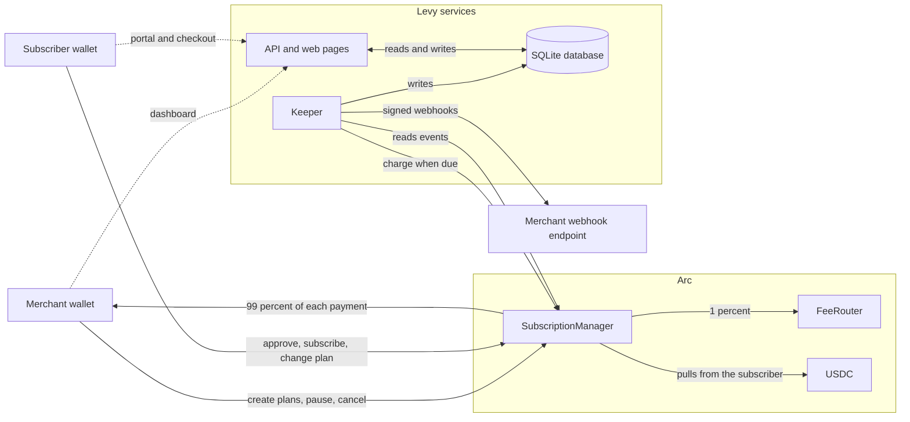

# Levy: Subscription Billing on Arc

Pull-based USDC subscription billing for Arc, like Stripe Billing for a chain where USDC is the gas token. Merchants define plans, subscribers approve a USDC allowance once and subscribe, and a keeper triggers each cycle's pull. Dunning, proration, signed webhooks and invoice records are built in. The protocol takes a 1% fee on collected payments.

Charging is permissionless by design: anyone can call `charge()`, but it can only move the subscriber's pre-approved USDC to that plan's merchant.

**Status:** contracts, keeper (charging, dunning, webhooks, allowance warnings), API with wallet sign-in, merchant dashboard, customer portal and checkout page are built and tested. Contracts: 117 tests green (104 unit + 13 invariants; CI fuzzes invariants at 1000 runs x depth 40). Keeper: 81 tests green. API: 73 tests green. **On Arc testnet since 2026-10-03 (current deployment, see Deployments); the M4 soak started 2026-10-07. Not on mainnet. Not audited.** Known open issues are listed in `SECURITY_REVIEW.md` §9.

**Manager v2** ([design](docs/manager-v2-design.md)) is built and tested on this code but not deployed: merchant accounts with a changeable owner and payout address, retiring plans, cycle limits (installments, fixed terms, one-time payments), intro prices, and moving a subscription to another wallet. This README and the docs describe v2. The testnet contracts under Deployments predate it, and v2 replaces them at its deployment, under new addresses.

**Read next:** [Wiki](docs/wiki/Home.md) · [Getting started](docs/wiki/Getting-Started.md) · [Merchant guide](docs/merchant-guide.md) · [Spec](SPEC.md) · [Security](SECURITY.md) · [Whitepaper](https://getlevy.xyz/whitepaper.html) · [getlevy.xyz](https://getlevy.xyz)

## What's in the repo

| Path | What it is |
|---|---|
| `src/` | Contracts: `SubscriptionManager.sol` (plans, subscriptions, permissionless `charge()`, proration, on-chain dunning state), `FeeRouter.sol` (holds the 1% fee until anyone calls `sweep()`, which sends it to the treasury), `IPermit2.sol` |
| `test/` | Foundry unit and invariant tests, plus the deploy script's tests |
| `script/Deploy.s.sol` | Deploys both contracts to Arc testnet or mainnet, with safety checks |
| `keeper/` | TypeScript service: indexes events, charges due subscriptions, runs dunning, delivers signed webhooks, warns when allowances run low. See `keeper/README.md` |
| `api/` | Fastify API plus the merchant dashboard, customer portal and checkout page. See `api/README.md` |
| `ops/` | Dockerfiles, docker-compose, systemd unit, env example, monitoring runbook, treasury multisig plan, and the testnet soak checklist (`testnet-soak.md`) with its tools |
| `docs/` | Merchant guide, dunning email copy, use cases, external review records, and the project wiki (`docs/wiki/`) |
| `site/` | Static landing page, whitepaper (`whitepaper.html`, with a PDF built from it), public merchant docs (`docs.html`, from `docs/merchant-guide.md`) and security policy |
| `SPEC.md`, `SECURITY_REVIEW.md`, `FEE_MATH_AUDIT.md`, `VERIFICATION.md` | Design spec, adversarial self-review, math audit, verified Arc facts |
| `SECURITY.md` | How to report a vulnerability: contact, scope, testing rules and what we commit to |

## Architecture at a glance



Every on-chain write is signed in the user's wallet, and the API holds no on-chain key. The keeper indexes contract events into SQLite, sends the `charge()` transactions (paying gas in USDC), runs the dunning retries and delivers signed webhooks to the merchant's own endpoints. The API serves the dashboard, the customer portal and the checkout page from the same database. See [Architecture](docs/wiki/Architecture.md) for the sequence diagrams.

## Quick start

Requires [Foundry](https://getfoundry.sh/) for the contracts and Node 24 for the keeper and API (22.13 or later also works). The repository is private, so cloning needs read access.

```bash
git clone --recurse-submodules https://github.com/RunTimeAdmin/levy.git && cd levy
forge build
forge test
FOUNDRY_PROFILE=ci forge test        # deeper invariant fuzzing, as CI runs it
cd keeper && npm install && npm test # unit tests + anvil integration test (needs anvil on PATH)
cd api && npm install && npm test
```

CI (`.github/workflows/ci.yml`) runs the contract tests, the keeper and API typechecks and tests, fails if `keeper/abi/*.json` no longer matches the contracts, and builds both Docker images, then starts the API container to check that it serves the pages and enforces sign-in. After changing a contract, regenerate with `forge inspect <Contract> abi --json > keeper/abi/<Contract>.json` (and `bytecode` into the `.bin`).

`foundry.toml` pins `evm_version = "paris"`. Arc mainnet runs an Osaka EVM, so this is not required; paris stays as a harmless conservative default (see `VERIFICATION.md` §2).

For a full local stack (anvil, a local deploy, the keeper and the API) follow [Getting Started](docs/wiki/Getting-Started.md).

## How charging works

1. A merchant calls `createPlan(account, (price, cycleSeconds, trialSeconds, maxFailed, maxCycles, introPrice, introCycles, transferable))` from their wallet, most simply through the dashboard's New plan form. `account` is the merchant account, at first the caller's own address, and the caller must own it. The cycle can be 1 day to 10 years. `maxCycles` caps the payments (0 for no limit; 1 with no trial is a one-time payment), `introPrice` (below `price`) is billed for the first `introCycles` cycles, and `transferable` lets subscribers move a subscription to another wallet. Plan terms are immutable; repricing means a new plan, and `setPlanRetired` closes the old one to new subscribers.
2. A subscriber approves a USDC allowance to the SubscriptionManager and calls `subscribe(planId, ref)`, or calls `subscribeWithPermit2(planId, ref, permit, signature)` with a Permit2 signature (submitted by the subscriber themselves). The checkout page (`/checkout.html?plan=<id>&ref=<ref>`) does the approve-and-subscribe flow for them. Billing is in advance: without a trial, the first cycle is pulled at subscribe, and the subscribe reverts if that pull fails. `ref` is the merchant's own reference for the customer (bytes32, zero for none), stored on-chain and carried on every webhook.
3. Anyone can call `charge(subId)` once `block.timestamp >= nextChargeAt`; it pays for the cycle that starts then. The contract prices the cycle (the intro price while intro cycles are left), spends any proration credit first, pulls the rest via `transferFrom`, sends 99% to the merchant account's payout address and 1% to the FeeRouter, advances the cycle and emits `Charged`. The cycle that reaches a limited plan's `maxCycles` moves the subscription to `COMPLETED`, which is final. The next charge date moves one cycle on from the stored date, so a late keeper does not shift the schedule; after a failed attempt, or when a whole cycle went by uncharged, it becomes one cycle from the payment instead (the overdue time is not billed). It is permissionless by design: it can only move the subscriber's pre-approved funds to that plan's merchant.
4. A failed pull does not revert: the contract records it (`ChargeFailed`), marks the subscription `PAST_DUE` at `maxFailed` failures, and auto-pauses it at twice that. It records failures only on the dunning schedule, 1, 3 and then 7 days apart (`retryGap`); a failing call sooner reverts `RetryTooSoon`, so nobody can pause a subscription sooner than its schedule by calling `charge()` (with `maxFailed` 2, not before day 11). The keeper retries on the same schedule.
5. The subscriber or merchant can pause or cancel. The subscriber can resume any pause; the merchant can resume only a pause it made itself, not one by the subscriber or a dunning auto-pause. Nothing is charged while paused; resuming is a fresh start (paused cycles are never billed, billing restarts at the resume if the charge date passed, and the failure count resets). Cancel is final.
6. A subscriber can change to another plan from the same merchant account that is not retired: the new plan starts and is billed immediately at its full price, less credit for unused paid time on the old plan at the price that cycle was billed at.
7. The merchant account's owner can fix a payout address with `setPayout` and hand the account to another wallet in two steps (`transferOwnership`, then `acceptOwnership` by the new owner). On a transferable plan, the subscriber can move a subscription to a new wallet: `proposeTransfer` from the subscriber, then `acceptTransfer` from the new wallet, which pays from then on.

### Money math

- All amounts are 6-decimal USDC units through the ERC-20 interface (`0x3600...0000`). Native 18-decimal values never enter payment logic.
- Integer arithmetic only. The fee is `amount / 100`, rounded down, so any rounding (under one unit) goes to the merchant.
- Credit only comes from a paid cycle, at the price it was billed at (trial time earns none), is added to existing credit, and is spent before any pull. Excess carries forward and survives failed pulls.

### Invariants (fuzz-tested)

- Conservation: every minted unit sits in exactly one tracked account.
- `failedAttempts <= 2 * maxFailed` for every subscription.
- Recorded failures follow the dunning schedule (1, 3, then 7 days apart) however often a caller hits `charge()`. The fuzzer calls it several times back to back; a griefer calling every day is a unit test (`test_dailyGrieferCannotPauseBeforeTheSchedule`).
- Cancel is terminal: `chargeCount` never moves after cancellation.
- `nextChargeAt` never falls below the subscription's start. (It can move earlier on a switch to a shorter-cycle plan, which bills the new cycle immediately.)
- Credit is backed: a subscription never holds more credit than the USDC it has paid.
- Credit never exceeds the largest plan price.
- The manager holds no funds at rest: every pull is fully split in the same transaction.
- A successful charge never leaves its subscription chargeable, so missed cycles are never pulled back to back.
- Completed is terminal, and no subscription is billed more than its plan's `maxCycles` times on that plan.
- A retired plan gains no subscriptions and no plan changes into it.
- A subscription changes wallet only when its subscriber proposed that wallet and the wallet accepted.

## Off-chain services

**Keeper** (`keeper/`, viem + SQLite). Two independent loops: charge cycles (every 30s) and webhook delivery (every 5s), so a slow merchant endpoint can never delay charging. Each charge cycle syncs events (chunked, and only Levy's own logs plus USDC transfers into or out of the manager), charges due subscriptions, runs dunning retries, backs off charges that revert, and checks subscribers' allowance runway. Webhooks are Ed25519-signed over timestamp, delivery id, destination webhook id, event type and body, delivered in parallel and retried with backoff (1 minute, rising to every 6 hours); a delivery still failing after about 19 hours is dead-lettered. Thirteen event types, including `subscription.completed`, `subscription.transferred`, `merchant.updated`, and `allowance.low` when a subscriber's allowance does not cover the next 2 charges of their subscriptions.

**API** (`api/`, Fastify). Merchants and subscribers sign in with their wallet (Sign-In with Ethereum, 24h sessions) and only ever see their own data; a merchant sees the merchant accounts its wallet owns. It serves:

- the merchant dashboard (`/`): the merchant account (payout address, handover and accepting an account), metrics, plans with their terms, checkout links, Retire or Reopen and a New plan form, subscriptions with references and allowance runway (each can be paused or cancelled, and resumed if the merchant paused it), dunning queue, webhooks with their delivery log, invoice CSV;
- the customer portal (`/portal.html`): subscriptions and invoices; pause, resume, cancel, plan changes and moving a subscription to another wallet from the wallet, and accepting one offered to it; and the Levy allowance, with a top-up and a revoke;
- the checkout page (`/checkout.html?plan=<id>&ref=<ref>`).

Webhook URLs must be https on port 443 at a public address (checked at registration and again at every delivery). The merchant guide (`docs/merchant-guide.md`) covers plans, webhooks and signature verification, checkout links and references, and dunning.

## Documentation

| Read this | For |
|---|---|
| [Project wiki](docs/wiki/Home.md) | Guided pages on the contracts, keeper, API, operations, testing and security |
| [Merchant guide](docs/merchant-guide.md) | Plans, webhooks and signature verification, checkout links, dunning (public copy: [getlevy.xyz/docs.html](https://getlevy.xyz/docs.html)) |
| [SPEC.md](SPEC.md) | The design spec |
| [SECURITY.md](SECURITY.md) | How to report a vulnerability |
| [SECURITY_REVIEW.md](SECURITY_REVIEW.md) | Adversarial self-review, review history and open items |
| [FEE_MATH_AUDIT.md](FEE_MATH_AUDIT.md) | Audit of every arithmetic operation |
| [VERIFICATION.md](VERIFICATION.md) | Verified Arc chain facts |
| [keeper/README.md](keeper/README.md), [api/README.md](api/README.md) | Service details and configuration |
| [ops/testnet-soak.md](ops/testnet-soak.md) | The testnet soak plan, pass criteria and log |
| [Whitepaper](https://getlevy.xyz/whitepaper.html) | The protocol described end to end |

## Deploy

`script/Deploy.s.sol` deploys FeeRouter and SubscriptionManager and prints the `.env` lines the keeper and API need (the API passes the addresses to the checkout page via `/api/config`). It refuses to deploy unless USDC and Permit2 have code at their addresses and USDC reports 6 decimals, and on mainnet unless USDC and Permit2 are the canonical Arc addresses and the treasury is a contract (the Safe from `ops/treasury-multisig.md`).

```bash
export DEPLOYER_PRIVATE_KEY=0x...   # pays gas in USDC; testnet USDC from https://faucet.circle.com
export LEVY_TREASURY=0x...          # FeeRouter treasury
forge script script/Deploy.s.sol --rpc-url arc_testnet             # simulate
forge script script/Deploy.s.sol --rpc-url arc_testnet --broadcast # deploy
```

On Windows, `script/deploy-testnet.ps1` does the testnet broadcast for you: it asks for the deployer's key without echoing it, checks that the key belongs to the address you give and that the wallet holds enough USDC, and clears the key when forge exits.

Use `--rpc-url arc_mainnet` for mainnet, and add `--legacy` if fee estimation fails. `LEVY_USDC` and `LEVY_PERMIT2` override the defaults on testnet; on mainnet the script accepts only the canonical USDC and Permit2. The current testnet deploy used 4.12M gas at 25 gwei, about 0.10 USDC (2026-10-24). Broadcast records land in `broadcast/`; commit the testnet and mainnet ones as the deployment record. If the keeper first starts more than `LEVY_LOOKBACK_BLOCKS` (default 5000, about 40 minutes) after the deploy, raise it to reach back to the deploy block.

To run the keeper and API: `docker compose -f ops/docker-compose.yml --env-file ops/.env up -d --build` (copy `ops/.env.example` first; `LEVY_PUBLIC_ORIGIN` is required). The API is published on the host's loopback only; put a TLS reverse proxy in front (`ops/nginx-app.conf.example` is the nginx site the testnet host uses). `ops/keeper.service` is the systemd alternative for the keeper.

## Deployments

**Arc testnet** (chain 5042002), deployed 2026-10-24 in blocks 68869601 and 68869602 from `54724d0`, which has the fixes from the 2026-10-24 review (merchant resume, the next charge date after failures, the Permit2 fallback, the two-step treasury move; `SECURITY_REVIEW.md` §9). It predates manager v2: its `createPlan` takes `(price, cycleSeconds, trialSeconds, graceSeconds, maxFailed)`, and the keeper, API and pages in this tree no longer work against it. The record is `broadcast/Deploy.s.sol/5042002/run-1792849705649.json` (also `run-latest.json`).

| Contract | Address | Transaction |
|---|---|---|
| SubscriptionManager | `0xea24ac9c1217a671139d93225fdcf19ea3c4df4e` | `0xa4b003da02c4631e8d1921a1f754183eba2eb047ee15cf477b1296dbbb1e730a` |
| FeeRouter | `0x9e62309243da8be600a718a323fbbdfce00f3ce8` | `0x0cd9161275c616ecd3d19f977558ffdd3b544ba10a558b0ae180805ab79106a0` |

- Deployer and treasury: `0xe305652DB35Ed45A567538438c9B29ede7097162` (testnet only; mainnet uses the Safe).
- Code: built with solc 0.8.33 from the sources at `54724d0`, the runtime bytecode of both contracts matches the chain byte for byte outside the constructor-set immutables, build metadata included. A different solc version gives a different metadata tail (`foundry.toml` does not pin one yet; `SECURITY_REVIEW.md` §9, item 12). `retryGap` reads 1, 3 and 7 days on-chain. Source is not yet verified on the explorer.
- Soak host: keeper and API at `https://app.getlevy.xyz`, running soak 2 (`ops/testnet-soak.md`).
- **Retired** after soak 1 (`ops/testnet-soak-1.md`, 2026-10-07 to 2026-10-24, 58 charges): 2026-10-03, block 65201372 (SubscriptionManager `0x62a6512335d630ef19fcadb497adf98d883f77c6`, FeeRouter `0x4819975f4fa3a693ec67539bcb121eb06f280541`, record `run-1790987718240.json`, code `08991fa`). It predates the 2026-10-24 fixes. The keeper no longer charges it and its fees were swept on 2026-10-24; its subscriptions keep whatever allowance their wallets left on it.
- **Superseded**, never used for billing, and nothing points at them:
  - 2026-09-26, block 64031023 (SubscriptionManager `0x33c8e7e46583bdfd2e001f55ac1c58bd84eb739f`, FeeRouter `0xa6efee5f5a2eb2afae102f790b4889fcc01fe848`, record `run-1790390636694.json`, code `08dd7b7`; the record itself says `58ed3ba`, the head when forge ran before the fix was committed): recorded failures only a day apart, so a caller could pause a subscription on day 3 instead of day 11 (finding 2 of the 2026-10-02 review). No plan or subscription was ever created on it.
  - 2026-09-26, block 64020204 (SubscriptionManager `0x9df75ab83bde215f773af982af95b00646318189`, FeeRouter `0x79c6bb4030c688e64efdd2d33f0178e63fdf0b9f`, record `run-1790385119083.json`): predates the H-1 fix.

## Arc facts (verified 2026-09-25, see `VERIFICATION.md`)

- Mainnet chain ID 5042 (`https://rpc.mainnet.arc.io`), testnet 5042002 (`https://rpc.testnet.arc.io`). USDC is the gas token.
- Single-block deterministic finality (~0.5s blocks, Malachite BFT, no reorgs), so the keeper treats a mined transaction as final.
- Osaka-baseline EVM (PUSH0 works).
- Permit2 at the canonical `0x000000000022D473030F116dDEE9F6B43aC78BA3`, same as Ethereum.
- Transaction memos are live on mainnet (Memo contract `0x5294E9927c3306DcBaDb03fe70b92e01cCede505`); Levy does not use them yet.

## Before mainnet

- A soak of at least a week on the current testnet deployment (M4; day 0 was 2026-10-07). Checklist and pass criteria: `ops/testnet-soak.md`.
- Manager v2 (`docs/manager-v2-design.md`): an external review of the diff, a testnet deployment and soak 3. The paid audit should cover v2, not the soak 2 contracts.
- Treasury multisig signers set (`ops/treasury-multisig.md`).
- Permit2 end to end against Arc (subscribing through it worked on testnet, soak wallet S5 on 2026-10-07; its recurring charges are still being checked in the soak).
- Open items in `SECURITY_REVIEW.md` §9, and an external audit.
- Thin-liquidity note for launch comms.

## Roadmap

- **M1:** contracts + tests (done; testnet deploy moves to M4)
- **M2:** keeper service, indexer, dunning engine (done)
- **M3:** signed webhooks, API, merchant dashboard, customer portal, checkout, invoicing (done)
- **M4:** testnet deploy (done; current deployment 2026-10-03) and soak (day 0 2026-10-07), then mainnet deploy
- **M5:** LEVY token: fee split to buyback-and-burn and staking, staking fee-tier discounts, premium feature gating

## License

MIT, see [LICENSE](LICENSE).
