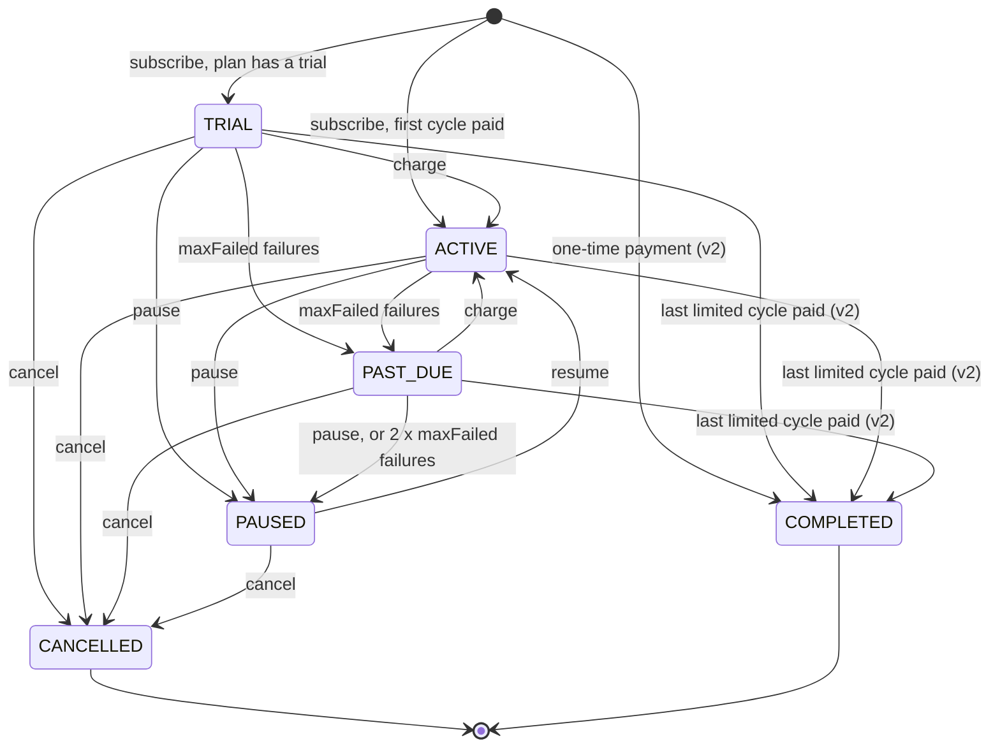

# Manager v2: merchant controls and plan terms

**Author:** drafted by Claude for David
**Status:** Draft, reviewed once (see Changes after review)
**Created:** 2026-10-25
**Scope:** `src/SubscriptionManager.sol` and the code that reads it. No code has changed.

## Objective

Let merchants move their revenue and control to new wallets, stop sign-ups to old plans, and sell fixed terms and introductory prices. Let subscribers move a subscription to a new wallet. All of it lands in the one contract redeploy that is still cheap to make before mainnet.

## Background

The 2026-10-25 comparison with Stripe Billing, BoomFi, MoonPay Commerce, Radom and Request found five gaps that live in the contract rather than in the keeper, API or pages:

1. **The plan creator is paid, permanently.** `Plan.merchant` is `msg.sender` at `createPlan`, and it is both the payee and the only merchant authority. A merchant cannot send revenue to a Safe while operating from a hot wallet, or hand control to a new key. If USDC blocklists the merchant address, every charge for its plans reverts (SECURITY_REVIEW.md §9, open item 5).
2. **A plan cannot be retired.** An old checkout link accepts new subscribers forever, including a cheap plan after a price rise.
3. **A subscription runs until someone cancels it.** Installments, fixed terms and one-time payments are not possible ([use-cases.md](use-cases.md)).
4. **Every cycle costs the same.** There is no "first month 1 USDC".
5. **The subscriber address is fixed.** Moving to a new wallet means cancelling and subscribing again. That forfeits proration credit and remaining paid time, and changes the `subId` the merchant tracks.

The contract is not upgradeable, so every fix means a new deployment, a new soak and a larger audit scope. There are no mainnet subscribers yet, so this is the cheapest these changes will ever be. After mainnet the same change means migrating every subscriber, each with their own transaction.

Soak 2 ([ops/testnet-soak.md](../ops/testnet-soak.md)) runs on the contracts deployed on 2026-10-24. Nothing here touches them.

## Related documents

- [SECURITY_REVIEW.md](../SECURITY_REVIEW.md) §9: open item 3 (forgiven overdue cycles) and open item 5 (a blocklisted merchant).
- [wiki/Plan-Changes-and-Proration.md](wiki/Plan-Changes-and-Proration.md): the credit rules this design must keep.
- [wiki/Smart-Contracts.md](wiki/Smart-Contracts.md): the current contract.
- [merchant-onboarding-friction.md](merchant-onboarding-friction.md): the off-chain onboarding work, separate from this.

## Goals

1. A merchant can change where revenue lands, and hand control to another wallet, with no action from subscribers.
2. A merchant can stop new sign-ups to a plan while existing subscribers carry on unaffected.
3. A merchant can sell a fixed number of payments: installments, a fixed term or a single payment.
4. A merchant can charge a different price for a subscription's first cycles.
5. A subscription can move to a new wallet and keep its paid time, credit, reference and id, but only when the subscriber proposes it, the new wallet accepts, and the merchant made the plan transferable.
6. None of it weakens what holds today. Nobody is charged without their own approval, credit is always backed by USDC the same merchant received, the manager holds nothing at rest, and `charge()` stays permissionless and harmless.

## Non-goals

- **Repricing existing subscriptions.** A subscriber's price changes only through their own `changePlan`.
- **Per-customer discount codes** (signed coupons). See Alternatives considered.
- **Usage, metered or per-seat pricing.**
- **Calendar-month billing.** Cycles stay fixed lengths.
- **On-chain refunds.**
- **Splitting revenue** between several payout addresses.
- **Recovering a merchant account whose owner key is lost or stolen.** Merchants who need that should make a Safe the owner.
- **Plan names, descriptions and merchant branding.** They belong in the API, set from the merchant's signed-in session, and need no contract change.
- **An upgradeable proxy.**
- **The off-chain gaps** from the same comparison: API keys, contract-wallet sign-in, subscriber emails and checkout redirects. None of them needs a contract change.

## Constraints

- **One redeploy.** Everything here ships together, then goes through a soak and the audit.
- **Contract size.** SubscriptionManager's runtime code is 16,143 bytes, 8,433 under the 24,576-byte limit (`forge build --sizes`, 2026-10-25). If v2 does not fit, try the optimizer settings first (open issue 4).
- **Shared allowance.** One USDC allowance to the manager pays all of a subscriber's Levy subscriptions, across merchants. Any change to who pays must be made by the payer. Otherwise an attacker could point a subscription at someone else's allowance.
- **Existing invariants keep passing** ([test/LevyInvariant.t.sol](../test/LevyInvariant.t.sol)): conservation, managerHoldsNothing, creditBacked, creditBounded, failuresSpaced, noBackToBackCharges, cancelIsTerminal, failedAttemptsBounded and nextChargeMonotonic.

## Design

### 1. Merchant accounts: payout and owner

The address that creates a plan stays the plan's `merchant`, and it becomes a merchant account: a permanent id that webhooks, the API and `changePlan`'s same-merchant rule keep using. Two settings hang off it:

- **Owner:** who may act for the account (create plans, pause, resume, cancel, retire, change settings). It defaults to the account address itself, which is today's behavior.
- **Payout:** where the merchant's 99% goes. It defaults to the current owner, so revenue follows control unless the merchant sets a fixed address such as a Safe or a treasury.

Rules:

- `setPayout(account, payout)` is owner only and applies from the next collection. Zero resets it to "follow the owner". The manager's own address is refused, since the share would be stuck there. It is one step with no acceptance: payout addresses are often exchange deposit addresses or Safes that cannot easily call back, and the owner can correct a mistake at once.
- `transferOwnership(account, newOwner)` followed by `acceptOwnership(account)` from the new owner. Two steps, like FeeRouter's treasury handover, so a mistyped address never takes control. Proposing again replaces the proposal, and proposing zero withdraws it. A fixed payout survives the handover, and a payout that follows the owner moves to the new owner. The dashboard asks the new owner to confirm the payout after accepting.
- `createPlan` names the account it creates the plan for and requires `ownerOf(account) == msg.sender`, with no other shortcut. A key that handed ownership away can no longer create plans under the account, even though the account is its own address. A new owner can add plans that existing subscribers can switch to. `createPlan(msg.sender, ...)` is today's behavior and needs no setup.
- Pause, resume, cancel and retire check `ownerOf(plan.merchant)` instead of `plan.merchant`.

This narrows open item 5 without paying merchants by withdrawal. A merchant whose payout address is blocklisted sets a new one, charges succeed again, and the manager still holds nothing at rest. Cycles that came due while the address was blocked are not recovered. Those charges reverted rather than failing, and the first successful charge afterwards starts a fresh cycle, so that revenue is lost, not delayed.

A stolen owner key can still redirect payout and cancel subscriptions. Today a stolen merchant key can empty the wallet the revenue lands in and cancel subscriptions, so that is no worse. With a separate payout address it is better, because the stolen key reaches only future revenue. Events and a `merchant.updated` webhook make every change visible after one keeper sync.

### 2. Retiring a plan

`setPlanRetired(planId, retired)`, by the account's owner. While a plan is retired:

- `subscribe` and `subscribeWithPermit2` revert `PlanRetired`.
- `changePlan` into the plan reverts `PlanRetired`. Changing out of it is allowed.
- Existing subscriptions are untouched. They charge, pause, resume and transfer as before.

Retiring is reversible, because a mistaken retire would otherwise force a new plan id and new checkout links. Price and terms stay immutable, and `retired` is the only plan field that changes.

### 3. Cycle limits

A new plan field, `maxCycles`, where 0 means no limit (today's behavior). Each subscription counts the cycles billed on its current plan, including cycles paid entirely from credit. The count restarts when the subscriber changes plan, and the change's own charge counts as cycle 1 on the new plan.

The collection that reaches `maxCycles` moves the subscription to COMPLETED, a new terminal status appended to the enum (value 5, so existing values keep their meaning). `nextChargeAt` then marks the end of the last paid cycle, which the pages show as "paid through". COMPLETED behaves like CANCELLED: charge, changePlan, pause, resume and cancel all revert. `charge`, `changePlan` and `resumeSubscription` already accept only the statuses they work on, so they refuse COMPLETED without a change. `pauseSubscription` and `cancelSubscription` instead name the statuses they refuse, so both need COMPLETED added. `changePlan` needs one more change: it ends by setting ACTIVE unconditionally, which would undo a completion reached by its own charge (part 6).

Uses:

- **Installments:** 12 cycles of 100 USDC.
- **Fixed term:** 12 monthly cycles, then the subscription ends.
- **One-time payment:** `maxCycles = 1` with no trial. Subscribe pulls once and completes in the same transaction. That gives merchants payment links for single purchases without a new code path.

A limit is a cap, not a commitment. A subscriber can still cancel at any time, so installments carry the merchant's credit risk, as any subscription does today. Levy cannot make anyone pay. Changing out of a limited plan to another of the merchant's plans is allowed too, which is the same as cancelling and subscribing to that plan.

### 4. Intro pricing

Two new plan fields, `introPrice` and `introCycles`. A subscription's first `introCycles` billed cycles on the plan it subscribed to cost `introPrice` instead of `price`. A trial, if the plan has one, comes first and does not count. Each subscription records how many intro cycles it has left: set at subscribe, lowered by each successful intro collection.

Two rules close the obvious abuse:

- **Intro pricing applies only to the plan a subscription started on.** `changePlan` sets the intro cycles left to 0 before it bills the new plan, so hopping between two intro plans cannot keep a subscriber on intro prices. A subscriber on "first month 1 USDC" who upgrades pays the new plan's full price, less credit.
- **Credit uses the price actually billed.** Today `changePlan` credits `oldPlan.price * remaining / oldPlan.cycleSeconds`. With intro pricing, that would credit up to 100 USDC of unused time on a cycle that cost 1 USDC. That is the unbacked-credit bug fixed on 2026-09-25, in a new form. v2 stores the price billed for the current cycle on the subscription and credits from that. It is written on every billed cycle, including cycles paid entirely from credit. Written only when USDC is pulled, it would keep a stale, higher price after a downgrade paid from credit, and each round trip between two plans would add credit nobody paid for. invariant_creditBacked must cover it, with intro plans in the fuzzer's set of plans.

`introPrice` must be above zero, like `price`. Free time is what trials are for, and a zero charge costs keeper gas without earning a fee. It must also be below `price`, because intro pricing is a discount only. A higher first price would work as a setup fee, but proration would turn it straight into credit: a plan change in the next block credits nearly all of it as unused time. Setup fees stay out of v2, and creditBounded keeps its current bound. On a limited plan, `introCycles` may not exceed `maxCycles`.

`subscribeWithPermit2`'s fallback checks that an existing Permit2 allowance covers one cycle. It must compare against the first billed price, intro or full, rather than `price`.

An intro price is per subscription. Repeat subscriptions are allowed on purpose (SECURITY_REVIEW.md §9, open item 7), so a subscriber can cancel before the full price starts, subscribe again from the same wallet or a new one, and pay the intro price again. Eligibility is enforced off-chain only, exactly as for trials today: merchants who care gate access by `ref` and their own customer records. A launch promotion is an intro plan that the merchant retires when the promotion ends, and its subscribers keep their terms.

### 5. Moving a subscription to a new wallet

Two steps:

1. `proposeTransfer(subId, to)`, by the subscriber only, in the statuses that acceptance allows. Proposing again replaces the proposal, and `to = 0` withdraws it.
2. `acceptTransfer(subId, planId)`, by `to` only. `planId` must equal the subscription's current plan, so nobody can switch the plan between the proposal and the acceptance. Allowed in TRIAL, ACTIVE, PAST_DUE and PAUSED, refused in CANCELLED and COMPLETED. The proposal is deleted when it is accepted.

Both revert unless the plan is transferable. Each plan has a `transferable` flag, fixed at creation.

Everything else carries over: id, plan, `ref`, credit, `nextChargeAt`, `chargeCount`, both cycle counters, the billed price, failed attempts with the time of the last failure, and who paused it. The failure count and its timer always move together, so the dunning schedule stays intact. The next charge pulls from the new wallet's allowance, direct or Permit2, and if there is none, dunning starts as usual. The old wallet's allowance stays as it was. The portal tells the subscriber to revoke it if no other subscription uses it.

**Why the new wallet must accept.** Every subscriber's allowance is one pool shared across merchants. Without the payer's consent, an attacker could create a plan, subscribe from an empty wallet, and point the subscription at a victim with a large allowance.

**Why only the subscriber may propose.** A merchant path would help a customer who lost their wallet, but it would give the owner key a power it lacks today. Cancel ends a subscription, while a transfer hands its id, `ref`, paid time and credit to a wallet the proposer picks. Merchants track customers by `subId` and `ref`, so a stolen owner key could take over customers' accounts on the merchant's side. A customer who lost their wallet subscribes again from a new one, and the merchant makes up the remaining time off-chain.

**Why plans opt in.** Transfers make subscriptions resellable, including those on a retired, cheaper plan, which would get around retiring it. The merchant decides per plan. Every transfer also sends a `subscription.transferred` webhook.

### 6. Billing a cycle

Parts 3 and 4 add state that every billed cycle must update the same way, and two of the ways to get it wrong are money bugs. `_collect` already bills every cycle (at subscribe, in `charge()` and in `changePlan`), so it becomes the only function that writes the billing fields. In order:

1. Revert if the plan has a limit and the subscription's cycle count on it has already reached `maxCycles`. It must revert rather than return false, which `charge()` would record as a failed payment. Status checks should stop this earlier, and this is the backstop.
2. Take this cycle's price: `introPrice` when the subscription has intro cycles left and the plan has `introCycles > 0`, otherwise `price`.
3. Pay it from credit first and pull the rest, as today. A failed pull returns false with nothing changed.
4. On success, whether the cycle was paid from credit, by a pull or by both: record the price as the subscription's billed price, add one to `chargeCount` and to the cycle count on the plan, use up an intro cycle if this was one, and if the cycle count has reached `maxCycles`, set COMPLETED and emit `Completed`.

Its callers:

- `_subscribe` sets the intro cycles left from the plan before the first `_collect`.
- `changePlan` computes credit from the billed price of the cycle in progress, then resets the cycle count and the intro cycles left to 0, then calls `_collect`. Afterwards it sets ACTIVE only if the subscription did not complete. Today it sets ACTIVE unconditionally ([SubscriptionManager.sol:420](../src/SubscriptionManager.sol)), which would let a `maxCycles = 1` plan reached by a plan change charge again a cycle later.
- `charge()` needs no new rule. It already moves only TRIAL and PAST_DUE to ACTIVE, so a completion stands.

### Subscription statuses in v2



A transfer changes the subscriber, not the status, so it does not appear here.

## Interfaces (sketch)

The names are proposals, and the implementation may adjust them.

```solidity
enum Status { TRIAL, ACTIVE, PAST_DUE, PAUSED, CANCELLED, COMPLETED }

struct PlanTerms {
    uint256 price;
    uint256 cycleSeconds;
    uint256 trialSeconds;
    uint8 maxFailed;
    uint32 maxCycles;     // 0 = no limit
    uint256 introPrice;   // used only when introCycles > 0; 0 < introPrice < price
    uint32 introCycles;
    bool transferable;    // fixed at creation
}

// Merchant accounts
function ownerOf(address account) external view returns (address);
function payoutOf(address account) external view returns (address);
function setPayout(address account, address payout) external;
function transferOwnership(address account, address newOwner) external;
function acceptOwnership(address account) external;

// Plans
function createPlan(address account, PlanTerms calldata terms) external returns (uint256 planId);
function setPlanRetired(uint256 planId, bool retired) external;

// Subscriptions
function proposeTransfer(uint256 subId, address to) external;
function acceptTransfer(uint256 subId, uint256 planId) external;
```

`graceSeconds` is dropped. It is informational, the pages always send 0, and the `createPlan` signature changes anyway.

New events: `PayoutChanged(account, payout)`, `OwnershipTransferStarted(account, pendingOwner)`, `OwnershipTransferred(account, previousOwner, newOwner)`, `PlanRetired(planId, retired)`, `Completed(subId)`, `TransferProposed(subId, from, to)` and `SubscriptionTransferred(subId, from, to)`.

New webhook types: `subscription.completed`, `subscription.transferred` and `merchant.updated`. They go only to endpoints registered for them, so existing receivers' event allowlists keep working.

## Off-chain changes

| Component | Change |
|---|---|
| Keeper indexer | Handle the new events. `refreshSubscription` and `upsertPlan` read the structs by position and must follow the new field order. Track owners, payouts and pending transfers |
| Keeper allowance runway (`funds.ts`) | Use the next billed price (intro or full). For a limited plan, an allowance that covers every remaining cycle is not low |
| Keeper webhooks | The three new event types |
| API | Plans expose `retired`, `maxCycles` and the intro terms. Sign-in resolves which accounts an address owns, which can be several. After an ownership transfer, the previous owner's sessions lose access to the account and its webhooks. Subscriptions expose COMPLETED and pending transfers |
| Dashboard | New plan form (cycle limit, intro price, transferable), Retire, and payout and owner settings |
| Portal | Propose a transfer, with a warning that the subscription and its paid time leave the wallet. Accept one, showing plan, price and merchant first. "Paid through" for completed subscriptions. The change-plan quote uses the billed price |
| Checkout | Refuse retired plans. Show intro and limited terms. Size the approval to the plan: exactly `maxCycles` for a limited plan, with the intro cycles at `introPrice` |
| `wallet.js`, `wallet.test.ts` | New selectors and struct layout |
| Scripts | `Deploy.s.sol` and `permit2-subscribe.mjs` for the new ABI |
| Docs | Merchant guide, `site/docs.html`, the wiki (Smart-Contracts, Plans-and-Subscriptions, Plan-Changes-and-Proration, Webhooks, Glossary), SPEC.md and the whitepaper |

## Security

| Threat | Answer |
|---|---|
| Charging a wallet that did not agree, through the shared allowance | Only the new wallet can accept a transfer, and acceptance names the plan |
| Unbacked credit through intro pricing | Credit comes from the price billed for the current cycle, written on every billed cycle, not from the plan's full price. Intro prices are below the full price |
| Intro prices forever through plan hopping | `changePlan` clears the intro cycles left before billing. Cancelling and subscribing again is allowed, as with trials, and eligibility is checked off-chain |
| A completion undone, then charged again | Only `_collect` sets COMPLETED, `changePlan` sets ACTIVE only when the subscription did not complete, and `_collect` refuses a cycle past `maxCycles` |
| Merchant share stuck in the manager | Payout cannot be the manager's own address |
| Control handed to a mistyped address | Ownership moves in two steps |
| A stolen owner key | Not prevented (non-goal). Visible through events and the `merchant.updated` webhook. A Safe as owner, with a separate payout address, limits the damage |
| Abuse of the permissionless `charge()` | The new state it can write (cycle counters, billed price and completion) changes only on a successful, due collection that pays the merchant |
| Retiring a plan to hurt its subscribers | Retire affects only new subscriptions and plan changes into the plan |
| Buying a retired plan's terms from an existing subscriber | Merchants choose per plan whether transfers are allowed |
| A previous owner creating plans under the account | `createPlan` checks `ownerOf(account)` and nothing else |
| A stolen owner key taking over subscriptions | Only the subscriber can propose a transfer |
| Phishing a wallet into accepting a transfer | The same risk as phishing someone into subscribing. The portal shows the plan, price and merchant before the wallet prompt, and the plan is bound at acceptance |
| Phishing a subscriber into proposing a transfer | The portal warns before the proposal that the subscription and its paid time leave the wallet |

New invariants and tests:

- invariant_creditBacked, with intro plans and transfers in the fuzzer's actions.
- Completed is terminal, as cancelIsTerminal checks for CANCELLED.
- A subscription's subscriber changes only in `acceptTransfer`, called by the new subscriber.
- A retired plan gains no new subscriptions and no plan changes into it.
- Conservation with payout addresses: every merchant share reaches the account's payout at the time of the charge.
- No subscription is billed more than `maxCycles` times on one plan.
- Regression tests: intro plan hopping, credit after an intro cycle, a plan change between proposal and acceptance, and recovery from a blocklisted payout address.
- Round trips between a 100 USDC and a 10 USDC plan under creditBacked, including downgrades paid entirely from credit.
- `changePlan` into a `maxCycles = 1` plan, then one cycle later `charge()` reverts NotChargeable.
- `createPlan` from a key that handed ownership away reverts, and so does a transfer on a plan that is not transferable.
- The fuzzer includes intro plans and `maxCycles = 1` plans.
- A mutation check for each new guard: remove it and confirm a test fails.

## Rollout

1. Review this design.
2. Implement the contract and its tests on a branch, then check the size and run the mutation checks.
3. Make the off-chain changes and update the docs.
4. Have the diff reviewed externally. The paid audit should cover v2, not the soak 2 contracts.
5. Deploy to Arc testnet and run soak 3.
6. Deploy to mainnet.

## Open issues

### 1. Include ownership transfer in v2?
- **Problem:** it costs an `account` argument on `createPlan`, an owner lookup on every merchant check and multi-account sign-in in the API. Without it, handing control to a new key means new plans, and every subscriber has to cancel and subscribe again, because `changePlan` only moves between plans of one merchant.
- **Recommendation:** include it. Payout alone covers the Safe and blocklist cases but not a planned key change.
- **Next step:** David decides.

### 2. Credit left at completion is forfeited
- **Problem:** as at cancellation, unspent credit is lost when a limited plan completes. A subscriber who downgrades from a large plan into a short limited one can lose most of it.
- **Options:** accept it and show it in the portal's quote (recommended); refuse plan changes into a limited plan when the credit is larger than its remaining cycles cost.
- **Next step:** David decides.

### 3. Soak plan
- **Problem:** soak 2 tests contracts that v2 replaces.
- **Options:** run soak 2 to its planned end while v2 is built (recommended, since it still proves the keeper, API and webhooks), or stop it when v2 is ready to deploy. How long soak 3 runs is a separate decision.
- **Next step:** David decides.

### 4. Contract size
- **Problem:** v2 may not fit in the 8,433 bytes left.
- **Options:** tune the optimizer settings first. Only if that is not enough, move part 1 into a separate MerchantRegistry contract. That adds an external call to every collection and merchant check, so it should be immutable, with no admin.
- **Next step:** measure once the contract is implemented.

## Alternatives considered

- **Numeric merchant ids registered in a separate call.** A cleaner model, but every merchant needs an extra transaction, and the keeper, API and webhooks would re-key from addresses to ids. Using the creating address as the account keeps today's zero-setup path.
- **An immutable payout address per plan.** Lets payout differ from the creator, but does not help with key changes or a blocklisted address.
- **Paying merchants by withdrawal** (review L-1). Survives a blocklisted merchant, but adds a claim step for every merchant, keeps funds in the manager and gives up managerHoldsNothing. A changeable payout covers the blocklist case.
- **Signed coupons.** The merchant signs a discount (plan, amount, cycles, expiry, optionally the subscriber) off-chain, and checkout passes it to subscribe. Per customer and bindable to one wallet, but it needs EIP-712 verification, replay protection and a merchant signing key online. Plan-level intro pricing plus retire covers the common promotions, and coupons can be added later.
- **A successor plan** (`nextPlanId`) that a subscription moves to after N cycles. Covers intro pricing and "renew into another plan", but it is a plan change the merchant sets up for the subscriber, which needs its own consent rules. Too much for v2.
- **Transfer by signature,** where the old wallet signs and the new wallet submits. One transaction instead of two, but it needs EIP-712 signing and replay protection for a rare action. Two plain transactions are simpler to audit.
- **Merchant-proposed transfers,** for customers who lost their wallet. Dropped in review, because they would let a stolen owner key take over subscriptions (part 5).
- **Recording intro use per wallet on-chain.** A new wallet gets around it at no cost, so it adds storage without stopping anyone.
- **An upgradeable proxy.** Would make later changes cheap, but adds an admin key with power over every subscriber's allowance, and the immutable contract is part of what Levy offers.

## Changes after review

An independent review against the contract on 2026-10-25 led to these changes:

- `_collect` became the one place for the billing rules (part 6). The review found two ways to get them wrong. A billed price written only when USDC is pulled adds unpaid credit on every round trip between two plans. `changePlan`'s unconditional ACTIVE undoes a completion, so a one-time plan reached by a plan change charges again.
- Merchant-proposed transfers were dropped, because a stolen owner key could use them to take over subscriptions.
- Intro prices must be below the full price, so setup fees are out of v2. Proration would have turned a setup fee into credit.
- Plans gained a `transferable` flag, which settled the former open issue on forbidding transfers and stops transfers from getting around a retired plan.
- Stated plainly: intro eligibility is checked off-chain only, cycles missed while a payout address is blocklisted are lost, the failure count and its timer transfer together, `createPlan`'s owner check has no shortcut, a fixed payout survives an ownership handover, and `subscribeWithPermit2`'s fallback compares against the first billed price.
