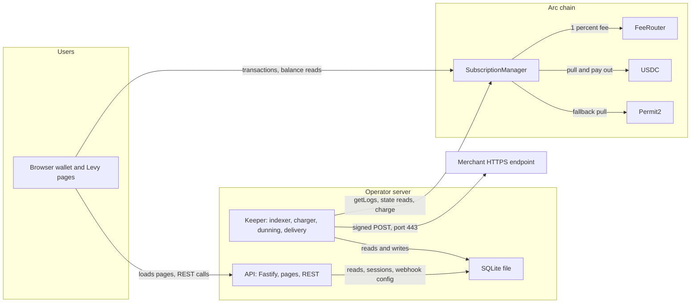
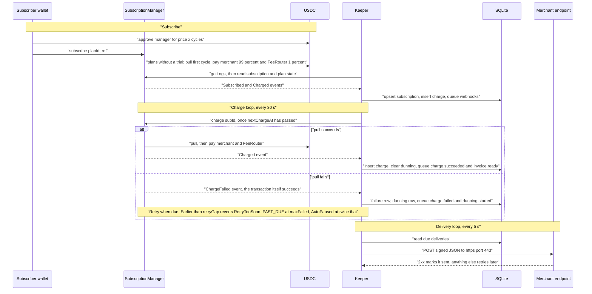

# Architecture

Levy is pull-based USDC subscription billing on Arc. Merchants publish immutable plans on-chain, subscribers grant a USDC allowance once, and any caller can trigger each cycle's payment with `charge()`. Two contracts hold the rules and move the money. A keeper service indexes their events into SQLite, makes the `charge()` calls, retries failures and delivers signed webhooks. A small API serves the dashboard, customer portal and checkout pages and answers their data requests from the same database. Levy runs on Arc testnet only; nothing is on mainnet and nothing is audited. To run it locally see [Getting Started](Getting-Started.md).

Current testnet deployment (2026-10-24, blocks 68869601 and 68869602, built with solc 0.8.33 from `54724d0`): SubscriptionManager `0xea24ac9c1217a671139d93225fdcf19ea3c4df4e`, FeeRouter `0x9e62309243da8be600a718a323fbbdfce00f3ce8`.

## Components

| Component | Runs on | Role | Secrets it holds |
|---|---|---|---|
| SubscriptionManager | Arc | Plans, subscriptions, `charge()`, proration credit, on-chain dunning state, the 99/1 split. No owner, no upgrade path | none; holds no funds at rest |
| FeeRouter | Arc | Holds the 1% fee until anyone calls `sweep()`, which sends it to the treasury | none |
| USDC and Permit2 | Arc (external) | The money (ERC-20 interface at `0x3600...0000`) and signature-based allowances (canonical Permit2) | none |
| Keeper | operator's server, one instance | Indexer, charge loop, dunning retries, allowance-runway check, webhook delivery loop | gas key, webhook signing key |
| SQLite (`levy.db`, WAL mode) | beside the keeper | Index of chain state plus webhooks, deliveries, dunning rows, sessions | none |
| API | operator's server | Fastify REST API and static pages, wallet sign-in, reads the database | webhook signing key (to publish its public half); no on-chain key, no RPC connection |
| Pages (dashboard, portal, checkout) | user's browser | Build transactions and send them through the browser wallet; read balances and allowances through the wallet's provider | none |
| Merchant endpoint | merchant's server | Receives signed webhooks over HTTPS | merchant's own |

## On-chain and off-chain

| Concern | On-chain | Off-chain |
|---|---|---|
| Plans | merchant, price, cycle, trial, `maxFailed` (plus a stored but unused `graceSeconds`), immutable; no names or metadata | read-only mirror table for display |
| Subscriptions | status, `nextChargeAt`, `failedAttempts`, credit, `chargeCount`, the merchant's `ref` | mirror row without credit and charge count |
| Money | the pull, proration credit, the fee split and rounding | nothing: no off-chain component can move funds |
| Timing | when a charge is allowed, minimum gaps between recorded failures (`retryGap`), PAST_DUE and auto-pause thresholds | when to call `charge()`; a retry schedule never shorter than the on-chain gaps |
| History | events (`Charged`, `ChargeFailed`, ...) | `charges` rows (the invoices), `charge_failures`, USDC transfers kept for visibility |
| Notifications and sessions | none | signed webhooks, `allowance.low`, wallet sign-in sessions |

Rules and money sit in contracts so they never depend on Levy's servers staying honest. A contract cannot wake itself, so something must call `charge()`; because the call is permissionless, the keeper is only the always-on caller, not an authority. Notifications, history views and pages are not consensus matters and would cost gas. The chain stays the source of truth: the keeper rebuilds plan and subscription rows from it. A lost database costs the dunning schedules, webhook registrations and delivery logs, sessions and history older than the lookback window, and past-due subscriptions without a schedule are not retried.

## Trust boundaries

| Boundary | Rule |
|---|---|
| Anyone calling `charge()` | Can only pull a subscriber's pre-approved USDC, for the plan's price less credit, after `nextChargeAt`, and pay it to the plan's merchant and the FeeRouter. The caller controls timing and nothing else |
| Keeper | Holds a gas key and nothing else on-chain: the contracts have no keeper role. A compromised or dead keeper can stop charging or leak data; it cannot take user funds |
| API | No on-chain key, no RPC. Every data route is scoped to the signed-in address |
| Browser | The wallet signs everything. Page scripts load from the app's own origin only |
| Keeper to merchants | Outbound only: https on port 443 to public addresses, signed with Ed25519 |
| Subscriber's allowance | The ceiling on what Levy can ever pull; revocable at any time |

Threats and mitigations are in [Security](Security.md).

## Flows

**Subscribe.** The checkout page reads the plan from the API's mirror, has the subscriber approve `price x N` cycles (default 12, added to any existing allowance), then calls `subscribe(planId, ref)`. A plan without a trial is billed in advance: the first cycle is pulled in the same transaction, and a failed pull reverts the subscribe with `PaymentFailed`. `subscribeWithPermit2` does both steps in one transaction; only the signer can submit it and no page uses it yet (see [Permit2](Permit2.md)).

**Successful charge.** Each cycle the keeper syncs events, then calls `charge(subId)`, one call at a time so nonces stay ordered, for every TRIAL or ACTIVE subscription that is due by chain time and has no open dunning row. The contract spends credit first, pulls the rest (direct allowance, then Permit2), pays the merchant `amount - fee` and the FeeRouter `fee = amount / 100` rounded down, and advances `nextChargeAt` by one cycle (from the payment time instead after failed attempts or a whole uncharged cycle, so a charge never leaves the subscription due again). A second sync records the `Charged` event, which is the invoice.

**Failed charge and dunning.** A failed pull does not revert. The contract records `ChargeFailed` only when `retryGap` has elapsed since the previous recorded failure (1 day before the second, 3 before the third, 7 before each later one); a failing call sooner reverts `RetryTooSoon`, so strangers cannot hurry the schedule. The keeper opens a dunning row and retries on `LEVY_DUNNING_DAYS` (default 1, 3, 7). At `maxFailed` failures the subscription is PAST_DUE and still chargeable; at twice that the contract pauses it inside `charge()`. The keeper never pauses anything, and one success clears the failures and starts a fresh cycle from the payment. See [Dunning and Failures](Dunning-and-Failures.md).

**Webhook delivery.** The indexer maps contract events to webhook events and queues one delivery per active endpoint of the subscription's merchant that subscribed to the event (`allowance.low` comes from the keeper's funds check). The delivery loop sends up to 8 requests at once, one in flight per endpoint, signing every attempt with a fresh timestamp. Failures retry after 1 minute, 5 minutes, 15 minutes, 1 hour, then every 6 hours; a delivery whose next retry would pass 24 hours of age is dead-lettered, so the last attempt is at about 19 hours 21 minutes. The API is not on this path: it stores endpoint registrations and publishes the public key, and the keeper delivers straight to the merchant. See [Webhooks](Webhooks.md).

## Arc facts Levy relies on

Verified on 2026-09-25 and 2026-10-07 (`VERIFICATION.md`):

- USDC is the gas token. Its ERC-20 interface at `0x3600...0000` has 6 decimals; the native balance has 18 and never enters payment logic. Levy amounts are integers in 6-decimal units (1 USDC = 1,000,000).
- Blocks take about 0.5 seconds with single-block deterministic finality (Malachite BFT, no reorgs), so the keeper treats a mined transaction as final and has no confirmation depth.
- The EVM is Osaka-baseline, so PUSH0 works. `foundry.toml` keeps `evm_version = "paris"` as a harmless default.
- Permit2 sits at the canonical `0x000000000022D473030F116dDEE9F6B43aC78BA3`, with code on testnet and mainnet.

## Deployment shape

One keeper (a second cannot double-charge or speed up dunning, it only wastes gas) and one API share a SQLite file and the signing key file, normally through the `levy-data` volume in `ops/docker-compose.yml`. The API listens on loopback behind a TLS reverse proxy. See [Deployment](Deployment.md) and [Keeper Service](Keeper-Service.md).

## Source files

- [src/SubscriptionManager.sol](https://github.com/RunTimeAdmin/levy/blob/main/src/SubscriptionManager.sol)
- [src/FeeRouter.sol](https://github.com/RunTimeAdmin/levy/blob/main/src/FeeRouter.sol)
- [keeper/src/keeper.ts](https://github.com/RunTimeAdmin/levy/blob/main/keeper/src/keeper.ts)
- [keeper/src/indexer.ts](https://github.com/RunTimeAdmin/levy/blob/main/keeper/src/indexer.ts)
- [keeper/src/webhooks.ts](https://github.com/RunTimeAdmin/levy/blob/main/keeper/src/webhooks.ts)
- [keeper/src/db.ts](https://github.com/RunTimeAdmin/levy/blob/main/keeper/src/db.ts)
- [api/src/server.ts](https://github.com/RunTimeAdmin/levy/blob/main/api/src/server.ts)
- [ops/docker-compose.yml](https://github.com/RunTimeAdmin/levy/blob/main/ops/docker-compose.yml)
- [VERIFICATION.md](https://github.com/RunTimeAdmin/levy/blob/main/VERIFICATION.md)
