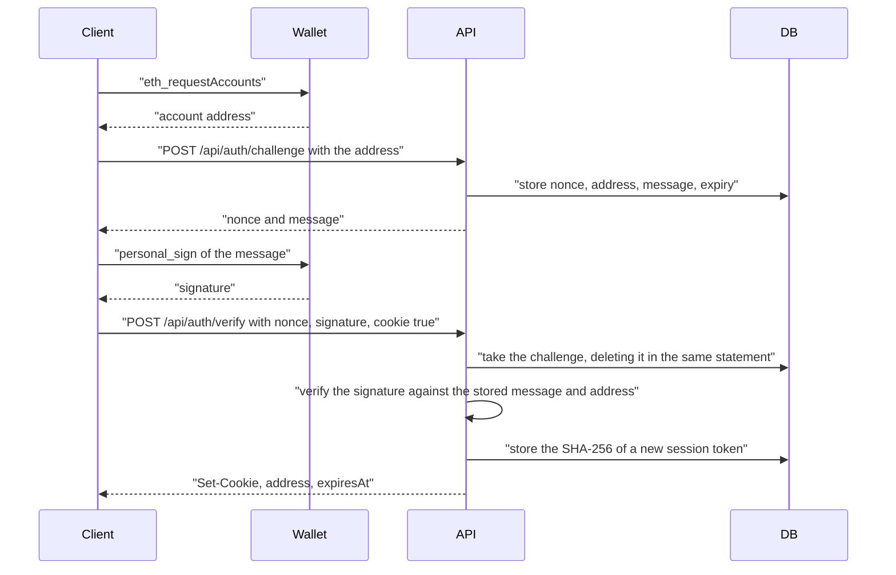
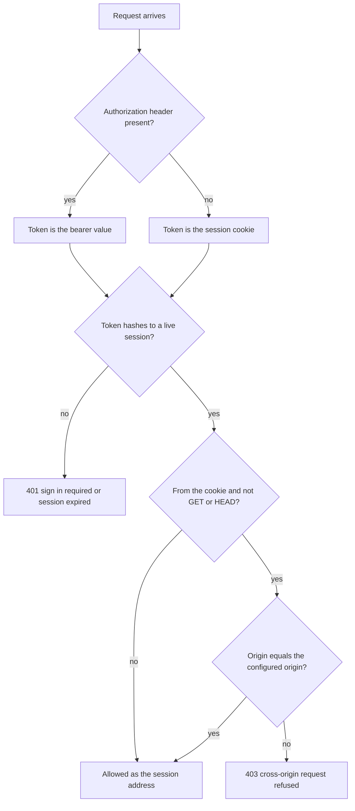

# Authentication

Levy has no accounts, passwords or API keys. A merchant or subscriber proves control of a wallet with Sign-In with Ethereum (EIP-4361) and receives a 24 hour session. The server writes the whole message, binds it to its configured origin and accepts each challenge once. Browser pages keep the session in an HttpOnly cookie that scripts cannot read; backends use a bearer token. Every data route is scoped to the signed-in address. Only plain wallets (EOAs) can sign in.

## Sign-in flow



The challenge is consumed before the signature is checked, so a wrong signature burns it and a second attempt with the same nonce gets 401 `challenge expired or already used`.

## The challenge

`POST /api/auth/challenge` takes `{address}` (any case) and returns `{nonce, message}`. The server builds the message with viem's `createSiweMessage`:

```text
app.getlevy.xyz wants you to sign in with your Ethereum account:
0xYourAddress

Sign in to Levy. This is not a transaction and costs no gas.

URI: https://app.getlevy.xyz
Version: 1
Chain ID: 5042002
Nonce: <32 hex characters>
Issued At: <time>
Expiration Time: <Issued At + 5 minutes>
```

| Field | Source |
|---|---|
| Domain, URI | `LEVY_PUBLIC_ORIGIN`. The server never takes the domain from the request. |
| Chain ID | `LEVY_CHAIN_ID` (5042002 on Arc testnet). The wallet need not be on that chain to sign. |
| Nonce | 16 bytes from `crypto.randomBytes`, hex encoded. |
| Lifetime | 5 minutes, enforced by the stored expiry. |

The server stores the exact message with the nonce and address and verifies the signature against that text, never against anything the client sends back. A phishing site cannot get a signature that works here: the only message it can obtain names `app.getlevy.xyz`, and wallets warn when that differs from the page's domain. `LEVY_PUBLIC_ORIGIN` is required when `NODE_ENV=production`; the server refuses to start without it, so a wrong default can never teach users to click through a domain warning.

Pending challenges are capped at 10,000; beyond that the route answers 503. Expired ones are deleted whenever a new challenge is created.

## Sessions

`POST /api/auth/verify` takes `{nonce, signature, cookie?}`. On success the server makes a token from 32 random bytes (base64url), stores only its SHA-256 with the address and a 24 hour expiry, and returns it one of two ways.

| | Bearer token | Cookie |
|---|---|---|
| Used by | Merchant backends, scripts | Dashboard and portal |
| Obtained with | `verify` without `cookie` | `verify` with `cookie: true` |
| Response body | `{token, address, expiresAt}` | `{address, expiresAt}` |
| Sent as | `Authorization: Bearer <token>` | `__Host-levy_session` cookie |
| Readable by page scripts | Yes, the caller holds it | No (HttpOnly) |
| Extra check on writes | None | `Origin` must equal the configured origin |
| Logout | Deletes the session | Deletes it and clears the cookie |

The cookie is `Path=/; Max-Age=86400; HttpOnly; SameSite=Strict`, plus `Secure` on an https origin. Over https it carries the `__Host-` prefix, which browsers accept only with `Secure`, `Path=/` and no `Domain`, so a sibling subdomain cannot plant its own. On a local `http://` origin the name is plain `levy_session`.

`SameSite=Strict` alone is not enough, because browsers treat `getlevy.xyz` and `app.getlevy.xyz` as one site. A cookie-authenticated request other than GET or HEAD is therefore refused with 403 `cross-origin request refused` unless its `Origin` header equals the configured origin. A request with an `Authorization` header is judged by that header alone. A cookie write with no `Origin` (curl, for example) is refused too; use a bearer token there.



`GET /api/auth/session` returns `{address}` for a live session. `POST /api/auth/logout` deletes only the session that made the call. There is no refresh; after 24 hours the user signs in again.

## Scoping by address

The session carries one checksummed address and there are no roles. The same address acts as a merchant on routes about plans it created and as a subscriber on routes about subscriptions it holds.

- A `merchant` or `subscriber` parameter must equal the session address: 400 if malformed, 403 if someone else's.
- `GET /api/subscriptions/:id` works for that subscription's subscriber or merchant only; `PATCH` and `DELETE /api/webhooks/:id` for the webhook's owner only. Anyone else gets 404, indistinguishable from a missing record.
- Metrics, dunning, charges, invoices, webhooks and deliveries always cover the session address's merchant data; `GET /api/funds` its subscriber data.

Per-route detail is in [API-Reference.md](API-Reference.md).

## How the pages sign in

`api/public/auth.js` calls `GET /api/auth/session` on load; a 401 only means nobody is signed in. `signIn()` gets the account from `window.ethereum`, fetches a challenge, asks the wallet for `personal_sign` over the hex-encoded message and verifies with `cookie: true`. Any 401 later clears the script's record of who is signed in. Earlier versions kept a bearer token in `localStorage`; the script deletes that entry on load. The checkout page does not sign in. Signing sends no transaction, and the dashboard and portal refuse to send one from an account other than the signed-in address. See [Dashboard-Portal-and-Checkout.md](Dashboard-Portal-and-Checkout.md).

## Rate limiting

The challenge route is the one unauthenticated endpoint that writes to the database, so it is limited at the reverse proxy: `ops/nginx-app.conf.example` allows 10 requests a minute per client IP with a burst of 5, answers 429 beyond that, and caps bodies at 64 KB. Without that rule only the 10,000 pending-challenge cap protects the route. See [Deployment.md](Deployment.md).

## Limitations

- **EOA only.** Signatures are checked by plain ECDSA recovery. Contract wallets and multisigs (ERC-1271) cannot sign in and receive 401 `signature does not match the address`.
- **No scoped API keys.** A merchant backend signs in with the wallet that receives its payouts and holds a 24 hour bearer token.
- **No session listing or revoke-all.** Logout ends one session.

## Configuration

| Variable | Effect |
|---|---|
| `LEVY_PUBLIC_ORIGIN` | The exact origin users load the pages from. Required in production; otherwise defaults to `http://localhost:<port>`. |
| `LEVY_CHAIN_ID` | Chain ID in the message and in `/api/config`. Defaults to 5042 when unset, so set it on testnet. |

## Source files

- [api/src/auth.ts](https://github.com/RunTimeAdmin/levy/blob/main/api/src/auth.ts)
- [api/src/server.ts](https://github.com/RunTimeAdmin/levy/blob/main/api/src/server.ts)
- [api/public/auth.js](https://github.com/RunTimeAdmin/levy/blob/main/api/public/auth.js)
- [keeper/src/db.ts](https://github.com/RunTimeAdmin/levy/blob/main/keeper/src/db.ts)
- [api/test/api.test.ts](https://github.com/RunTimeAdmin/levy/blob/main/api/test/api.test.ts)
- [api/README.md](https://github.com/RunTimeAdmin/levy/blob/main/api/README.md)
- [ops/nginx-app.conf.example](https://github.com/RunTimeAdmin/levy/blob/main/ops/nginx-app.conf.example)
- [SECURITY_REVIEW.md](https://github.com/RunTimeAdmin/levy/blob/main/SECURITY_REVIEW.md)
