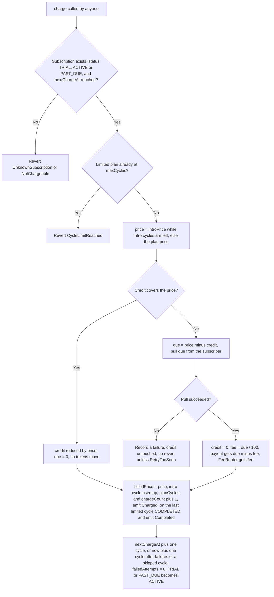
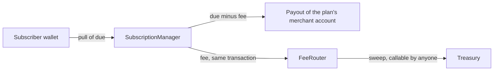

# Charging and Fees

Every payment in Levy goes through one internal routine, `_collect`: it prices the cycle, spends proration credit, pulls the rest from the subscriber, and splits the pull 99% to the merchant and 1% to the FeeRouter. `subscribe`, `charge` and `changePlan` all call it. In manager v2 ([design](https://github.com/RunTimeAdmin/levy/blob/main/docs/manager-v2-design.md), not yet deployed) it is also the only writer of the billing state that cycle limits and intro prices add, and the merchant's 99% goes to the payout address of the plan's merchant account. This page covers a charge step by step, the fee arithmetic, the FeeRouter, and the invoice reference each charge emits.

Amounts are 6-decimal USDC units: 1 USDC = 1,000,000 units, so $10.00 is `10000000` and the smallest amount is $0.000001.

## How `charge(subId)` works

Anyone can call `charge`. The keeper does so on every billing date, but the contract does not care who calls. The pull moves USDC only from the subscriber to the manager, and the manager pays out only to the payout address of the plan's merchant account (`payoutOf`, which only the account's owner can set) and to the FeeRouter fixed at deployment. A caller never receives funds and cannot redirect them. The function is `nonReentrant`.

1. **Preconditions.** The subscription must exist (`UnknownSubscription`), have status TRIAL, ACTIVE or PAST_DUE, and have reached `nextChargeAt` (the last two revert `NotChargeable`). A reverted call changes nothing. `_collect` itself reverts `CycleLimitReached` when a limited plan has already billed `maxCycles` cycles on the subscription. It reverts rather than returning false, which `charge` would record as a failed payment; the status check stops a completed subscription first, so this is a backstop.
2. **Price.** The cycle costs the plan's `introPrice` while the subscription has intro cycles left (`introCyclesLeft`, set at subscribe) and the plan has intro pricing; otherwise its `price`.
3. **Credit first.** If the subscription's proration `credit` covers the price, the price comes off the credit and no tokens move. Otherwise `due = price - credit`.
4. **The pull.** `_tryPull` tries `usdc.transferFrom(subscriber, manager, due)` against the direct allowance, then falls back to Permit2 ([Permit2](Permit2.md)). If both fail, `_collect` returns false having changed nothing, credit included, and `charge` records a failure instead of reverting ([Dunning and Failures](Dunning-and-Failures.md)).
5. **The 99/1 split.** Credit is set to zero, `fee = due / 100`, and the manager sends `due - fee` to `payoutOf(plan.merchant)` and `fee` to the FeeRouter in the same transaction. If USDC refuses a payout (a blocklisted payout address, say), the whole charge reverts, no failure is recorded, and the keeper backs off. The account's owner fixes it by setting a new payout with `setPayout`.
6. **Billing state.** Whether the cycle was paid from credit, by a pull or by both: `billedPrice` records the price, an intro cycle is used up if this was one, `planCycles` and `chargeCount` go up by one, and `Charged(subId, amount, fee, invoiceRef, chargeCount)` is emitted. `amount` is `due`, the tokens actually pulled, so it is 0 for a cycle paid from credit. If `planCycles` has reached a limited plan's `maxCycles`, the status becomes COMPLETED and `Completed(subId)` is emitted.
7. **Advance.** `nextChargeAt` moves forward by one `cycleSeconds` (or to now plus one cycle, below), `failedAttempts` resets to 0, and TRIAL or PAST_DUE becomes ACTIVE. A completion stands, and `nextChargeAt` then marks the end of the last paid cycle.

Step 7 normally adds the cycle to the stored `nextChargeAt`, not to the current time, so a late keeper does not shift the schedule. It starts a fresh cycle at the payment instead (now plus one cycle) in two cases: the charge follows failed attempts (`failedAttempts > 0`, which includes every PAST_DUE recovery), or one cycle after the stored date has already passed, meaning a whole cycle went by with no charge (a keeper outage, say). The overdue time is forgiven, the same way resume forgives paused time and `changePlan` forgives an overdue cycle. A successful charge therefore never leaves the next one already due, and missed cycles cannot be pulled back to back (invariant `noBackToBackCharges`).

## One routine, three entry points

| Entry point | When it calls `_collect` | If the pull fails |
|---|---|---|
| `subscribe`, `subscribeWithPermit2` | Only on a plan without a trial, right after `Subscribed` is emitted and `introCyclesLeft` is set from the plan. On a `maxCycles = 1` plan this one cycle completes the subscription. | Reverts `PaymentFailed`. No subscription is created. |
| `charge` | Every due cycle. | The failure is recorded. No revert. |
| `changePlan` | After the old cycle's unused paid time becomes credit at its `billedPrice`, and `planCycles` and `introCyclesLeft` are reset to 0. The new plan's first cycle is billed now at its full price and `nextChargeAt` becomes now plus the new cycle. | Reverts `PaymentFailed`. Nothing changes. |

The credit arithmetic is on [Plan Changes and Proration](Plan-Changes-and-Proration.md). `billedPrice` is written on every billed cycle, including one paid entirely from credit, because credit computed from a stale, higher price would not be backed.

## Fee math

`FEE_BPS = 100` is a divisor, not a basis-point rate, despite its name: the fee is `due / 100`. It applies to `due`, the amount actually pulled, not to the plan price. Integer division rounds down, so rounding goes to the merchant and the protocol loses less than one unit per charge.

| Pulled (`due`) | Fee | Merchant | Note |
|---|---|---|---|
| 10,000,000 ($10.00) | 100,000 | 9,900,000 | Exact 1% |
| 199 | 1 | 198 | Rounded down (`testFeeRoundsDown`) |
| 100 | 1 | 99 | Smallest pull that pays a fee |
| 99 | 0 | 99 | Under 100 units ($0.0001): no fee, no revert |
| 0 (credit covered the cycle) | 0 | 0 | No tokens move, but `Charged` is still emitted |

On a pull under 100 units the manager still makes a zero-value transfer to the FeeRouter. Arc testnet's USDC accepts zero-value transfers (checked with a read-only call on 2026-10-07), so a very cheap plan charges normally and earns the protocol nothing. Since `fee + (due - fee) == due`, the manager never keeps a remainder (invariant `managerHoldsNothing`). The rate is a constant, so changing it means redeploying.

## Worked example

A plan costs 10 USDC every 30 days with no trial. Alice approves 120 USDC and subscribes at time T.

| When | What happens | Merchant | FeeRouter | `chargeCount`, next charge |
|---|---|---|---|---|
| T, subscribe | Pull 10,000,000. `Charged(subId, 10000000, 100000, ...)`. | +9,900,000 | +100,000 | 1, T + 30 days |
| T + 30 days + 2 minutes (keeper slightly late) | Same pull. | +9,900,000 | +100,000 | 2, T + 60 days |
| T + 45 days, Alice moves to a 20 USDC plan | 15 of the 30 paid days are unused: credit = 10,000,000 × 15 / 30 = 5,000,000. `due` = 20,000,000 - 5,000,000 = 15,000,000. | +14,850,000 | +150,000 | 3, T + 75 days |

The late charge did not move the schedule: the next date is T + 60 days, not T + 60 days + 2 minutes. The router now holds 350,000 units (0.35 USDC), and one `sweep()` call sends all of it to the treasury.

## Invoice reference

Each `Charged` event carries `invoiceRef = keccak256(abi.encode(subId, chargeCount))`, with `chargeCount` taken after this charge's increment. It identifies one charge: deterministic, unique within a subscription, and an indexed topic, so logs can be filtered by it. Subscription 5 on the testnet deployment has `invoiceRef` `0xe2689cd4a84e23ad2f564004f1c9013e9589d260bde6380aba3ca7e09e4df40c` for its first charge, which is both the emitted value and the output of `cast keccak $(cast abi-encode "f(uint256,uint256)" 5 1)` (checked 2026-10-07).

A cycle paid entirely from credit still counts as a charge and gets an `invoiceRef`. The keeper stores each `Charged` as an invoice row ([Event Indexer and Database](Event-Indexer-and-Database.md)), and the reference appears in `GET /api/invoices`, the CSV export and the `charge.succeeded` and `invoice.ready` webhooks ([Webhooks](Webhooks.md)).

It is not the merchant's `ref`. The `ref` is chosen by whoever calls `subscribe`, stored once per subscription in `subscriptionRef`, and carried on every webhook. The `invoiceRef` is set by the contract and is per charge.

## FeeRouter

`FeeRouter` is a plain forwarder. The planned split into buyback-and-burn and staking rewards is not built.

| Member | Behavior |
|---|---|
| `usdc` | Immutable. The same token the manager uses. |
| `treasury` | Where fees go. Set at construction, never zero. |
| `sweep()` | Callable by anyone. Sends the router's whole USDC balance to `treasury` and emits `Swept(amount, treasury)`. An empty balance emits `Swept` with amount 0. |
| `pendingTreasury` | The proposed successor until it accepts; zero when none. |
| `proposeTreasury(address)` | Callable only by the current treasury (`OnlyTreasury`). The address cannot be zero (`ZeroAddress`). Stores it as `pendingTreasury`, replacing any earlier proposal, and emits `TreasuryProposed(treasury, pendingTreasury)`. |
| `acceptTreasury()` | Callable only by `pendingTreasury` (`OnlyPendingTreasury`). Makes the caller the treasury, clears `pendingTreasury` and emits `TreasuryUpdated(old, new)`. |

Fees arrive in the same transaction as the pull they come from, so they cannot get stuck, and the router cannot be paused. `sweep` is safe to leave open because it can only pay `treasury`. Nothing sweeps on a schedule: the keeper never calls it, so an operator has to (the testnet soak sweeps by hand on day 7).

Moving the treasury takes both steps, so a mistyped address cannot take over the fees: it would have to call `acceptTreasury` itself. The contract still does not require the treasury to be a contract: `proposeTreasury` accepts any nonzero address, and a plain key that accepts becomes the treasury. Only `script/Deploy.s.sol` checks more. On Arc mainnet (chain 5042) it refuses to deploy unless the treasury has code and USDC and Permit2 are the canonical Arc addresses, and on every chain it requires USDC to report 6 decimals. On testnet the treasury is the deployer's key. Treat every `TreasuryProposed` and `TreasuryUpdated` event as something to verify. The mainnet plan is a Safe multisig ([ops/treasury-multisig.md](https://github.com/RunTimeAdmin/levy/blob/main/ops/treasury-multisig.md)).

## Money-math rules

- All amounts are raw 6-decimal USDC units read through the ERC-20 interface at `0x3600...0000`. On Arc, USDC is also the gas token, and the chain accounts for that native balance with 18 decimals. The contracts never handle native value, never call `decimals()` and never scale by `1e6` or `1e18`.
- Integer arithmetic only. Division rounds down and the remainder stays with the merchant. Solidity 0.8 reverts on overflow instead of wrapping.
- The fee comes only out of tokens actually pulled. A failed pull moves nothing.
- The manager holds no funds at rest: each pull is fully split in the transaction that makes it.

## Source files

- [src/SubscriptionManager.sol](https://github.com/RunTimeAdmin/levy/blob/main/src/SubscriptionManager.sol)
- [src/FeeRouter.sol](https://github.com/RunTimeAdmin/levy/blob/main/src/FeeRouter.sol)
- [script/Deploy.s.sol](https://github.com/RunTimeAdmin/levy/blob/main/script/Deploy.s.sol)
- [test/Levy.t.sol](https://github.com/RunTimeAdmin/levy/blob/main/test/Levy.t.sol)
- [test/LevyInvariant.t.sol](https://github.com/RunTimeAdmin/levy/blob/main/test/LevyInvariant.t.sol)
- [FEE_MATH_AUDIT.md](https://github.com/RunTimeAdmin/levy/blob/main/FEE_MATH_AUDIT.md)
- [SPEC.md](https://github.com/RunTimeAdmin/levy/blob/main/SPEC.md)
