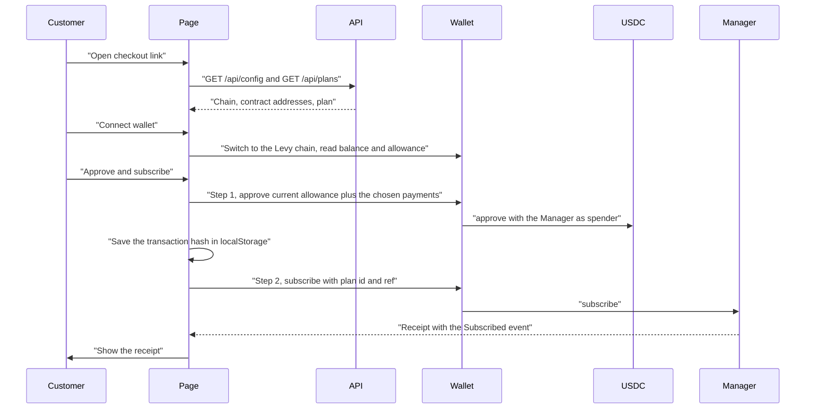
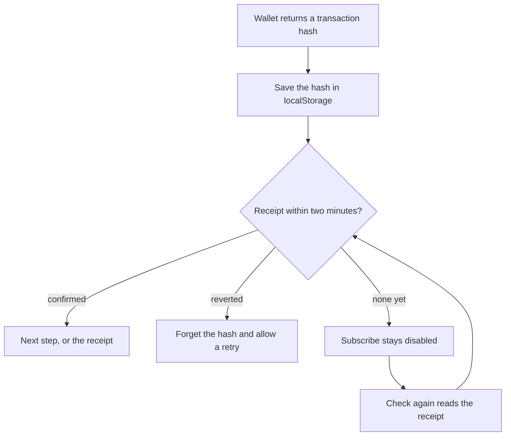

# Dashboard, Portal and Checkout

The API serves three browser pages: a merchant dashboard, a customer portal and a checkout page. They are plain HTML, JavaScript and one stylesheet, with no framework, build step or third-party code. They read from the API and write to the chain, and every write is a transaction the user signs in their own wallet. The API holds no on-chain key; the only thing the pages ask it to change is webhook configuration.

Amounts are USDC with 6 decimals (1 USDC = 1,000,000 units). The pages show exact amounts: cents, plus further digits only when they are not zero.

## The three pages

| Page | URL | For | Signs in | On-chain actions |
|---|---|---|---|---|
| Merchant dashboard | `/` | The owner of a merchant account | Yes | `createPlan`, `setPlanRetired`, pause, resume (its own pause only), cancel, `setPayout`, `transferOwnership`, `acceptOwnership` |
| Customer portal | `/portal.html` | A subscriber | Yes | pause, resume, cancel, `changePlan`, `proposeTransfer`, `acceptTransfer`, allowance top-up and revoke |
| Checkout | `/checkout.html?plan=<id>&ref=<ref>` | Anyone with a merchant's link | No | `approve`, `subscribe` |

This page describes the pages for manager v2 ([design](https://github.com/RunTimeAdmin/levy/blob/main/docs/manager-v2-design.md)). They encode v2's calls, so they work only against a v2 deployment, not the testnet contracts from 2026-10-24.

Dashboard and portal sign in with the wallet ([Authentication.md](Authentication.md)); checkout reads only the public `/api/config` and `/api/plans`. The shared scripts in `/public/` are `wallet.js` (`LevyWallet`: chain switching, `eth_call` reads, transaction sending, hand-encoded calls whose selectors `api/test/wallet.test.ts` checks against the contract ABI), `auth.js` (sign-in), `network.js` (testnet bar) and `app.css`, plus one controller per page.

## On-chain actions

| Action | Page | Call | Contract allows |
|---|---|---|---|
| Create plan | Dashboard | `createPlan(account, (price, cycleSeconds, trialSeconds, maxFailed, maxCycles, introPrice, introCycles, transferable))` | The account's owner; the dashboard sends the account it is showing |
| Retire or reopen a plan | Dashboard | `setPlanRetired(planId, retired)` | The owner of the plan's account |
| Set payout, pay the owner again | Dashboard | `setPayout(account, payout)`, with the zero address to follow the owner | The account's owner |
| Offer the account, withdraw the offer | Dashboard | `transferOwnership(account, newOwner)`, with the zero address to withdraw | The account's owner |
| Accept an account | Dashboard | `acceptOwnership(account)` | The proposed owner |
| Approve allowance | Checkout, portal | `approve(manager, total)` on the USDC contract | The USDC holder |
| Subscribe | Checkout | `subscribe(planId, ref)` | The subscriber, on a plan that is not retired |
| Pause, resume, cancel | Dashboard, portal | `pauseSubscription`, `resumeSubscription`, `cancelSubscription` | The subscriber or the owner of the plan's account. The merchant can resume only a pause it made itself |
| Change plan | Portal | `changePlan(subId, newPlanId)` | The subscriber only, to another plan of the same account that is not retired, while trial, active or past due |
| Move to another wallet, withdraw the offer | Portal | `proposeTransfer(subId, to)`, with the zero address to withdraw | The subscriber, on a transferable plan, while trial, active, past due or paused |
| Accept a subscription | Portal | `acceptTransfer(subId, planId)` | The offered wallet |

Balance, allowance, the manager's `subscriptions(subId)` getter and `billedPrice(subId)` are read through the wallet as `eth_call`.

`LevyWallet.connect` requests the account, switches the wallet to the configured chain (adding the Arc network if the wallet lacks it) and re-checks the chain id. The dashboard and portal then refuse to send from any account other than the signed-in one. A transaction goes out with `eth_sendTransaction` and its receipt is polled once a second for up to two minutes. The result is confirmed, reverted (nothing changed) or unknown (no receipt yet, which is not the same as failed).

## Merchant dashboard

The dashboard acts for one merchant account at a time, chosen from `GET /api/accounts`: the signed-in wallet's own account unless it handed that on, or one handed to it. A wallet that owns two or more gets a picker. Every data request names the account in `merchant`, and every transaction is sent from the signed-in wallet.

- **Merchant account.** The account address, its owner, where payments go (the owner, or a fixed address) and any open handover. Set payout takes an address, such as a Safe, and warns that a payment sent to a wrong address cannot be recovered; Pay the owner again appears while a payout is fixed. Offer the account starts a handover and says that nothing changes until the other wallet accepts; Withdraw the offer appears while one is open. Accounts offered to the signed-in wallet show an Accept the account button. A wallet that owns no account (it handed its own on) sees only a note and any offers, and the rest of the dashboard is hidden.
- **Metric cards.** MRR, active subscriptions, charge success rate, dunning queue length, total collected, past due and paused counts.
- **Plans.** The account's plans with price, terms (intro price and how many payments it covers, the number of payments or "one payment", "transferable", or "until cancelled"), trial, failed payments before past due, live subscriber count, a copyable checkout link and Retire or Reopen. A retired plan has a grey "retired" pill. Adding `&ref=` and an id of up to 31 characters tags a customer.
- **New plan.** Price in USDC (up to 6 decimals), cycle (daily, weekly, 30, 90 or 365 days, or custom from 1 to 3650), trial days (shorter than the cycle), failed payments before past due (1 to 255), number of payments (blank for no limit), an optional intro price with the number of payments it covers, and whether customers may move the subscription to another wallet. The form enforces the contract's rules: an intro price above 0 and below the price, set together with its payment count, and no more intro payments than the plan has. A summary states what customers pay, the intro payments, the limit, transferability, that a subscription pauses after twice that many failures, and Levy's 1% share. Plan terms are immutable; to change a price, create a new plan and retire the old one. The plan id comes from the `PlanCreated` log, and the page polls `/api/plans` every 5 seconds for up to 90 seconds until the keeper's index has the plan.
- **Subscriptions.** Subscriber, reference (readable if ASCII, else shortened hex), plan, price, status, next charge ("paid through" for a completed subscription), failed attempts and allowance runway (`low: N`, `N cycles` or `not checked`). Pause and Cancel while trial, active or past due; Resume and Cancel while paused by the merchant (`pausedByMerchant` 1); a "customer resumes" label and Cancel while paused by the customer or after failed payments; nothing once cancelled or completed. Each asks for confirmation, then a signature, then updates its row at once; the rest follows the keeper's next sync.
- **Dunning queue.** Subscription, subscriber, attempts, next retry (UTC).
- **Webhooks.** Endpoints with latest delivery status, a log of the last 20 deliveries, Enable or Disable (confirmed first, because queued deliveries are dropped) and Delete. Adding takes an https URL and the thirteen event types, all ticked by default. Limits are in [API-Reference.md](API-Reference.md).
- **Invoices.** The latest 50 charges with explorer links. "Export CSV" fetches `/api/invoices?merchant=<account>&format=csv` with the session and saves `levy-invoices.csv`.

## Customer portal

The allowance panel comes first, then one card per subscription: status, plan (with "a single payment" or the number of payments for a limited plan), price, next charge (none once cancelled, "Paid through" once completed), failed attempts, merchant and invoice history. Pause, Resume and Cancel follow the dashboard's rules, except that Resume shows on every paused subscription, since the subscriber can resume any pause. Cancel is final, and refunds are the merchant's decision off-chain. "Change plan" appears for trial, active and past due subscriptions when the merchant account has another plan that is not retired.

**Plan change quote.** Before the wallet is involved, the portal reads the subscription and its `billedPrice` from the contract and applies the contract's own arithmetic: unused time on a paid cycle becomes credit at the price that cycle was billed at, the new plan's first cycle is paid at its full price from credit first, and the rest is pulled now. The panel states what is due, what carries over and the next charge date, and keeps the switch button disabled if the allowance would not cover it. See [Plan-Changes-and-Proration.md](Plan-Changes-and-Proration.md).

**Moving to another wallet.** On a transferable plan, a trial, active, past due or paused subscription has "Move to another wallet". It takes an address (not the signed-in one) and confirms first that once that wallet accepts, the subscription, its paid time and any credit move there for good and later payments come from it. The card then notes the open offer, and "Withdraw the offer" replaces the button. Subscriptions offered to the signed-in wallet (`GET /api/subscriptions?pendingTransfer=<me>`) appear in an "Offered to this wallet" panel at the top, each with the plan, price, merchant and sender, and an Accept button that sends `acceptTransfer` with the subscription's current plan after a confirmation saying payments will come from this wallet.

**Allowance panel.** All of a subscriber's Levy subscriptions draw on one USDC allowance. The panel shows that pool: approved amount, how many rounds of all their charges it covers, and balance, in a warning style when the allowance is low or the balance is under one round. Figures come from `/api/funds`, as of the keeper's last check. Only direct USDC allowances count, so a Permit2 subscriber shows as low ([Permit2.md](Permit2.md)).

- **Top up** adds a chosen number of rounds (1 to 120, default 12) times the per-round amount to the allowance read from the chain at click time.
- **Revoke** sets it to 0 after a warning that every Levy subscription will then fail to charge. To stop one subscription, cancel it.

## Checkout

The plan comes from the URL and the subscriber is whoever connects a wallet.



1. **The link.** `plan` must be digits. `ref` is optional: `0x` plus 64 hex digits, or 1 to 31 printable ASCII characters, left-aligned and zero-padded to 32 bytes. An invalid `ref` stops the page rather than subscribing with the wrong one.
2. **The plan card.** A retired plan stops the page with a note that it is closed to new subscribers. Otherwise: price and cycle ("one payment" for a `maxCycles = 1` plan), the intro price and how many payments it covers, the number of payments for a limited plan, when the first charge happens (today, or after the trial), the merchant's address, the reference, the Levy contract and the network. It shows an address, not a verified name.
3. **Allowance.** The customer picks how many cycles to approve, 1 to 120, default 12, with the USDC total shown live. For a limited plan the field allows at most the plan's payments (and 120) and starts at that number. The total prices intro payments at the intro price. A note explains it is a ceiling shared by all their Levy subscriptions, and the contract limits each charge to the plan's price once per cycle, paid to that merchant.
4. **Connect.** Shows the account, USDC balance and current Levy allowance. With no trial and a balance below the first charge (the intro price, if there is one), it says so and, on testnet, links to the faucet.
5. **Approve and subscribe.** Step 1 reads the current allowance and sends `approve(manager, current + total)`, where `total` is what the chosen number of payments costs: intro payments at the intro price, the rest at the price, and none past a limited plan's last. This adds to the existing allowance instead of replacing it, so other subscriptions keep their runway. The total is fixed when sent and `approve` sets the allowance to it, so repeating the same approval changes nothing. Step 2 sends `subscribe(planId, ref)`. Without a trial it also pays the first cycle, and a failed payment reverts the subscribe.
6. **Receipt.** Subscription id and first charge time from the `Subscribed` log, the plan with its intro and limited terms, what was paid today, the next charge date ("Paid through" for a one-time payment), allowance left (in charges at this price), the transaction as an explorer link and a link to the portal. The transaction is the on-chain record.

### Transaction recovery

A second subscribe after an uncertain outcome would create a second paid subscription, so checkout never sends one blind.

- **Pending record.** As soon as the wallet returns a hash, the page saves `{approveTarget, approveHash, subscribeHash, at}` in `localStorage` under `levy-checkout:<chainId>:<planId>:<account>`. It lasts 24 hours and is removed on success.
- **On reconnect** the page settles the record before offering anything. A confirmed subscribe goes to the receipt, a confirmed approval moves to step 2 (the button reads "Subscribe"), and a reverted transaction is forgotten so the customer can try again.
- **Unknown outcome.** With no receipt after two minutes, or on a reload before one exists, the page warns not to pay again, links the explorer and offers "Check again". Subscribe stays disabled until a receipt says how it ended.
- **Within a session**, a failed subscribe after a good approval does not approve again, and the cycles field locks once an approval is sent.



## Testnet bar

On every page `network.js` reads `/api/config` and, when the chain id is not 5042 (treated as mainnet), shows a bar under the header: "Arc Testnet: test USDC only, no real money moves." On Arc testnet (5042002) it links Circle's faucet. If the call fails the bar stays hidden.

## Content-Security-Policy

HTML responses carry this policy, plus `x-frame-options: DENY`, `cross-origin-opener-policy: same-origin` and a `permissions-policy` that turns off camera, microphone, geolocation, payment and USB:

```text
default-src 'none'; script-src 'self'; style-src 'self' 'unsafe-inline'; img-src 'self' data:;
connect-src 'self'; base-uri 'none'; form-action 'none'; frame-ancestors 'none'
```

Scripts load only from the app's own origin and never inline, so an injected `<script>` or event-handler attribute cannot run and act with the session. That is why each page's logic lives in `/public/*.js` and handlers are attached from code. The session cookie is HttpOnly as well. Pages can fetch only their own origin and cannot be framed. Inline styles stay allowed because a style cannot run code. Wallet extensions inject their provider as content scripts, which a page's CSP does not govern. On the dashboard, strings a sender controls (webhook URLs, event names, error text, references) are escaped before reaching `innerHTML`. Scripts and the stylesheet are served without these headers.

## Styling

`app.css` is the one shared stylesheet. It declares the palette as CSS custom properties on `:root` (`--bg`, `--card`, `--text`, `--muted`, `--accent`, `--accent-2`, `--border`, `--radius`, plus `--warn`, `--bad` and `--mono`, which `site/style.css` does not define) and mirrors the marketing site's colors, type and buttons, so the app reads as the same dark product. It uses system fonts and no dependencies. Components are a few classes: panels and cards, buttons (primary, `.ghost`, `.danger`, `.small`), status pills (green for trial, active and sent; amber for past_due, failed and pending; red for paused, cancelled and dead; grey for completed and retired), scrolling tables, a banner, a spinner and skeletons. One 640px breakpoint stacks the header into two rows, and `prefers-reduced-motion` stops animation. Each HTML file adds a small inline `<style>` block for its own layout, which the policy allows.

## Known limitations

The first two are open items 7 and 8 in SECURITY_REVIEW.md section 9 (see [Security.md](Security.md)).

- **Checkout recovery is per browser and short-lived (item 7).** A second tab that connected before the first tab broadcast does not stop at the pending record: its confirm handler loads the record but never checks `subscribeHash`. The record expires after a day and is lost if storage is blocked. The planned fix keeps the order longer, coordinates tabs and reconciles with the chain before offering another subscribe. Repeat subscriptions per wallet and plan can be legitimate, so they are not banned.
- **Portal top-up can repeat (item 8).** It adds rounds to the allowance it reads at click time and re-enables its buttons after an unknown outcome. An approval that mined but whose receipt could not be read can be topped up twice. Only the allowance changes; no funds move. The planned fix stores the target total, as checkout does.
- The wallet's network is checked at connect, not again before each transaction (item 11).
- Checkout shows the merchant's address with no verified identity, and has no Permit2 path although the contract supports `subscribeWithPermit2`.
- API data is as of the keeper's last sync; after a confirmed transaction the pages update the affected row themselves.
- Levy runs on Arc testnet only and is not audited; each page footer says so.

## Source files

- [api/public/index.html](https://github.com/RunTimeAdmin/levy/blob/main/api/public/index.html), [api/public/portal.html](https://github.com/RunTimeAdmin/levy/blob/main/api/public/portal.html), [api/public/checkout.html](https://github.com/RunTimeAdmin/levy/blob/main/api/public/checkout.html)
- [api/public/dashboard.js](https://github.com/RunTimeAdmin/levy/blob/main/api/public/dashboard.js), [api/public/portal.js](https://github.com/RunTimeAdmin/levy/blob/main/api/public/portal.js), [api/public/checkout.js](https://github.com/RunTimeAdmin/levy/blob/main/api/public/checkout.js)
- [api/public/wallet.js](https://github.com/RunTimeAdmin/levy/blob/main/api/public/wallet.js), [api/public/auth.js](https://github.com/RunTimeAdmin/levy/blob/main/api/public/auth.js), [api/public/network.js](https://github.com/RunTimeAdmin/levy/blob/main/api/public/network.js), [api/public/app.css](https://github.com/RunTimeAdmin/levy/blob/main/api/public/app.css)
- [api/src/server.ts](https://github.com/RunTimeAdmin/levy/blob/main/api/src/server.ts)
- [api/test/wallet.test.ts](https://github.com/RunTimeAdmin/levy/blob/main/api/test/wallet.test.ts)
- [SECURITY_REVIEW.md](https://github.com/RunTimeAdmin/levy/blob/main/SECURITY_REVIEW.md)
- [docs/merchant-guide.md](https://github.com/RunTimeAdmin/levy/blob/main/docs/merchant-guide.md)
