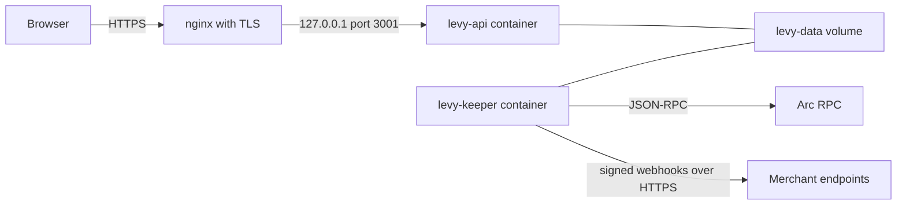

# Deployment

Levy deploys in two parts. The two immutable contracts go on-chain with a Foundry script. The keeper and API run as Docker containers behind a TLS reverse proxy. All of this has run on Arc testnet only; nothing is on mainnet and nothing is audited. A step that is a recommendation and not a shipped tool is marked as one. For the variables see [Keeper Configuration](Keeper-Configuration.md); for day-two work see [Monitoring and Maintenance](Monitoring-and-Maintenance.md).

## Runtime layout



Compose publishes the API on the host's loopback only, so the reverse proxy is the single public entry point. The keeper publishes nothing: it calls the Arc RPC and delivers webhooks to merchants' own HTTPS endpoints. Both containers share one SQLite database through the `levy-data` volume. The webhook signing key is on `levy-keys`, which only the keeper mounts; the keeper publishes the public half to `levy-data` for the API to serve.

## Deploying the contracts

`script/Deploy.s.sol` deploys `FeeRouter`, then a `SubscriptionManager` wired to it. Gas on Arc is paid in USDC (18 decimals natively; the ERC-20 interface Levy uses has 6, so 1 USDC = 1,000,000 units there). Testnet USDC comes from https://faucet.circle.com.

| Variable | Required | Meaning |
|---|---|---|
| `DEPLOYER_PRIVATE_KEY` | yes | Signs and pays for the deployment. Never commit it. |
| `LEVY_TREASURY` | yes | Where `FeeRouter.sweep()` sends the 1% fee |
| `LEVY_USDC` | no | USDC ERC-20 interface. Default `0x3600000000000000000000000000000000000000` |
| `LEVY_PERMIT2` | no | Default is the canonical `0x000000000022D473030F116dDEE9F6B43aC78BA3` |

The script checks the chain before deploying:

| Check | Testnet (5042002) | Mainnet (5042) |
|---|---|---|
| USDC and Permit2 have code | yes | yes |
| USDC reports 6 decimals | yes | yes |
| USDC and Permit2 are the canonical addresses | no | yes |
| Treasury is a contract | no | yes |

A failed check reverts with `NoCode`, `WrongDecimals`, `NotCanonical` or `TreasuryNotContract` during the simulation, before anything is sent. The mainnet rules apply on chain ID 5042 only; any other chain, a local anvil node included, gets the testnet rules. USDC and Permit2 are immutable in the manager, hence no substitutes on mainnet, and the contract-treasury rule makes the fee destination a multisig from day one ([below](#treasury-multisig)). `deploy()` is separate from `run()` so that `test/Deploy.t.sol` can call it ([Testing](Testing.md)).

```bash
export DEPLOYER_PRIVATE_KEY=0x...
export LEVY_TREASURY=0x...
forge script script/Deploy.s.sol --rpc-url arc_testnet             # simulate
forge script script/Deploy.s.sol --rpc-url arc_testnet --broadcast # deploy
```

`arc_testnet` and `arc_mainnet` are aliases in `foundry.toml`. Add `--legacy` if fee estimation fails. Do not add `[etherscan]` entries for chains 5042 or 5042002: until Foundry ships Arc metadata, an unknown chain ID breaks `forge script`.

The script prints the FeeRouter address, the treasury, a block number (the keeper must reach back to it; see `LEVY_LOOKBACK_BLOCKS`) and the lines the keeper and API need: `LEVY_CHAIN_ID`, `LEVY_MANAGER_ADDRESS` and `LEVY_USDC_ADDRESS`. The manager address appears only there and in the broadcast record. The 2026-10-03 deploy used 3.79M gas at 29.7 gwei, about 0.11 USDC.

**Windows helper.** `script/deploy-testnet.ps1` wraps the testnet broadcast. It asks for the deployer's private key (hidden as it is pasted) and address, rejects an address pasted as a key, checks that the key derives that address and that the wallet holds at least 0.3 USDC, runs `forge script ... --broadcast` with the two variables set, then clears them. The treasury is always the deployer's own address, so use it for testnet only. Flags: `-DryRun`, `-Legacy`, `-Foundry <folder>`.

**Deployment record.** `--broadcast` writes `broadcast/Deploy.s.sol/<chainId>/run-<timestamp>.json` and `run-latest.json`; simulations go to `dry-run/` folders, which git ignores. Commit the testnet and mainnet records. Each holds the transaction hashes, addresses, receipts and a `commit` field, which is the git HEAD when the script ran. A deploy from an uncommitted tree therefore records the last commit, not the code that went on-chain; the record for block 64031023 shows this.

## Current testnet deployment

Arc testnet, chain 5042002, deployed 2026-10-24 in blocks 68869601 and 68869602 from commit `54724d0`, with the fixes from the 2026-10-24 review. `retryGap` reads 1, 3 and 7 days. The deploy used 4.12M gas at 25 gwei, about 0.10 USDC.

| Contract | Address |
|---|---|
| SubscriptionManager | `0xea24ac9c1217a671139d93225fdcf19ea3c4df4e` |
| FeeRouter | `0x9e62309243da8be600a718a323fbbdfce00f3ce8` |
| Deployer and treasury | `0xe305652DB35Ed45A567538438c9B29ede7097162` (testnet only) |

Built with solc 0.8.33. `foundry.toml` does not pin the compiler, so another version gives a different metadata tail (`SECURITY_REVIEW.md` section 9, item 12). The source is not yet verified on the explorer. The deployment of 2026-10-03 (block 65201372, SubscriptionManager `0x62a6512335d630ef19fcadb497adf98d883f77c6`, commit `08991fa`) ran soak 1 and is retired: it predates the 2026-10-24 fixes, including the two-step treasury move. Two earlier testnet deployments (blocks 64020204 and 64031023) are superseded and were never used for billing; the README lists them all.

The contracts have no protocol owner and no upgrade path; the only admin functions are the FeeRouter's two-step treasury move, `proposeTreasury` and `acceptTreasury`. (Manager v2's merchant account owners control only their own accounts.) A fix means a new deployment: new addresses in `ops/.env`, a fresh database, and new plans and subscriptions. The soak host did this twice and kept the old database aside each time. Manager v2 ([design](https://github.com/RunTimeAdmin/levy/blob/main/docs/manager-v2-design.md)) is the next such deployment, and the keeper, API and pages that come with it work only against it.

## Keeper and API with Docker Compose

```bash
cp ops/.env.example ops/.env     # edit it; ops/.env is git-ignored
docker compose -f ops/docker-compose.yml --env-file ops/.env build
bash ops/set-keeper-key.sh       # writes the keeper key to ops/keeper.env, see below
docker compose -f ops/docker-compose.yml --env-file ops/.env up -d
```

Keep this order: `set-keeper-key.sh` derives the keeper address with the keeper image, and `up` refuses to run until `ops/keeper.env` exists.

`ops/.env.example` defaults to Arc **mainnet** (chain 5042, the mainnet RPC, zero addresses). For testnet, change at least `LEVY_RPC_URL` (`https://rpc.testnet.arc.io`), `LEVY_CHAIN_ID` (`5042002`), `LEVY_MANAGER_ADDRESS` and `LEVY_USDC_ADDRESS` (from the deploy output) and `LEVY_PUBLIC_ORIGIN` (the exact public origin, for example `https://app.getlevy.xyz`; the API will not start without it). If the keeper first starts more than 5000 blocks (about 40 minutes) after the deploy, set `LEVY_LOOKBACK_BLOCKS` to the current block minus the deploy block.

| | keeper | api |
|---|---|---|
| Container | `levy-keeper` | `levy-api` |
| Build | context `keeper/`, `ops/Dockerfile.keeper` | context is the repo root, `ops/Dockerfile.api` |
| Ports | none | `127.0.0.1:${LEVY_API_PORT:-3001}` to container port 3001 |
| Env files | `ops/.env` and `ops/keeper.env` | `ops/.env` only |
| Volumes | `levy-data` at `/data`, and `levy-keys` at `/keys` for the signing key | `levy-data` at `/data` only |
| Forced env | `LEVY_DB_PATH=/data/levy.db`, `LEVY_WEBHOOK_KEY_PATH=/keys/webhook-signing-key.pem`, `LEVY_WEBHOOK_PUBLIC_KEY_PATH=/data/webhook-public-key.pem` | `LEVY_DB_PATH=/data/levy.db`, `LEVY_WEBHOOK_PUBLIC_KEY_PATH=/data/webhook-public-key.pem`, `LEVY_API_PORT=3001` |
| Health | none | `fetch` of `/api/health` every 30 s |
| Restart | `unless-stopped` | `unless-stopped`, starts after the keeper |
| Logs | json-file, 5 files of 50 MB | the same |

`--env-file` is what makes `LEVY_API_PORT` apply on the host side; if you change it, change the nginx `proxy_pass` to match.

Both images are multi-stage builds on `node:24-slim` with production dependencies only, and run as a non-root `levy` user that can write only `/data` (and, in the keeper, `/keys`). The API image also compiles `keeper/src`, because the API imports the keeper's database and webhook code, so a change under `keeper/src` means rebuilding both. The keeper image bakes in `keeper/abi/`, so regenerate the ABIs after any contract change. The root `.dockerignore` keeps `.git`, `node_modules`, `lib`, `out`, `cache`, `broadcast`, `.env`, `*.pem` and `*.db` out of the API build context.

### Setting the keeper key

The keeper key is a hot wallet that pays gas; fund it minimally. `ops/set-keeper-key.sh` keeps the key out of chat, shell history and the repository:

1. Create a separate keeper wallet (`cast wallet new`) and note only its address.
2. Run the script on the host. It prompts for the private key with no echo and rejects a 40-hex address pasted by mistake.
3. It derives the address by piping the key to the `levy-keeper` image on stdin and writes `LEVY_KEEPER_KEY=` into `ops/keeper.env`, creating the file if needed, with mode 600.
4. It prints the keeper address and its USDC balance (via `python3`; "unknown" if that fails), so you can confirm it is the wallet you funded.

It needs the keeper image built. The key reaches `awk` through its environment, never a command line. Compose gives `ops/keeper.env` to the keeper alone; the API reads only `ops/.env` and refuses to start if `LEVY_KEEPER_KEY` or `LEVY_WEBHOOK_KEY` is there, and the script says so when `ops/.env` still holds a key. After changing the key, recreate the keeper with `docker compose -f ops/docker-compose.yml --env-file ops/.env up -d --force-recreate keeper`. A plain `docker restart` does not re-read the env file.

### Moving a host to the split key layout

Hosts set up before 2026-10-27 kept the keeper key in `ops/.env` and the webhook signing key on `levy-data`, where the API could read both (2026-10-27 review M-1). To move one:

1. Run `bash ops/set-keeper-key.sh`; it writes `ops/keeper.env`.
2. Delete the `LEVY_KEEPER_KEY` line from `ops/.env`.
3. If `ops/.env` sets `LEVY_WEBHOOK_KEY` (an inline signing key), delete that line too. Do not move it to `ops/keeper.env`: the API could read that key, and step 6 replaces it. The API refuses to start while either line is in `ops/.env`.
4. Stop both containers, set the old database aside and delete the old private key. Manager v2 is a new deployment, so it needs a fresh database (the keeper refuses one with data but no deployment record), and the old key on `levy-data` is readable by the API until it is gone. With the containers stopped, the new API never sees it:

   ```bash
   docker compose -f ops/docker-compose.yml --env-file ops/.env stop
   docker run --rm -v levy-data:/data --entrypoint sh levy-keeper:latest -c '
     cd /data && mkdir -p pre-v2
     for f in levy.db levy.db-wal levy.db-shm; do if [ -e "$f" ]; then mv -n "$f" pre-v2/; fi; done
     rm -f webhook-signing-key.pem
     ls -la /data /data/pre-v2'
   ```

5. Rebuild and recreate both containers (`docker compose -f ops/docker-compose.yml --env-file ops/.env up -d --build`).
6. The keeper creates a new signing key on `levy-keys` and publishes its public half, so the `keyId` changes. That rotation is deliberate, since the API could read the old key. Merchants, and the soak receiver, fetch the new public key.
7. Check that the old key is gone: `docker exec levy-api ls /data` must not list `webhook-signing-key.pem`.

A new manager deployment also needs a fresh database: the keeper records the chain, manager and USDC in its database and refuses to start on one made for another deployment.

### Verifying

```bash
curl -sf http://127.0.0.1:3001/api/health               # {"ok":true,"service":"levy-api",...}
curl -s  http://127.0.0.1:3001/api/config               # chain ID and contract addresses
curl -s  http://127.0.0.1:3001/api/webhooks/public-key  # 503 until the keeper has booted
docker logs levy-keeper | head                          # chain, manager, keeper address
cast call <MANAGER> "feeRouter()(address)" --rpc-url https://rpc.testnet.arc.io
cast call <FEEROUTER> "treasury()(address)" --rpc-url https://rpc.testnet.arc.io
```

## systemd instead of Docker

`ops/keeper.service` runs the keeper alone. The API is not packaged for systemd; the unit's comments say to run it with Docker against the same database and the public key the keeper publishes. Setup, as the unit describes it:

1. Put the repo in `/srv/levy` (edit the unit's paths if different). Node 24 must be at `/usr/bin/node`, since the keeper uses built-in `node:sqlite`.
2. `cd /srv/levy/keeper && npm ci && npx tsc && npm prune --omit=dev`. The unit runs `node dist/index.js`.
3. Create the `levy` system user and `/var/lib/levy` (database, signing key and public key).
4. Build `/etc/levy/keeper.env` from `ops/.env.example` (the settings) followed by `ops/keeper.env.example` (`LEVY_KEEPER_KEY` and the signing key path), fill it in, set mode 600. `ops/.env.example` alone has no `LEVY_KEEPER_KEY`, and the keeper will not start without it.
5. Install the unit as `levy-keeper.service`, then `systemctl daemon-reload && systemctl enable --now levy-keeper`.

**Keeping the API away from the signing key.** Under systemd both key files sit in `/var/lib/levy`, next to the database, so the separation comes from users and file modes rather than volumes. The keeper runs as `levy` and creates the signing key with mode 600, so only `levy` and root can read it; the public key it publishes is mode 644. Run the API container as a different user: never as root, and never with `--user` set to the host's `levy` uid. The `levy` user inside the `levy-api` image has its own uid; compare `id levy` on the host with `docker run --rm --entrypoint id levy-api:latest`. The API also writes the database (SQLite keeps `-wal` and `-shm` files beside it), so its user needs write access to the database files but never read access to the signing key. This layout has not been run yet, so the exact ownership and modes for the database are not documented.

It restarts on failure after 10 seconds, gives up after 5 failed starts in 5 minutes (`start-limit-hit`), is hardened (`NoNewPrivileges`, `ProtectSystem=strict`, `ProtectHome`, `PrivateTmp`, writes only to `/var/lib/levy` and its working directory) and logs to journald as `levy-keeper`.

## Reverse proxy and TLS

`ops/nginx-app.conf.example` is the nginx site the testnet soak host uses. Copy it to `sites-available`, link it, run `nginx -t && systemctl reload nginx`, then `certbot --nginx -d <your domain>`. Run `nginx -t` before every reload: a bad config takes down every site on that nginx.

- Everything proxies to `127.0.0.1:3001`; request bodies are capped at 64 KB.
- `POST /api/auth/challenge` is the one unauthenticated endpoint that writes, so it is limited per client IP to 10 a minute with bursts of 5; beyond that nginx answers 429.
- nginx adds `X-Content-Type-Options`, `Referrer-Policy` and a one-year `Strict-Transport-Security`. The API sends the pages' Content-Security-Policy itself.
- `/.well-known/security.txt` is served from the repo's `site/` folder. The example hardcodes `/docker/levy/site/...` in its `alias`, so edit that path.
- The server listens on port 80 until certbot adds the TLS listener and redirect. ACME challenges need port 80.

The repository ships no certificate renewal config; see [Monitoring and Maintenance](Monitoring-and-Maintenance.md#certificate-renewal).

## Treasury multisig

The 1% fee accrues in `FeeRouter` until anyone calls `sweep()`, which sends it to `treasury`. On mainnet the treasury is a Safe from the start. `ops/treasury-multisig.md` recommends 2 of 3: it survives one lost key and one unresponsive signer, while 1 of N and 3 of 3 each leave a single point of failure. The seats are for the owner to fill. Deploy and test the Safe first, then deploy Levy with its address.

- **Before:** the Safe exists on chain 5042, every signer has proven they hold their key, and `getThreshold()` reads 2. SPEC.md records code at the canonical Safe v1.4.1 addresses on Arc mainnet (checked 2026-10-07, exact versions unverified), so confirm before relying on it.
- **After:** `treasury()` returns the Safe, a `sweep()` lands USDC in it, and one real `charge()` plus a sweep delivers exactly the 1%.
- **Later:** only the current treasury can call `proposeTreasury`, and it accepts any non-zero address, a plain key included; the new address takes over only when it calls `acceptTreasury`. Treat every `TreasuryProposed` and `TreasuryUpdated` event as something to verify.

Before mainnet the README also requires a soak of at least a week (day 0 was 2026-10-07), Permit2 checked end to end on Arc, the open items in `SECURITY_REVIEW.md` section 9 dealt with, and an external audit. See [Security](Security.md).

## Source files

- [script/Deploy.s.sol](https://github.com/RunTimeAdmin/levy/blob/main/script/Deploy.s.sol)
- [script/deploy-testnet.ps1](https://github.com/RunTimeAdmin/levy/blob/main/script/deploy-testnet.ps1)
- [foundry.toml](https://github.com/RunTimeAdmin/levy/blob/main/foundry.toml)
- [broadcast/Deploy.s.sol/5042002/run-latest.json](https://github.com/RunTimeAdmin/levy/blob/main/broadcast/Deploy.s.sol/5042002/run-latest.json)
- [ops/docker-compose.yml](https://github.com/RunTimeAdmin/levy/blob/main/ops/docker-compose.yml)
- [ops/Dockerfile.api](https://github.com/RunTimeAdmin/levy/blob/main/ops/Dockerfile.api)
- [ops/Dockerfile.keeper](https://github.com/RunTimeAdmin/levy/blob/main/ops/Dockerfile.keeper)
- [ops/.env.example](https://github.com/RunTimeAdmin/levy/blob/main/ops/.env.example)
- [ops/set-keeper-key.sh](https://github.com/RunTimeAdmin/levy/blob/main/ops/set-keeper-key.sh)
- [ops/keeper.service](https://github.com/RunTimeAdmin/levy/blob/main/ops/keeper.service)
- [ops/nginx-app.conf.example](https://github.com/RunTimeAdmin/levy/blob/main/ops/nginx-app.conf.example)
- [ops/treasury-multisig.md](https://github.com/RunTimeAdmin/levy/blob/main/ops/treasury-multisig.md)
