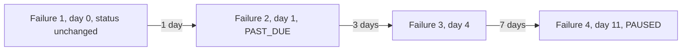

# Dunning and Failures

Dunning is how Levy handles a payment that does not go through. The contract records each failed pull on-chain, spaces the recorded failures on a 1, 3, then 7 day schedule that nobody can speed up, marks the subscription PAST_DUE at the plan's `maxFailed` failures, and pauses it automatically at twice that. The keeper retries on the same schedule and tells the merchant through webhooks. The merchant tells the subscriber: Levy sends no subscriber email.

## What a failed pull does on-chain

A pull fails when the subscriber's USDC balance or allowance is too small, the allowance was revoked, or a Permit2 allowance expired. `charge` does not revert on it. It calls `_recordFailure`:

1. If `block.timestamp < lastFailedAt + retryGap(failedAttempts)`, revert `RetryTooSoon`. The whole call is undone and nothing is recorded.
2. Set `lastFailedAt` to now, add one to `failedAttempts`, and emit `ChargeFailed(subId, failedAttempts)`.
3. If `failedAttempts >= maxFailed`, set the status to PAST_DUE.
4. If `failedAttempts >= 2 * maxFailed`, set the status to PAUSED and emit `AutoPaused`. The product is computed in 256 bits: a `uint8` product once overflowed for `maxFailed` of 128 or more and made every failed pull revert (fixed 2026-09-25).

`nextChargeAt` and `credit` are untouched, so every retry targets the same missed cycle and any proration credit survives.

| Failures since the last success or resume | Status | Events |
|---|---|---|
| 1 to `maxFailed - 1` | Unchanged (a trial subscription stays TRIAL) | `ChargeFailed` |
| `maxFailed` to `2 * maxFailed - 1` | PAST_DUE | `ChargeFailed` |
| `2 * maxFailed` | PAUSED | `ChargeFailed`, `AutoPaused` |

With `maxFailed = 1` the first failure already makes the subscription PAST_DUE and the second pauses it.

PAST_DUE is a label, not a lock. TRIAL, ACTIVE and PAST_DUE are all chargeable, and one successful charge (or a plan change that pays) returns the subscription to ACTIVE with the count reset to 0. A PAUSED subscription cannot be charged until it is resumed.

## The retry gaps

`retryGap(failures)` is the minimum time after the last recorded failure before the next one may be recorded:

| Failures recorded so far | Wait before the next failure can be recorded |
|---|---|
| 0 | None: the first failure is recorded as soon as the cycle is due |
| 1 | 1 day |
| 2 | 3 days |
| 3 or more | 7 days |

Only failing calls are held back. If the pull would succeed, `charge` collects at once, even inside a gap, so a subscriber who tops up is collected by the next call (`test_topUpDuringTheGapIsCollected`, `test_successIsNeverHeldBack`).

**Why a stranger cannot accelerate it.** `charge` is permissionless, so the gaps are enforced in the contract and not only by the keeper. A failing call inside the window reverts `RetryTooSoon`, and several calls in one transaction revert the whole transaction (`test_loopInOneTransactionReverts`). A griefer who calls every day records failures only on days 0, 1, 4 and 11, the days the keeper would (`test_dailyGrieferCannotPauseBeforeTheSchedule`). Earlier versions were weaker: back-to-back failures in one block (finding H-1, 2026-09-25 review), then a flat one-day gap that allowed a pause on day 3 instead of day 11 (finding 2, 2026-10-02 review). The current testnet deployment enforces the schedule.

## Earliest auto-pause

Auto-pause happens at failure number 2m, where m is `maxFailed`. The wait after failure 1 is 1 day, after failure 2 it is 3 days, and after every later failure it is 7 days. The earliest pause is the sum of the waits between failure 1 and failure 2m:

- m = 1: one wait, so 1 day.
- m of 2 or more: 1 + 3 + 7 × (2m - 3) days. Failures 3 through 2m - 1 each add 7 days, and there are 2m - 3 of them.

PAST_DUE arrives at failure m: 0 days after the first failure for m = 1, 1 day for m = 2, and 4 + 7 × (m - 3) days for m of 3 or more.

| `maxFailed` | PAST_DUE no earlier than | Auto-pause no earlier than |
|---|---|---|
| 1 | Day 0 (first failure) | Day 1 |
| 2 | Day 1 | Day 11 |
| 3 | Day 4 | Day 25 |
| 4 | Day 11 | Day 39 |
| 5 | Day 18 | Day 53 |

Days count from the first recorded failure. For m = 2 the failures fall on days 0, 1, 4 and 11, which `test_failuresFollowTheDunningSchedule` asserts to the second. These are floors: the keeper's polling adds a few seconds to each step.

## Resume is a fresh start

`resumeSubscription` can be called by the subscriber, or by the merchant for a pause it made itself, and only on a PAUSED subscription (anything else reverts `NotChargeable`). An auto-pause or a pause by the subscriber is the subscriber's to resume: a merchant trying reverts `NotSubscriber`.

- If `nextChargeAt` has passed it moves to now, so paused cycles are never billed and an overdue cycle is forgiven. If it is still in the future (days already paid), it stays.
- `failedAttempts` resets to 0 and `lastFailedAt` is deleted, so the next failure is recorded at once instead of being held for a day (`test_resumeResetsTheTimer`).
- The status becomes ACTIVE.

A resumed subscription whose allowance is still empty starts a full new run: its next failure counts as failure 1 and sends a new `dunning.started`. Pausing and resuming has the same effect, so a subscriber can restart the run. The cost falls on the keeper, which pays gas for at most 2m failing transactions per run (`SECURITY_REVIEW.md` section 3).

## The keeper's side

The keeper learns about a failure from the `ChargeFailed` event, whoever sent the transaction. It stores a row in its `dunning` table with the attempt number and `nextRetryAt`, which is the chain time at which it indexed the failure plus the matching entry of `LEVY_DUNNING_DAYS` (default `1,3,7`; attempts past the end of the list reuse the last entry).

Each charge cycle (every 30 seconds by default) the keeper makes two passes:

1. **Due sweep.** It charges TRIAL and ACTIVE subscriptions whose `nextChargeAt` has passed and that have no dunning row. PAST_DUE subscriptions, and any subscription with a dunning row, are left out on purpose, so a failing subscription is not hit every cycle.
2. **Retry sweep.** For each dunning row whose `nextRetryAt` has arrived it calls `charge` again. If the subscription is no longer TRIAL, ACTIVE or PAST_DUE (cancelled, paused, auto-paused), it deletes the row instead.

A `Charged` event deletes the row, and so does `Resumed`. PAST_DUE subscriptions live entirely on this schedule, retried until they pay or auto-pause. The keeper never pauses anything: auto-pause happens inside `charge`. If the keeper database is lost, PAST_DUE subscriptions have no row and are not retried.

`LEVY_DUNNING_DAYS` can lengthen the gaps but never shorten them, and longer gaps push the auto-pause out by the same amount. A retry earlier than `retryGap` allows reverts `RetryTooSoon`, which the keeper treats like any non-payment error: it re-reads the subscription and backs off 1 minute, 5, 15, 1 hour, then every 6 hours (in memory, so a restart tries once more). A charge that reverts because USDC refuses a payout gets the same backoff.

A successful retry starts a fresh cycle at the payment: `nextChargeAt` becomes the payment time plus one cycle, and the overdue time is forgiven, as with resume. However long the subscription was failing (a daily plan that failed for four days, say), the recovery pulls one cycle and the next charge is a full cycle away. Before the 2026-10-24 review the retry advanced the date one cycle from the missed one, so such a subscription was still overdue and was charged again at once, once per missed cycle.

## Webhooks during dunning

The keeper delivers these from its own delivery loop to the merchant's https endpoints, signed with Ed25519 ([Webhooks](Webhooks.md)).

| Event | When | Extra payload fields |
|---|---|---|
| `charge.failed` | Every recorded failure | `failedAttempts`, `txHash`, `blockNumber` |
| `dunning.started` | Only when `failedAttempts` is 1, so again after a success or resume | `nextRetryAt` (unix seconds) |
| `subscription.paused` | An auto-pause (`auto: true`, same transaction as the last `charge.failed`) or a manual pause (`auto: false`) | `auto` |
| `charge.succeeded`, `invoice.ready` | A retry collects | `amount`, `fee`, `invoiceRef`, `chargeCount`, `txHash`, `blockNumber` |
| `subscription.resumed` | A resume | none |

Every payload also carries `subId`, `merchant` and `ref`. There is no PAST_DUE event: compare `failedAttempts` with the plan's `maxFailed`, which the public `GET /api/plans` returns. The `subscription.paused` payload carries no failure count.

## Telling subscribers

The merchant sends the notice from its own system, triggered by these webhooks. The full copy is in [docs/dunning-copy.md](https://github.com/RunTimeAdmin/levy/blob/main/docs/dunning-copy.md).

| Notice | Trigger |
|---|---|
| 1. First failed charge | `charge.failed` with `failedAttempts` 1 (arrives with `dunning.started`) |
| 2. Retry scheduled | `charge.failed` with `failedAttempts` 2 or more, when neither 3 nor 4 applies |
| 3. Past due | `charge.failed` with `failedAttempts` equal to the plan's `maxFailed` |
| 4. Auto-paused | `subscription.paused` with `auto: true` |
| 5. Successful retry | `charge.succeeded` for a subscription that failed before |
| 6. Approval running low | `allowance.low` |

Send one notice per failure, the highest-numbered one that applies. `subscription.paused` can arrive after `charge.failed`, so choose between notices 3 and 4 from `failedAttempts` and `maxFailed` instead of waiting for it. The placeholders come from:

- `{amount}`: `priceUsdc` from `GET /api/subscriptions/:id`, because `charge.failed` carries no amount. Amounts in webhook payloads are 6-decimal units (1 USDC = 1,000,000).
- `{n}`: `failedAttempts` from the payload; for notice 4 it is `2 * maxFailed`.
- `{days}`: days until `nextRetryAt`, from `dunning.started` for the first failure and from `dunning.nextRetryAt` in `GET /api/subscriptions/:id` after that.
- Portal link: `https://<your Levy host>/portal.html`, where the subscriber tops up the allowance and resumes.

A subscriber fixes a failing subscription by topping up USDC or approving more. The next scheduled retry collects it, or the next `charge` call from anyone. An auto-paused subscription also needs a resume, from the subscriber in the portal; the merchant cannot resume it.

## Source files

- [src/SubscriptionManager.sol](https://github.com/RunTimeAdmin/levy/blob/main/src/SubscriptionManager.sol)
- [test/FailureCooldown.t.sol](https://github.com/RunTimeAdmin/levy/blob/main/test/FailureCooldown.t.sol)
- [test/Levy.t.sol](https://github.com/RunTimeAdmin/levy/blob/main/test/Levy.t.sol)
- [keeper/src/dunning.ts](https://github.com/RunTimeAdmin/levy/blob/main/keeper/src/dunning.ts)
- [keeper/src/keeper.ts](https://github.com/RunTimeAdmin/levy/blob/main/keeper/src/keeper.ts)
- [keeper/src/indexer.ts](https://github.com/RunTimeAdmin/levy/blob/main/keeper/src/indexer.ts)
- [keeper/src/webhooks.ts](https://github.com/RunTimeAdmin/levy/blob/main/keeper/src/webhooks.ts)
- [keeper/src/db.ts](https://github.com/RunTimeAdmin/levy/blob/main/keeper/src/db.ts)
- [keeper/src/config.ts](https://github.com/RunTimeAdmin/levy/blob/main/keeper/src/config.ts)
- [docs/dunning-copy.md](https://github.com/RunTimeAdmin/levy/blob/main/docs/dunning-copy.md)
- [docs/merchant-guide.md](https://github.com/RunTimeAdmin/levy/blob/main/docs/merchant-guide.md)
- [SECURITY_REVIEW.md](https://github.com/RunTimeAdmin/levy/blob/main/SECURITY_REVIEW.md)
