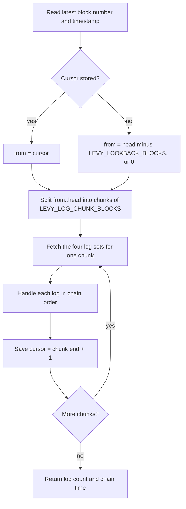

# Event Indexer and Database

The indexer turns SubscriptionManager events into rows in a local SQLite file. The keeper and the API both read that file. For plans and subscriptions the chain stays the source of truth: the indexer re-reads them from the contract instead of rebuilding them from event fields. The database owns what the chain does not hold: dunning schedules, webhook registrations and delivery logs, allowance snapshots and API sign-in state.

Amount columns are TEXT holding base-10 integers in 6-decimal USDC units (1 USDC = 1,000,000). Time columns are unix seconds.

## What the indexer reads

Every sync chunk makes four `eth_getLogs` calls, one at a time (parallel calls trip public RPC rate limits):

| # | Contract | Filter | Used for |
|---|---|---|---|
| 1 | SubscriptionManager | every event | Subscription state, charges, failures, webhooks |
| 2 | USDC | `Transfer` with `to` = manager | `usdc_transfers` |
| 3 | USDC | `Transfer` with `from` = manager | `usdc_transfers` |
| 4 | USDC | `Approval` with `spender` = manager | Marks the owner's allowance snapshot stale |

The USDC queries are always scoped. On Arc, USDC is the gas token, so an unfiltered query returns thousands of logs per 500 blocks (the keeper README measured about 4,000 on testnet) and providers refuse it. The results are merged and sorted by block number and log index, so events are handled in the order they happened.

## The sync procedure

- **Cursor.** `sync_state` holds one key, `manager_events_from_block`, the next block to read. It moves after every chunk, so a failure part-way through a long catch-up loses at most one chunk.
- **Chunking.** Ranges are inclusive and at most `LEVY_LOG_CHUNK_BLOCKS` blocks (default 500; some providers reject 1,000). A keeper that was down for a day is about 172,800 blocks behind, which is 346 chunks and roughly 1,400 requests.
- **First boot.** With no cursor, the first sync scans back `LEVY_LOOKBACK_BLOCKS` (default 5000, about 40 minutes). If the keeper starts long after deployment, raise it to reach the deploy block (the testnet deployment is at block 65201372), or older charge history is never indexed.
- **Transport.** The RPC client retries a failed request 4 times with a doubling delay starting at 1 second (about 15 seconds in total) before the cycle fails.
- **Chain time.** The sync returns the latest block's timestamp. Failure and dunning records are stamped with it, so retry math agrees with due math.

## Backfill

At every start the keeper calls `backfillAll()`: it reads `planCount` and `subCount` from the contract, then refreshes every plan, the merchant account of every plan (three reads each: `ownerOf`, `accountPayout`, `pendingOwner`) and every subscription (three contract reads for a subscription on a plain plan, more as below). This hydrates a fresh database and repairs drift in an old one. It does not touch charges, failures, dunning or webhooks, and it emits no webhooks.

## How events update the database

| Event | Database effect | Webhook events queued |
|---|---|---|
| `PlanCreated`, `PlanRetired` | Read the plan and upsert it into `plans` | none |
| `Subscribed` | Refresh the subscription (and its plan) | `subscription.created` |
| `Charged` | Insert into `charges`, delete the `dunning` row, refresh the subscription, mark the payer's funds stale | `charge.succeeded`, `invoice.ready` |
| `ChargeFailed` | Insert into `charge_failures`, write the `dunning` row, refresh the subscription | `charge.failed`, plus `dunning.started` on the first failure |
| `Paused` | Refresh | `subscription.paused` with `auto: false` |
| `AutoPaused` | Refresh | `subscription.paused` with `auto: true` |
| `Resumed` | Delete the `dunning` row, then refresh | `subscription.resumed` |
| `Cancelled` | Refresh | `subscription.cancelled` |
| `PlanChanged` | Refresh | `subscription.updated` |
| `Completed` | Refresh | `subscription.completed` |
| `TransferProposed` | Refresh, which records the offered wallet in `pendingTransfer` | none |
| `SubscriptionTransferred` | Refresh, which writes the new `subscriber`, then mark both wallets' funds stale | `subscription.transferred` |
| `PayoutChanged`, `OwnershipTransferStarted`, `OwnershipTransferred` | Read the account's owner, fixed payout and pending owner and upsert `merchant_accounts` | `merchant.updated` |
| USDC `Transfer` | Insert into `usdc_transfers` | none |
| USDC `Approval` to the manager | Mark the owner's `subscriber_funds` row stale | none |

A refresh reads `subscriptions(subId)`, `plans(planId)` and `subscriptionRef(subId)` at the chain head, plus `pausedByMerchant(subId)` when the subscription is PAUSED, `introCyclesLeft(subId)` when the plan has intro pricing, `planCycles(subId)` when it has a cycle limit and `pendingTransfer(subId)` when it is transferable, and upserts the row, so it reflects chain state at sync time even if later events are still unread. Each extra read happens only for plans that use the feature, so a plain plan costs no more RPC reads than before v2. A zero `ref` and a zero `pendingTransfer` are stored as NULL. The webhook for each subscription event is built after the refresh, using the merchant account from the refreshed row; `merchant.updated` is built from the account row the event just refreshed. The `allowance.low` webhook is not a contract event; the keeper's allowance check queues it ([Keeper Service](Keeper-Service.md)). Payload fields are in [Webhooks](Webhooks.md).

### Replay and duplicates

The cursor is saved after a chunk is handled, so a crash mid-chunk re-reads that chunk. `charges` (unique on `txHash` and `chargeCount`) and `usdc_transfers` (primary key on `txHash` and `logIndex`) ignore repeats, and the upserts are idempotent. `charge_failures` has no unique key, and a replayed event queues new webhook deliveries under new delivery ids, so both can duplicate in that rare case.

## Schema

The schema is created with `CREATE TABLE IF NOT EXISTS` when the database opens. One migration exists: it adds any missing column to files created before it, namely `ref`, `pausedByMerchant`, `introCyclesLeft`, `planCycles` and `pendingTransfer` on `subscriptions`, and `retired`, `transferable`, `maxCycles`, `introPrice` and `introCycles` on `plans`. There are no foreign keys; tables relate by id. Address columns can differ in letter case between rows, so the queries that need it compare with `COLLATE NOCASE`.

### Chain mirror and billing records

| Table | Key | Main columns | Purpose |
|---|---|---|---|
| `plans` | `planId` | `merchant`, `price`, `cycleSeconds`, `trialSeconds`, `maxFailed`, `retired`, `transferable`, `maxCycles`, `introPrice`, `introCycles` | Mirror of the plan registry, including plans nobody has joined. `merchant` is the plan's merchant account. Only `retired` changes on-chain; the upsert rewrites it and the other v2 columns, which also fills them in on rows from before they existed. `introPrice` is `'0'` without intro pricing. |
| `merchant_accounts` | `account` (NOCASE) | `owner`, `payout`, `pendingOwner` | Mirror of `ownerOf`, `accountPayout` and `pendingOwner` for accounts the keeper has read: every plan's account at backfill, and any account with a payout or ownership event. `payout` and `pendingOwner` are NULL when unset. An account with no row owns itself and is paid itself. The API's ownership checks read it. |
| `subscriptions` | `subId` | `subscriber`, `planId`, `merchant`, `price`, `cycleSeconds`, `status`, `nextChargeAt`, `failedAttempts`, `ref`, `pausedByMerchant`, `introCyclesLeft`, `planCycles`, `pendingTransfer` | Each subscription with its plan terms; `merchant` is the plan's account and `price` its full price. `status`: 0 TRIAL, 1 ACTIVE, 2 PAST_DUE, 3 PAUSED, 4 CANCELLED, 5 COMPLETED. `ref` is the merchant's bytes32 reference or NULL. `pausedByMerchant` is 1 while the merchant's own pause holds the subscription (the only pause the merchant may resume), else 0. `introCyclesLeft` and `planCycles` are kept only for plans that use intro pricing or a cycle limit, and 0 otherwise. `pendingTransfer` is the wallet offered the subscription, or NULL. The upsert rewrites `subscriber` too, since a subscription can move to a new wallet. |
| `charges` | `id`, unique (`txHash`, `chargeCount`) | `subId`, `amount`, `fee`, `invoiceRef`, `txHash`, `blockNumber`, `chargeCount` | One row per `Charged` event. These are the invoices. `amount` is 0 when proration credit covered the cycle. |
| `charge_failures` | `id` | `subId`, `failedAttempts`, `txHash`, `blockNumber`, `at` | One row per `ChargeFailed` event. `at` is chain time when the log was indexed. |
| `dunning` | `subId` | `attempts`, `nextRetryAt`, `updatedAt` | The open retry schedule. It exists from a failure until a charge succeeds, the subscription resumes, or the keeper finds the subscription no longer chargeable. |
| `usdc_transfers` | (`txHash`, `logIndex`) | `fromAddr`, `toAddr`, `amount`, `blockNumber` | USDC moving into or out of the manager, kept for visibility. Nothing reads it at runtime. |

`dedupedTransfers()` collapses identical movements within one transaction (the EIP-7708 case where native and ERC-20 faces both emit). It can also merge two genuinely identical transfers in one transaction, so never use it for reconciliation. Charge truth comes from `Charged` and `ChargeFailed`.

### Keeper state, webhooks and API sign-in

| Table | Key | Main columns | Purpose |
|---|---|---|---|
| `sync_state` | `key` | `value` | The log cursor. |
| `subscriber_funds` | `subscriber` (NOCASE) | `allowance`, `balance`, `per_cycle`, `cycles_covered`, `low`, `checked_at` | Allowance runway per subscriber. `checked_at` of 0 forces a recheck. `cycles_covered` is capped at 1,000,000 so unlimited approvals fit. |
| `webhooks` | `id` | `merchant`, `url`, `events` (JSON array), `active`, `created_at` | Merchant endpoints. Written by the API; deleting one removes the row. |
| `webhook_deliveries` | `id`; index on (`status`, `next_retry_at`) | `webhook_id`, `event_type`, `payload`, `status`, `attempts`, `next_retry_at`, `created_at`, `last_error` | One row per event per endpoint. `payload` is the exact canonical JSON that is posted. `webhook_id` has no foreign key, so rows survive endpoint deletion and are dead-lettered on the next pass. |
| `auth_challenges` | `nonce` | `address`, `message`, `expires_at` | Single-use sign-in messages, consumed by one `DELETE ... RETURNING`. Expired rows are purged when a new challenge is created. |
| `sessions` | `token_hash` | `address`, `expires_at` | SHA-256 of the bearer token only. Expired rows are purged when a session is created. |

## What the API reads

The API opens the same file through the same `LevyDb` class and holds no chain connection of its own.

| Endpoint | Tables |
|---|---|
| `GET /api/plans` | `plans` |
| `GET /api/accounts` | `merchant_accounts`, which every merchant route also reads to check that the signed-in address owns the account |
| `GET /api/subscriptions`, `/api/subscriptions/:id` | `subscriptions` joined to `subscriber_funds`; the detail view adds `charges` and `dunning` |
| `GET /api/funds` | `subscriber_funds` |
| `GET /api/metrics` | `subscriptions`, `charges`, `charge_failures`, `dunning` |
| `GET /api/dunning` | `dunning` joined to `subscriptions` |
| `GET /api/charges`, `/api/invoices` | `charges` joined to `subscriptions` |
| `/api/webhooks` (list, register, toggle, delete) | `webhooks` (the only table besides sign-in that the API writes) |
| `GET /api/deliveries` | `webhook_deliveries` joined to `webhooks`, so only the caller's endpoints appear |
| `/api/auth/*` | `auth_challenges`, `sessions` |

See [API Reference](API-Reference.md) and [Authentication](Authentication.md).

## Operating the database

- **Engine.** Node's built-in `node:sqlite`. WAL journal mode and a 5-second busy timeout let the API's small writes and the keeper's work share the file. Reading it with the `sqlite3` CLI while the keeper runs is safe.
- **Back it up.** If the file is deleted, plans, their merchant accounts and subscriptions return from chain at the next start. Webhook registrations, delivery logs, charge history older than the lookback, dunning schedules and API sessions do not. PAST_DUE subscriptions without a dunning row are not retried.
- **No pruning.** Nothing deletes old `charges`, `charge_failures`, `webhook_deliveries` or `usdc_transfers`. Only expired sign-in rows are cleaned up.

## Source files

- [keeper/src/indexer.ts](https://github.com/RunTimeAdmin/levy/blob/main/keeper/src/indexer.ts)
- [keeper/src/db.ts](https://github.com/RunTimeAdmin/levy/blob/main/keeper/src/db.ts)
- [keeper/src/webhooks.ts](https://github.com/RunTimeAdmin/levy/blob/main/keeper/src/webhooks.ts)
- [keeper/src/dunning.ts](https://github.com/RunTimeAdmin/levy/blob/main/keeper/src/dunning.ts)
- [api/src/server.ts](https://github.com/RunTimeAdmin/levy/blob/main/api/src/server.ts)
- [keeper/README.md](https://github.com/RunTimeAdmin/levy/blob/main/keeper/README.md)
