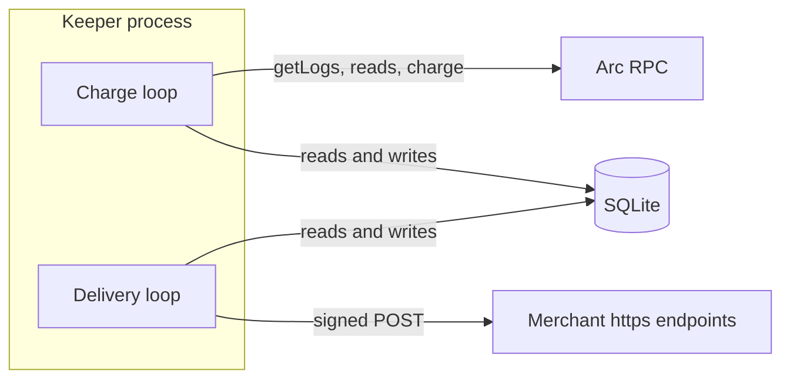
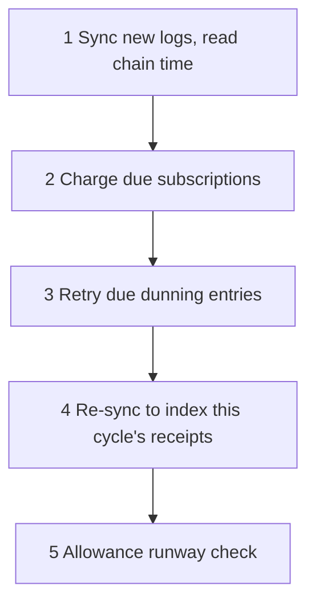

# Keeper Service

The keeper is the off-chain process that makes Levy billing happen. It indexes the SubscriptionManager contract into a SQLite database, calls the permissionless `charge()` function when a subscription comes due, retries failed pulls on the dunning schedule, warns merchants when a subscriber's allowance is running low, and delivers signed webhooks. It is one Node.js process running two independent loops. Its key only pays gas: `charge()` can move a subscriber's pre-approved USDC only to the payout of the plan's merchant account and the fee router, so the keeper has no authority over anyone's funds.

Amounts in the database and in webhooks are 6-decimal USDC units: 1 USDC = 1,000,000.

## The two loops

| Loop | Interval variable | Default | Work per pass |
|---|---|---|---|
| Charge loop | `LEVY_POLL_MS` | 30000 ms | One charge cycle (below) |
| Delivery loop | `LEVY_WEBHOOK_POLL_MS` | 5000 ms | POST due webhooks to merchant endpoints ([Webhooks](Webhooks.md)) |

Each loop sleeps its interval after a pass finishes, so the interval is the gap between passes, not a fixed rate. A pass that throws is logged and the loop carries on. The loops are separate so a slow or dead merchant endpoint can delay webhooks but never charging. Settings are in [Keeper Configuration](Keeper-Configuration.md).

## One charge cycle

1. **Sync.** `Indexer.sync()` fetches logs since the stored cursor, applies them to the database, and returns the head block's timestamp. That timestamp is "now" for the rest of the cycle. Details in [Event Indexer and Database](Event-Indexer-and-Database.md).
2. **Charge due.** Each due subscription is charged in order of `nextChargeAt`, skipping any that are backing off. The keeper sends `charge(subId)`, waits for the receipt and decodes its logs.
3. **Dunning retries.** For every dunning row whose `nextRetryAt` has passed, the keeper skips subscriptions it already handled in step 2. If the subscription is missing or no longer TRIAL, ACTIVE or PAST_DUE (cancelled, paused by hand, or auto-paused on-chain), it deletes the row. Otherwise it calls `charge()`.
4. **Re-sync.** A second `sync()` brings this cycle's `Charged` and `ChargeFailed` events into the database and the webhook queue immediately. The keeper writes no charge outcome itself; the indexer records everything from events.
5. **Allowance runway.** A bounded batch of subscribers is checked (see below).

Transactions are sent one at a time and each waits for its receipt, so nonces stay ordered.

## How due work is chosen

| Query | Selects | Order |
|---|---|---|
| Due subscriptions | status TRIAL or ACTIVE, `nextChargeAt` at or before chain time, and no row in `dunning` | `nextChargeAt` ascending |
| Due retries | `dunning` rows with `nextRetryAt` at or before chain time | `nextRetryAt` ascending |

PAST_DUE subscriptions are deliberately left out of the first query: after a failed pull, the dunning schedule owns the retries. The consequence is that a PAST_DUE subscription with no dunning row is never retried, which happens if the database is deleted and rebuilt from chain.

A charge normally advances `nextChargeAt` by one cycle from its stored value, so a late keeper keeps the billing date. After failed attempts, or when a whole cycle went by uncharged (a keeper outage), it moves to the payment time plus one cycle instead, so a successful charge never leaves the subscription due again: an overdue subscription is charged once, not once per missed cycle.

## What a charge call can produce

`charge()` does not revert when the pull fails for lack of allowance or balance; it records the failure and emits `ChargeFailed`. The keeper reads the receipt to tell the outcomes apart.

| Receipt | Treated as | What happens next |
|---|---|---|
| `Charged` for this subscription | Success | Backoff cleared. The indexer stores the charge and clears the dunning row. |
| `ChargeFailed` | Payment failure | Backoff cleared. The indexer stores the failure and writes a dunning row. |
| Revert, RPC error, or no `Charged` event | Error | The keeper re-reads the subscription from chain (a stale row is the usual cause) and backs off. |

### Error backoff

Errors would otherwise repeat every cycle forever. The keeper delays them by consecutive failure count:

| Consecutive errors | 1 | 2 | 3 | 4 | 5 and later |
|---|---|---|---|---|---|
| Delay | 1 min | 5 min | 15 min | 1 h | 6 h |

The backoff map lives in memory, so a restart tries each stuck subscription once more. Payment failures never use this map; they use the dunning schedule.

## Dunning

When the indexer sees `ChargeFailed` with attempt number N, it sets `nextRetryAt` to the chain time of that sync plus entry N of `LEVY_DUNNING_DAYS` (default `1,3,7`; later attempts reuse the last value). The contract enforces the same minimum gaps with `retryGap`: 1 day after the first failure, 3 after the second, 7 after each later one. Configured gaps can be longer but not shorter, since an early retry reverts with `RetryTooSoon` and lands in the error backoff. A successful charge deletes the dunning row. The contract sets PAST_DUE at `maxFailed` failures and auto-pauses at twice that, inside `charge()`; the keeper never pauses anything. See [Dunning and Failures](Dunning-and-Failures.md).

## Allowance runway

A subscriber's USDC allowance to the SubscriptionManager is one pool shared by all their Levy subscriptions, so when it runs out every charge fails. Each cycle the keeper checks up to 50 subscribers who have chargeable subscriptions and whose last check is missing or more than 6 hours old. It reads their allowance and balance (two RPC calls each) and prices each chargeable subscription's next charges as they will be billed: intro cycles left at the plan's intro price, the rest at its price, and none past a limited plan's last cycle (`maxCycles` minus `planCycles`). `perCycle` is the next charge of every subscription, and `cyclesCovered` is `allowance / perCycle`. Low means the allowance does not cover the next 2 charges of all of them, so a limited plan with one payment left needs only that one covered, and a plan whose remaining payments are all covered is never low.

When a subscriber goes from not low to low, each affected subscription's merchant gets one `allowance.low` webhook. It repeats only after the allowance recovers and runs low again. A charge, or an `Approval` to the manager (a top-up), marks the subscriber for a recheck on the next cycle, and so does a subscription transfer, for both the old and the new wallet. Only the direct ERC-20 allowance is read, so a subscriber who used Permit2 is flagged low ([Permit2](Permit2.md)).

## Single instance

Run one keeper per deployment. A second one adds no capability: once a successful call has moved `nextChargeAt` past the current time, the other call reverts with `NotChargeable`, and a second failing call inside the retry gap reverts with `RetryTooSoon`, so it cannot speed up dunning. It does duplicate every log query and can waste gas on a call that loses a race. Within one keeper, a subscription is charged at most once per cycle.

## Chain time and wall time

Due, dunning and backoff math uses the timestamp of the latest block, because the contract compares `nextChargeAt` against `block.timestamp`. This keeps the keeper correct across clock skew on its host and across time warps in tests. Arc has single-block deterministic finality, so the indexer has no reorg handling. The delivery loop and webhook signatures use the wall clock; on Arc, with roughly half-second blocks, the two agree closely.

## Gas

The keeper's account pays gas for every `charge()` it sends, and on Arc gas is paid in USDC. The account's native balance has 18 decimals, while the ERC-20 face of the same USDC has 6. A keeper with no gas stops charging entirely. [Monitoring and Maintenance](Monitoring-and-Maintenance.md) covers balance alerts (`ops/monitoring.md` estimates about 0.003 USDC per charge), and [Keeper Configuration](Keeper-Configuration.md) covers key handling.

## Startup and shutdown

At start the keeper loads its configuration, opens the database and runs `backfillAll()`, which re-reads every plan, every plan's merchant account and every subscription from the contract and rewrites those rows. This happens on every start, not only the first, and it emits no webhooks. Then both loops start. On `SIGINT` or `SIGTERM` each loop stops after its current pass and sleep, and the database is closed. `npm run once` runs one charge cycle and one delivery pass, then exits.

## Source files

- [keeper/src/index.ts](https://github.com/RunTimeAdmin/levy/blob/main/keeper/src/index.ts)
- [keeper/src/keeper.ts](https://github.com/RunTimeAdmin/levy/blob/main/keeper/src/keeper.ts)
- [keeper/src/indexer.ts](https://github.com/RunTimeAdmin/levy/blob/main/keeper/src/indexer.ts)
- [keeper/src/dunning.ts](https://github.com/RunTimeAdmin/levy/blob/main/keeper/src/dunning.ts)
- [keeper/src/funds.ts](https://github.com/RunTimeAdmin/levy/blob/main/keeper/src/funds.ts)
- [keeper/src/config.ts](https://github.com/RunTimeAdmin/levy/blob/main/keeper/src/config.ts)
- [src/SubscriptionManager.sol](https://github.com/RunTimeAdmin/levy/blob/main/src/SubscriptionManager.sol)
- [keeper/README.md](https://github.com/RunTimeAdmin/levy/blob/main/keeper/README.md)
