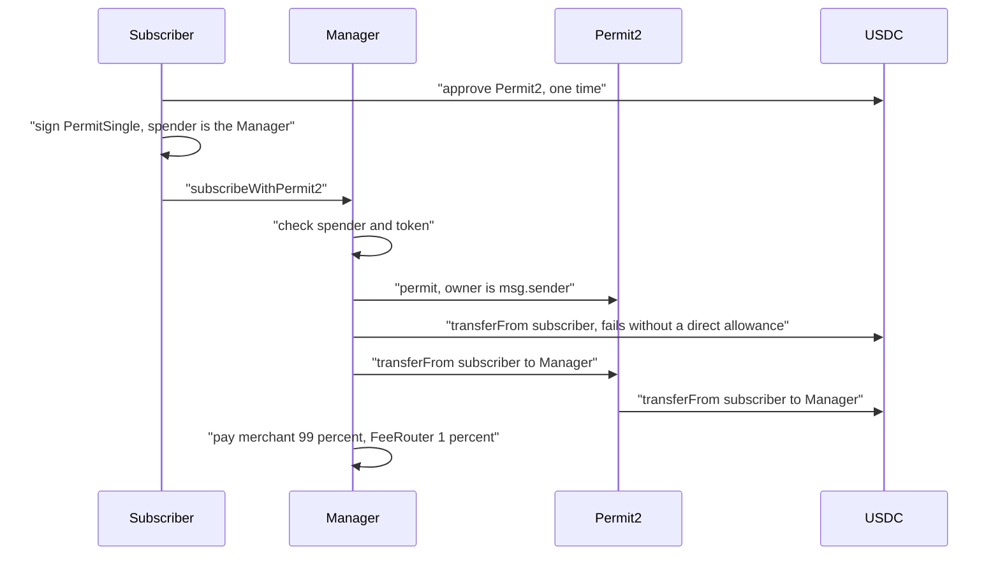

# Permit2

`subscribeWithPermit2` lets a subscriber start a subscription in one transaction. They sign an off-chain permit that authorizes the SubscriptionManager to pull USDC through Uniswap's Permit2 contract, then submit the signature together with the subscribe call. It is the alternative to a plain `approve` followed by `subscribe`. Every later pull tries the subscriber's direct USDC allowance first and falls back to the Permit2 allowance, so a Permit2 subscriber needs no direct approval at all.

Amounts are 6-decimal USDC units: 1 USDC = 1,000,000.

## The Permit2 address

Permit2 is at the canonical `0x000000000022D473030F116dDEE9F6B43aC78BA3`, the same address as on Ethereum, and has code on both Arc testnet and Arc mainnet ([VERIFICATION.md](https://github.com/RunTimeAdmin/levy/blob/main/VERIFICATION.md)). The manager takes the address as a constructor argument and keeps it as the immutable `permit2`; the live testnet manager returns the canonical address. `script/Deploy.s.sol` refuses to deploy when there is no code at the address, and on mainnet when it is not the canonical one. The constant `PERMIT2_ARC` records the address for reference only; the logic uses the immutable.

## What `subscribeWithPermit2` does

`subscribeWithPermit2(planId, ref, permitSingle, signature)` is `nonReentrant` and runs in this order:

1. Revert `BadPermitSpender` unless `permitSingle.spender` is the manager.
2. Revert `BadPermitToken` unless `permitSingle.details.token` is USDC.
3. Call `permit2.permit(msg.sender, permitSingle, signature)`. Permit2 verifies the EIP-712 signature against `msg.sender`, plus the signature deadline and nonce, and stores an allowance for (owner, USDC, manager). If `permit` reverts, the manager reads `permit2.allowance(msg.sender, USDC, manager)` and carries on when that allowance covers the plan's first billed cycle (its intro price when the plan has intro cycles, else its price) and has not expired; otherwise it re-throws Permit2's own error (see the front-run below).
4. Run the same `_subscribe` as `subscribe`: refuse a retired plan (`RetiredPlan`), store the subscription, emit `Subscribed`, and on a plan without a trial pull the first cycle. If that pull fails the call reverts `PaymentFailed`, and the permit is undone with it.

The two Levy checks run first so a signature for the wrong spender or token fails fast instead of creating an allowance Levy cannot use. Permit2 enforces everything else.

| `PermitSingle` field | Meaning | Checked by |
|---|---|---|
| `details.token` | Must be USDC | Levy |
| `spender` | Must be the manager | Levy, and Permit2 (it is signed) |
| `details.amount` | Total the manager may pull through Permit2 | Permit2, at pull time. Too small for the first cycle: `PaymentFailed`. Used up later: charges fail into dunning. |
| `details.expiration` | When the allowance lapses | Permit2, at pull time. After it, charges fail into dunning. |
| `details.nonce` | Must match Permit2's stored nonce for (owner, token, spender) | Permit2 |
| `sigDeadline` | Last moment the signature is valid | Permit2 |

On a plan with a trial nothing is pulled at subscribe, but the permit is still recorded and later charges use it.

## Why only the signer can submit it

The owner is always `msg.sender`; there is no `owner` parameter. The signed permit does not name a plan, so if a relayer could submit it, that relayer (or anyone who copied the signature from the mempool) could subscribe the signer to a plan of their own choosing and pull the first cycle at once. An earlier version took an `owner` argument so the keeper could relay. It was removed on 2026-09-25, and relaying could return only with a second signature that binds the plan. `testSubscribeWithPermit2OnlySignerCanSubmit` checks that any other submitter fails.

Someone who sees the signature in the mempool can still call Permit2's `permit` first and burn the nonce. That used to make `subscribeWithPermit2` revert (a low-severity gap, [SECURITY_REVIEW.md](https://github.com/RunTimeAdmin/levy/blob/main/SECURITY_REVIEW.md) section 6). Since the fix for finding L-2 of the 2026-10-24 review, the manager catches the failed `permit` and subscribes on the allowance the front-runner set, which is the one the subscriber signed (`testSubscribeWithPermit2SurvivesFrontRunPermit`). It still reverts with Permit2's error when that allowance is below the first cycle (`testSubscribeWithPermit2FailedPermitNeedsOneCycleAllowance`; on an intro plan the intro price is enough, `testSubscribeWithPermit2FallbackUsesTheIntroPrice`) or has expired (`testSubscribeWithPermit2IgnoresExpiredAllowance`). No funds are lost either way.

## How the pull uses it

`_tryPull` is the only place Levy moves a subscriber's USDC, and it serves `subscribe`, `charge` and `changePlan` alike:

1. Try `usdc.transferFrom(subscriber, manager, amount)`. A `true` return ends it; a revert or `false` moves on.
2. If `amount` exceeds the `uint160` maximum, fail (Permit2 amounts are `uint160`).
3. Try `permit2.transferFrom(subscriber, manager, amount, usdc)`. Success returns true. A revert returns false, and the caller treats it as any failed pull ([Dunning and Failures](Dunning-and-Failures.md)).

A direct allowance therefore wins whenever both exist (`testDirectAllowanceStillTakesPriority`), and a top-up from the customer portal, which is a plain `approve` to the manager, works for a Permit2 subscriber too. A Permit2 pull is capped by two allowances at once: the permit itself (amount and expiration) and the subscriber's USDC approval of the Permit2 contract. Each pull draws both down.

## One-time setup for a subscriber

1. **Approve Permit2 to spend USDC.** An ordinary `approve(Permit2, amount)` on the USDC contract, shared with every app that uses Permit2. Without it the pull fails even with a valid permit. The test script approves exactly what the chosen number of payments cost (default 12; intro payments at the intro price, and no more than a limited plan's payments) when the current approval is lower. It refuses a retired plan, and with no trial it checks the balance against the first payment.
2. **Sign the `PermitSingle`.** EIP-712, domain name `Permit2`, with the fields from the table above. Read the `nonce` from Permit2 for (owner, USDC, manager). The script uses a 365 day `expiration` and a 30 minute `sigDeadline`.
3. **Submit `subscribeWithPermit2` from the same wallet.** Without a trial, the wallet needs the first cycle's price in USDC at that moment.

The hosted checkout and the customer portal do not use Permit2; they run the plain approve and subscribe flow. The only Permit2 client in the repo is `keeper/scripts/permit2-subscribe.mjs`, a testnet script that refuses other chains and sends nothing until the operator types `yes`. It reads manager v2's `plans()` layout, so it works against a v2 deployment, not the testnet contracts from 2026-10-24 that soak 2 runs on. It also refuses a wallet that has contract code: Permit2 validates signatures from accounts with code through ERC-1271, and well-known test keys on public testnets are often taken over by EIP-7702 delegations that make Permit2 reject the signature. Use a fresh wallet.

## What the keeper's allowance warning sees

The keeper's runway check reads `USDC.allowance(subscriber, manager)` and the subscriber's balance. It never reads Permit2. A subscriber who used only Permit2 has a direct allowance of 0, which covers none of the next two charges, so the merchant gets one `allowance.low` webhook per subscription soon after subscribing, and the dashboard shows the same low reading. While the Permit2 allowance holds, charges keep succeeding and the warning is a false alarm. The reverse also holds: nothing warns when the permit's amount runs down or its expiration nears, so a Permit2 subscriber's first signal is `charge.failed`.

The portal's allowance panel and its Revoke button act on the direct allowance only. To stop Permit2 pulls without cancelling, the subscriber must clear the permit on Permit2 itself or set their USDC approval of Permit2 to 0, which affects every app that uses it. Cancelling the subscription is the clean stop.

## Testing and testnet status

- **Unit tests** use `MockPermit2`, which implements the real EIP-712 scheme and Permit2's allowance accounting (amount and expiration, enforced in `transferFrom`), and also requires the owner's USDC approval of the mock as the real contract does. They cover the full flow, only-signer, wrong spender, wrong token, a bad signature, direct-allowance priority, and a front-run permit with enough, too little or an expired allowance. The mock's error names differ from the real Permit2's. The keeper's anvil integration test does not exercise Permit2.
- **Soak wallet S5** subscribed to plan 1 through Permit2 on 2026-10-07 at 03:30:56 UTC (subscription 5), running the script against the live testnet contracts and Arc's real Permit2 ([ops/testnet-soak.md](https://github.com/RunTimeAdmin/levy/blob/main/ops/testnet-soak.md)). The script had been tested on a fork of Arc testnet on 2026-09-26. A read-only check on 2026-10-07 confirmed the first cycle came through Permit2: the subscription is ACTIVE with one charge (1,000,000 units pulled, 10,000 to the FeeRouter), the direct allowance to the manager is 0, and both the Permit2 allowance and the USDC approval of Permit2 fell from 12 USDC to 11 USDC.
- **Still open.** S5's first recurring charge, due 2026-10-08, is the first time `charge()` uses the Permit2 fallback against the real contract. Until the soak confirms recurring Permit2 charges, "Permit2 end to end against Arc" stays on the list to finish before mainnet.

## Source files

- [src/SubscriptionManager.sol](https://github.com/RunTimeAdmin/levy/blob/main/src/SubscriptionManager.sol)
- [src/IPermit2.sol](https://github.com/RunTimeAdmin/levy/blob/main/src/IPermit2.sol)
- [test/Levy.t.sol](https://github.com/RunTimeAdmin/levy/blob/main/test/Levy.t.sol)
- [test/mocks/MockPermit2.sol](https://github.com/RunTimeAdmin/levy/blob/main/test/mocks/MockPermit2.sol)
- [keeper/scripts/permit2-subscribe.mjs](https://github.com/RunTimeAdmin/levy/blob/main/keeper/scripts/permit2-subscribe.mjs)
- [keeper/src/keeper.ts](https://github.com/RunTimeAdmin/levy/blob/main/keeper/src/keeper.ts)
- [keeper/src/funds.ts](https://github.com/RunTimeAdmin/levy/blob/main/keeper/src/funds.ts)
- [script/Deploy.s.sol](https://github.com/RunTimeAdmin/levy/blob/main/script/Deploy.s.sol)
- [ops/testnet-soak.md](https://github.com/RunTimeAdmin/levy/blob/main/ops/testnet-soak.md)
- [SECURITY_REVIEW.md](https://github.com/RunTimeAdmin/levy/blob/main/SECURITY_REVIEW.md)
- [VERIFICATION.md](https://github.com/RunTimeAdmin/levy/blob/main/VERIFICATION.md)
