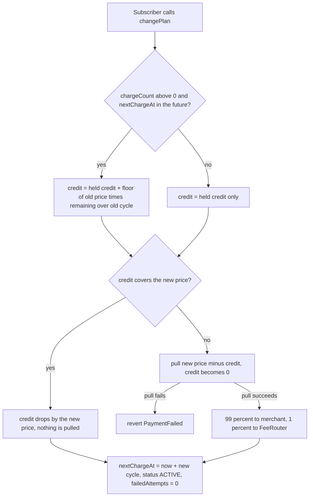

# Plan Changes and Proration

`changePlan` moves a subscriber to another plan of the same merchant. The new plan's first cycle starts and is billed right away, and the unused part of the cycle already paid for on the old plan becomes credit that pays for it. Credit that is left over carries forward and pays later cycles. There are no refunds: credit is only ever spent against the same merchant's plans.

USDC amounts are integers with 6 decimals (1 USDC = 1,000,000 units). The examples below are written in USDC, with the unit figures where rounding matters.

## Rules

| Rule | Detail |
|---|---|
| Who | The subscriber only (`NotSubscriber` otherwise). A merchant cannot move a subscriber |
| Which plan | Must exist (`UnknownPlan`), differ from the current one (`SamePlan`) and belong to the same merchant (`DifferentMerchant`) |
| Status | `TRIAL`, `ACTIVE` or `PAST_DUE`. A `PAUSED` or `CANCELLED` subscription reverts `NotChargeable`, so resume first |
| Payment | The new first cycle must be collectable. If the pull fails the whole call reverts `PaymentFailed` and nothing changes |

Credit only comes from a cycle that was actually paid, and it only moves between plans of the merchant who was paid. An earlier version credited unpaid time and allowed switching to another merchant's plan, which let a subscriber ride free cycles. It was fixed on 2026-09-25 and is covered by regression tests.

## What the call does

1. **Credit.** If the subscription has been charged at least once and `nextChargeAt` is still ahead, `remaining = nextChargeAt - now`, and

   `credit = heldCredit + floor(oldPrice * remaining / oldCycleSeconds)`

   The multiplication happens before the division, so the result is under 1 unit below the exact value. That remainder stays with the merchant, who already collected the full old price. `remaining` is clamped to one old cycle, so one change adds at most the old price. The clamp is a guard: every write to `nextChargeAt` puts it at most one cycle of the current plan ahead, so it does not bind today.
2. **Switch.** `planId` and `credit` are stored and `PlanChanged(subId, oldPlanId, newPlanId, credit)` is emitted. The `credit` field is the total available before the new cycle spends any of it.
3. **Bill.** The new plan's price is paid from credit first. If credit covers it, credit drops by the price and no USDC moves, so `Charged` shows `amount = 0, fee = 0`. If not, the difference is pulled, credit resets to 0, and the pull is split 99/1 with the fee rounded down.
4. **Reset.** `nextChargeAt = now + newCycleSeconds`, `failedAttempts = 0`, status `ACTIVE`, and `chargeCount` goes up by one. A past-due or trial subscription becomes active.

Events come out as `PlanChanged` then `Charged`. The keeper sends them as a `subscription.updated` webhook (with `oldPlanId`, `newPlanId` and `credit`) followed by `charge.succeeded`. See [Webhooks](Webhooks.md).

Credit is a bookkeeping entry on the subscription, not USDC held by the contract. The manager holds nothing at rest. The fee was taken when the old cycle was paid, so the part of a cycle covered by credit pays no second fee.

## Worked examples

Plans of one merchant: Basic 10 USDC and Pro 25 USDC, both 30 days.

**Upgrade, Basic to Pro, 12 days into the cycle (18 days left).**
Credit = 10,000,000 x 1,555,200 / 2,592,000 = 6,000,000 (6 USDC). Due = 25 minus 6 = 19 USDC. Fee 0.19 USDC, merchant receives 18.81 USDC. Credit is 0, `chargeCount` is 2, and the next charge is 30 days from now at the full 25 USDC.

**Downgrade, Pro to Basic, 12 days into the cycle.**
Credit = 25,000,000 x 18 / 30 = 15,000,000 (15 USDC), and `PlanChanged` reports 15 USDC. Basic costs 10 USDC, so credit covers it: nothing is pulled, `Charged` shows `amount = 0`, and 5 USDC of credit remains. Thirty days later the charge pulls only 5 USDC (fee 0.05, merchant 4.95), and credit is 0. The cycle after that pulls the full 10 USDC.

**Switch to a shorter cycle, Monthly 30 USDC (30 days) to Weekly 7 USDC (7 days), 10 days in.**
Credit = 30 x 20 / 30 = 20 USDC. Weekly costs 7, so 13 USDC remains. `nextChargeAt` moves to 7 days from now, earlier than the old date 20 days out. So the `nextChargeMonotonic` invariant only requires `nextChargeAt` to stay at or above `start`. The weekly charges then run: day 7 covered by credit (6 USDC left), day 14 pulls 1 USDC because credit falls short, day 21 pulls the full 7 USDC.

**Rounding, Basic to a 4 USDC plan one second after subscribing.**
`remaining` is 2,591,999 seconds. Exact credit is 9,999,996.14 units and the contract stores 9,999,996. Spending 4,000,000 on the new plan leaves 5,999,996 to carry.

`testChangePlanProrates` (10 to 20 USDC at day 15) and `testDowngradeCreditCoversLaterCycles` (10 to 2 USDC at once) in `Levy.t.sol` cover the same shapes. The four examples above were rerun against the current source.

## Edge cases

- **Trial.** Unused trial time was never paid for, so it earns no credit. A change during a trial pulls the new plan's full price now, ends the trial and makes the subscription `ACTIVE` with `chargeCount` 1.
- **Past due or overdue.** If `nextChargeAt` is not in the future there is no unused paid time, so only previously carried credit counts. The new plan's first cycle is billed in full now, `failedAttempts` resets and the status becomes `ACTIVE`. The overdue cycle is forgiven, which is economically the same as cancelling and resubscribing. [Security](Security.md) keeps this on its list of behavior to confirm before the audit.
- **Failed pull later.** Credit survives a failed charge. After a 10 to 8 USDC downgrade three days in, credit is 9 minus 8 = 1 USDC. If the allowance then lapses and the next 7 USDC pull fails, the 1 USDC stays.
- **Cancel.** Cancelling forfeits unspent credit. Nothing is refunded on-chain.
- **Billing date.** The change always resets the schedule to now plus the new cycle, so the billing day shifts.
- **Plan hopping.** Switching just before a charge does not skip payment. Each switch starts a new paid cycle, and `testPlanHoppingStillPaysEveryCycle` checks six hops in a row.

## Previews

The customer portal lists only plans of the same merchant and shows a quote before the transaction. `changePlanQuote` in `wallet.js` mirrors the contract's formula, reads the live subscription from the chain and warns when the allowance does not cover the amount due.

## Source files

- [src/SubscriptionManager.sol](https://github.com/RunTimeAdmin/levy/blob/main/src/SubscriptionManager.sol)
- [test/Levy.t.sol](https://github.com/RunTimeAdmin/levy/blob/main/test/Levy.t.sol)
- [test/LevyInvariant.t.sol](https://github.com/RunTimeAdmin/levy/blob/main/test/LevyInvariant.t.sol)
- [FEE_MATH_AUDIT.md](https://github.com/RunTimeAdmin/levy/blob/main/FEE_MATH_AUDIT.md)
- [api/public/wallet.js](https://github.com/RunTimeAdmin/levy/blob/main/api/public/wallet.js)
- [api/public/portal.js](https://github.com/RunTimeAdmin/levy/blob/main/api/public/portal.js)
