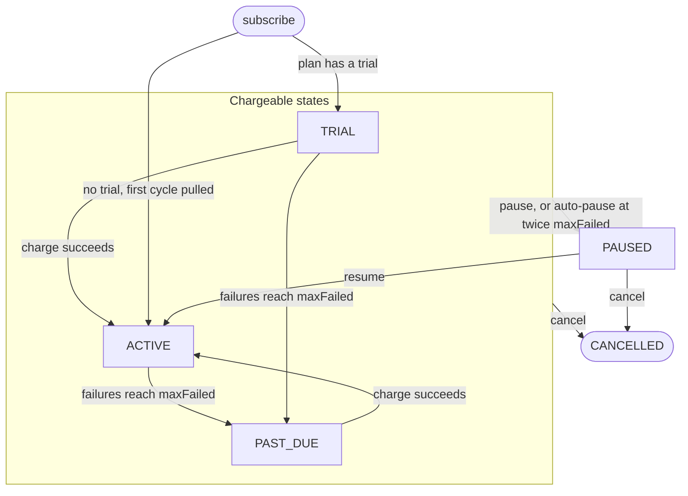

# Plans and Subscriptions

A plan is a merchant's fixed offer: a price, a billing cycle, an optional trial and a failure tolerance. A subscription ties one subscriber to one plan and moves through five states as payments succeed, fail, pause or end. Both live in the `SubscriptionManager` contract on Arc testnet. This page covers creating plans, the two ways to subscribe, the merchant reference, and the subscription lifecycle.

Prices are USDC integers with 6 decimals: 1 USDC = 1,000,000 units, so a 10 USDC plan has `price = 10000000`.

## Creating a plan

`createPlan(price, cycleSeconds, trialSeconds, graceSeconds, maxFailed)` is open to anyone. The caller becomes the plan's merchant and receives 99% of every payment. Plan ids count up from 1, and `PlanCreated` carries the id.

| Parameter | Rule | Meaning |
|---|---|---|
| `price` | Above 0 | USDC units pulled each cycle |
| `cycleSeconds` | 86,400 (1 day) to 315,360,000 (10 years) | Length of one billing cycle. "Monthly" is a fixed 30 days (2,592,000), so dates drift against calendar months |
| `trialSeconds` | Below `cycleSeconds`; 0 for none | Time before the first pull |
| `graceSeconds` | Any value | Stored and never read by the contract, keeper or API. The dashboard sends 0 |
| `maxFailed` | 1 to 255 | Recorded failures before the subscription becomes `PAST_DUE`. At twice this number it is paused automatically |

A broken rule reverts `BadPlanParams`.

Plans are immutable. No function edits, disables or deletes one, so repricing means creating a new plan, and an old plan stays open to new subscribers. Existing subscribers keep their price until they move with `changePlan`: see [Plan Changes and Proration](Plan-Changes-and-Proration.md).

**What `maxFailed` means.** Failures are recorded at least 1 day, then 3 days, then 7 days apart (see [Dunning and Failures](Dunning-and-Failures.md)). With `maxFailed = 2` the subscription turns `PAST_DUE` at failure 2 and pauses at failure 4, no earlier than day 11 after the first failure. In general the earliest auto-pause is `1 + 3 + 7 * (2m - 3)` days after the first failure for `maxFailed = m` of 2 or more, and 1 day for `m = 1`. A past-due subscription is still charged. The merchant guide suggests 2 or 3.

## Subscribing

The subscriber is always `msg.sender`, and ids count up from 1. Nothing limits how many subscriptions one wallet opens on a plan, trial plans included, so a merchant that wants one trial per customer must enforce it off-chain.

| Path | Before calling | Transactions |
|---|---|---|
| `subscribe(planId, ref)` | `approve` USDC to the manager | Two: approve, then subscribe |
| `subscribeWithPermit2(planId, ref, permitSingle, signature)` | One-time USDC `approve` to the Permit2 contract, then sign a Permit2 permit off-chain | One for subscribing |

The Permit2 path rejects a permit whose spender is not the manager (`BadPermitSpender`) or whose token is not USDC (`BadPermitToken`). Only the signer can submit it, because the permit owner is `msg.sender`. The permit does not name a plan, so a relayer could otherwise subscribe the owner to a plan of its own choosing. See [Permit2](Permit2.md).

The contract does not check the allowance size at subscribe. Later pulls simply fail into dunning if it runs out. A direct ERC-20 allowance is tried first and a Permit2 allowance is the fallback.

**What happens on subscribe.** Billing is in advance: each pull pays for the cycle that starts at it.

| | No trial | Trial |
|---|---|---|
| Status | `ACTIVE` | `TRIAL` |
| Pulled now | The first cycle, split 99/1 | Nothing, and no allowance is needed yet |
| `chargeCount` | 1 | 0 |
| `nextChargeAt` | start + `cycleSeconds` | start + `trialSeconds` |
| If the pull fails | The whole call reverts `PaymentFailed` | Not applicable |

With a trial, the first `charge` at trial end bills the first paid cycle, and `nextChargeAt` then advances by one cycle from the trial end (from the payment instead, if that charge failed first).

## The merchant reference

`ref` is a `bytes32` the subscriber passes at subscribe. It is stored in `subscriptionRef[subId]` when nonzero, emitted in `Subscribed`, and carried on every webhook. Zero means none.

- It is public on-chain, so use an opaque token, never an email or name.
- Whoever subscribes chooses it. It is a claim, not proof of identity: someone can copy another customer's ref and subscribe with it. Issue an unguessable ref per checkout, and once `subscription.created` links it to your customer, track the subscription by `subId`.
- A checkout link's `?ref=` accepts `0x` plus 64 hex digits, or 1 to 31 printable ASCII characters, left-aligned and zero-padded.

## Lifecycle

| Status | Can be charged | Meaning |
|---|---|---|
| `TRIAL` | Yes | Subscribed with a trial, nothing paid yet |
| `ACTIVE` | Yes | Current |
| `PAST_DUE` | Yes | `maxFailed` failures recorded. Still retried |
| `PAUSED` | No | Paused by hand, or automatically at twice `maxFailed` failures |
| `CANCELLED` | No | Final |

| Action | Who | Allowed from | Result |
|---|---|---|---|
| `charge` | Anyone | `TRIAL`, `ACTIVE`, `PAST_DUE`, once `nextChargeAt` has passed | Success: `ACTIVE`. Failure: recorded, then `PAST_DUE` or `PAUSED` at the thresholds |
| `pauseSubscription` | Subscriber or merchant | `TRIAL`, `ACTIVE`, `PAST_DUE` | `PAUSED` |
| `resumeSubscription` | Subscriber, or the merchant if it made the pause | `PAUSED` | `ACTIVE` |
| `cancelSubscription` | Subscriber or merchant | Any status but `CANCELLED` | `CANCELLED` |
| `changePlan` | Subscriber | `TRIAL`, `ACTIVE`, `PAST_DUE` | `ACTIVE` on the new plan |

A call from the wrong state reverts `NotChargeable`, and a stranger calling pause, resume or cancel reverts `NotSubscriberOrMerchant`. A merchant resuming a pause it did not make reverts `NotSubscriber`. `changePlan` is not drawn above: it moves any chargeable state to `ACTIVE`.

**Charging.** A successful `charge` clears `failedAttempts`, moves `TRIAL` or `PAST_DUE` to `ACTIVE`, and normally advances `nextChargeAt` by one cycle from its stored value, not from the current time, so a late keeper keeps the billing date. When the charge follows failed attempts, or one cycle after the stored date has already passed (an outage that skipped a whole cycle), `nextChargeAt` becomes the payment time plus one cycle instead: the overdue time is forgiven, as with resume. A successful charge therefore never leaves the next one already due, and missed cycles are never collected back to back. Failures follow the dunning schedule. See [Charging and Fees](Charging-and-Fees.md).

**Pause.** Nothing but the status changes (and `pausedByMerchant` records whether the merchant made the pause), and time already paid for keeps running. `nextChargeAt`, the failure count and credit stay as they were. Emits `Paused`.

**Resume is a fresh start.**
- The subscriber can resume any pause. The merchant can resume only one it made itself (`pausedByMerchant`), so a pause by the subscriber or a dunning auto-pause needs the subscriber. Resume clears `pausedByMerchant`.
- If `nextChargeAt` passed during the pause it moves to the resume time. Paused cycles are never billed, and an overdue cycle is forgiven. One `charge` then bills a new cycle at once. If the date is still ahead, it is left alone.
- `failedAttempts` resets to 0 and the retry timer (`lastFailedAt`) is cleared, so a still-unfunded subscription gets a full new dunning run.
- The status is always `ACTIVE`, even if the pause began during a trial. `chargeCount` and `credit` are untouched.
- Resume does not check the allowance. Emits `Resumed`.

**Cancel.** Final. No further charge or plan change is possible, nothing is refunded on-chain (refunds are the merchant's policy, handled off-chain), and any unspent credit stays unused. A merchant can cancel any subscription on its plans. Emits `Cancelled`.

## Source files

- [src/SubscriptionManager.sol](https://github.com/RunTimeAdmin/levy/blob/main/src/SubscriptionManager.sol)
- [test/Levy.t.sol](https://github.com/RunTimeAdmin/levy/blob/main/test/Levy.t.sol)
- [test/FailureCooldown.t.sol](https://github.com/RunTimeAdmin/levy/blob/main/test/FailureCooldown.t.sol)
- [api/public/checkout.js](https://github.com/RunTimeAdmin/levy/blob/main/api/public/checkout.js)
- [api/public/wallet.js](https://github.com/RunTimeAdmin/levy/blob/main/api/public/wallet.js)
- [docs/merchant-guide.md](https://github.com/RunTimeAdmin/levy/blob/main/docs/merchant-guide.md)
