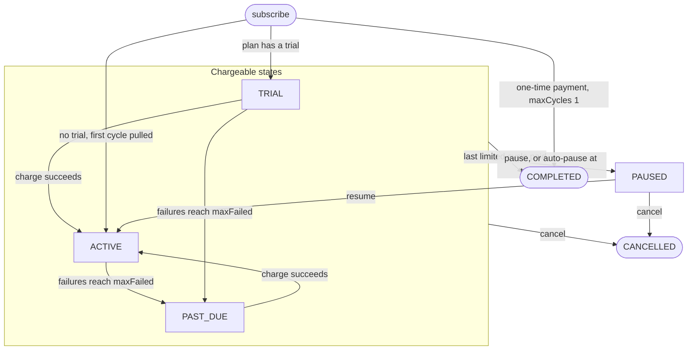

# Plans and Subscriptions

A plan is a merchant's fixed offer: a price, a billing cycle, an optional trial, a failure tolerance and, since manager v2, an optional cycle limit, intro price and transfer permission. A subscription ties one subscriber to one plan and moves through six states as payments succeed, fail, pause or end. Both live in the `SubscriptionManager` contract. This page covers merchant accounts, creating and retiring plans, the two ways to subscribe, the merchant reference, the subscription lifecycle and moving a subscription to another wallet. It describes manager v2 ([design](https://github.com/RunTimeAdmin/levy/blob/main/docs/manager-v2-design.md)), which is not yet on Arc testnet; the deployed contracts take `createPlan(price, cycleSeconds, trialSeconds, graceSeconds, maxFailed)` and have none of the v2 parts.

Prices are USDC integers with 6 decimals: 1 USDC = 1,000,000 units, so a 10 USDC plan has `price = 10000000`.

## Merchant accounts

A plan belongs to a merchant account, the address it was created for. That address is the account's permanent id: it is the plan's `merchant`, the webhook `merchant` field and what `changePlan`'s same-merchant rule compares. Two settings hang off it.

| Setting | Read with | Default | Changed by |
|---|---|---|---|
| Owner: who creates plans, retires them, pauses, resumes and cancels for the account, and changes its settings | `ownerOf(account)` | The account itself | `transferOwnership(account, newOwner)` from the owner, then `acceptOwnership(account)` from `newOwner` |
| Payout: where the 99% goes | `payoutOf(account)`; `accountPayout(account)` is the fixed address or zero | Follows the owner | `setPayout(account, payout)` from the owner, from the next collection. Zero follows the owner again; the manager's own address reverts `BadPayout` |

The handover takes two steps so a mistyped address never takes control. Proposing again replaces the proposal (`pendingOwner`), and proposing zero withdraws it. A fixed payout survives a handover; one that follows the owner moves to the new owner. Anyone but the current owner gets `NotOwner`, and anyone but the proposed owner calling `acceptOwnership` gets `NotPendingOwner`. Setting a payout needs no acceptance, because payout addresses are often exchange deposit addresses or Safes that cannot easily call back, and the owner can correct a mistake at once.

If USDC blocklists the payout address, the payout transfer reverts and so does every charge for the account's plans, until the owner sets a new payout. Those charges revert rather than fail, so no failure is recorded. The first successful charge afterwards collects one cycle, and if a whole cycle went by uncharged it starts a fresh cycle from the payment (see Charging below), so the other missed cycles are never collected.

## Creating a plan

`createPlan(account, terms)` creates a plan for `account` and requires `msg.sender == ownerOf(account)`, with no other shortcut: a key that handed its account on can no longer create plans under it, even though the account is its own address. `createPlan(msg.sender, terms)` needs no setup. Plan ids count up from 1, and `PlanCreated` carries the id and the account. `terms` is a `PlanTerms` tuple:

| Field | Rule | Meaning |
|---|---|---|
| `price` | Above 0 | USDC units pulled each cycle, once any intro cycles are used up |
| `cycleSeconds` | 86,400 (1 day) to 315,360,000 (10 years) | Length of one billing cycle. "Monthly" is a fixed 30 days (2,592,000), so dates drift against calendar months |
| `trialSeconds` | Below `cycleSeconds`; 0 for none | Time before the first pull |
| `maxFailed` | 1 to 255 | Recorded failures before the subscription becomes `PAST_DUE`. At twice this number it is paused automatically |
| `maxCycles` | Any `uint32`; 0 for no limit | Cycles billed on this plan before the subscription completes |
| `introPrice` | Above 0 and below `price` when `introCycles` is above 0; otherwise 0 | Price of each intro cycle |
| `introCycles` | Any `uint32`; at most `maxCycles` on a limited plan | How many of a subscription's first billed cycles cost `introPrice` |
| `transferable` | Any | Whether the plan's subscriptions may move to another wallet |

A broken rule reverts `BadPlanParams`, and a caller who does not own `account` reverts `NotOwner`.

Plan terms are immutable: no function edits or deletes a plan, so repricing means creating a new plan. Existing subscribers keep their price until they move with `changePlan`: see [Plan Changes and Proration](Plan-Changes-and-Proration.md). The one field that changes is `retired`.

**Retiring.** `setPlanRetired(planId, retired)`, from the owner of the plan's account, closes the plan to new subscribers or reopens it, and emits `PlanRetired`. While it is retired, `subscribe`, `subscribeWithPermit2` and `changePlan` into the plan revert `RetiredPlan`. Changing out of it is allowed, and existing subscriptions charge, pause, resume and transfer as before. Retiring is reversible, so a mistake does not force a new plan id and new checkout links.

**Cycle limits.** Each subscription counts the cycles billed on its current plan (`planCycles`), including cycles paid entirely from credit. The cycle that reaches `maxCycles` moves the subscription to `COMPLETED` and emits `Completed`. `nextChargeAt` then marks the end of the last paid cycle, which the pages show as "paid through". A plan change restarts the count, and the change's own charge is cycle 1 on the new plan. Uses: installments (12 cycles of 100 USDC), a fixed term, and a one-time payment (`maxCycles = 1` and no trial, which subscribe pulls and completes in one transaction). A limit is a cap, not a commitment: the subscriber can still cancel, or change to another of the account's plans, at any time.

**Intro pricing.** A subscription's first `introCycles` billed cycles on the plan it subscribed to cost `introPrice`. A trial comes first and does not count. `introCyclesLeft` is set at subscribe and lowered by each successful intro cycle. `changePlan` sets it to 0 before billing the new plan, so intro prices stay with the plan a subscription started on and hopping between intro plans cannot keep one. The price must be a discount, because a higher first price would turn into proration credit at the next plan change. Intro prices are per subscription: a subscriber can cancel and subscribe again, from the same wallet or a new one, and get the intro price again, exactly as with trials. Merchants who care check eligibility off-chain.

**What `maxFailed` means.** Failures are recorded at least 1 day, then 3 days, then 7 days apart (see [Dunning and Failures](Dunning-and-Failures.md)). With `maxFailed = 2` the subscription turns `PAST_DUE` at failure 2 and pauses at failure 4, no earlier than day 11 after the first failure. In general the earliest auto-pause is `1 + 3 + 7 * (2m - 3)` days after the first failure for `maxFailed = m` of 2 or more, and 1 day for `m = 1`. A past-due subscription is still charged. The merchant guide suggests 2 or 3.

## Subscribing

The subscriber is always `msg.sender`, and ids count up from 1. Nothing limits how many subscriptions one wallet opens on a plan, trial plans included, so a merchant that wants one trial per customer must enforce it off-chain.

| Path | Before calling | Transactions |
|---|---|---|
| `subscribe(planId, ref)` | `approve` USDC to the manager | Two: approve, then subscribe |
| `subscribeWithPermit2(planId, ref, permitSingle, signature)` | One-time USDC `approve` to the Permit2 contract, then sign a Permit2 permit off-chain | One for subscribing |

The Permit2 path rejects a permit whose spender is not the manager (`BadPermitSpender`) or whose token is not USDC (`BadPermitToken`). Only the signer can submit it, because the permit owner is `msg.sender`. The permit does not name a plan, so a relayer could otherwise subscribe the owner to a plan of its own choosing. See [Permit2](Permit2.md).

The contract does not check the allowance size at subscribe. Later pulls simply fail into dunning if it runs out. A direct ERC-20 allowance is tried first and a Permit2 allowance is the fallback. A retired plan reverts `RetiredPlan` on both paths.

**What happens on subscribe.** Billing is in advance: each pull pays for the cycle that starts at it. On a plan with intro pricing, `introCyclesLeft` is set to `introCycles` before anything is billed.

| | No trial | Trial |
|---|---|---|
| Status | `ACTIVE` (`COMPLETED` on a plan with `maxCycles = 1`) | `TRIAL` |
| Pulled now | The first cycle, at `introPrice` on an intro plan, split 99/1 | Nothing, and no allowance is needed yet |
| `chargeCount` | 1 | 0 |
| `nextChargeAt` | start + `cycleSeconds` | start + `trialSeconds` |
| If the pull fails | The whole call reverts `PaymentFailed` | Not applicable |

With a trial, the first `charge` at trial end bills the first paid cycle (the first intro cycle, if there are any), and `nextChargeAt` then advances by one cycle from the trial end (from the payment instead, if that charge failed first).

## The merchant reference

`ref` is a `bytes32` the subscriber passes at subscribe. It is stored in `subscriptionRef[subId]` when nonzero, emitted in `Subscribed`, and carried on every webhook. Zero means none.

- It is public on-chain, so use an opaque token, never an email or name.
- Whoever subscribes chooses it. It is a claim, not proof of identity: someone can copy another customer's ref and subscribe with it. Issue an unguessable ref per checkout, and once `subscription.created` links it to your customer, track the subscription by `subId`.
- A checkout link's `?ref=` accepts `0x` plus 64 hex digits, or 1 to 31 printable ASCII characters, left-aligned and zero-padded.

## Lifecycle

| Status | Can be charged | Meaning |
|---|---|---|
| `TRIAL` | Yes | Subscribed with a trial, nothing paid yet |
| `ACTIVE` | Yes | Current |
| `PAST_DUE` | Yes | `maxFailed` failures recorded. Still retried |
| `PAUSED` | No | Paused by hand, or automatically at twice `maxFailed` failures |
| `CANCELLED` | No | Final |
| `COMPLETED` | No | Final: every cycle of a limited plan was billed. `nextChargeAt` is the end of the last paid cycle |

| Action | Who | Allowed from | Result |
|---|---|---|---|
| `charge` | Anyone | `TRIAL`, `ACTIVE`, `PAST_DUE`, once `nextChargeAt` has passed | Success: `ACTIVE`, or `COMPLETED` on a limited plan's last cycle. Failure: recorded, then `PAST_DUE` or `PAUSED` at the thresholds |
| `pauseSubscription` | Subscriber or the account's owner | `TRIAL`, `ACTIVE`, `PAST_DUE` | `PAUSED` |
| `resumeSubscription` | Subscriber, or the account's owner if the merchant made the pause | `PAUSED` | `ACTIVE` |
| `cancelSubscription` | Subscriber or the account's owner | Any status but `CANCELLED` and `COMPLETED` | `CANCELLED` |
| `changePlan` | Subscriber | `TRIAL`, `ACTIVE`, `PAST_DUE` | `ACTIVE` on the new plan, or `COMPLETED` when its charge is a limited plan's last cycle (a one-cycle plan) |
| `proposeTransfer`, `acceptTransfer` | Subscriber, then the offered wallet | `TRIAL`, `ACTIVE`, `PAST_DUE`, `PAUSED`, on a transferable plan | Same status, new subscriber |

A call from the wrong state reverts `NotChargeable`, and a stranger calling pause, resume or cancel reverts `NotSubscriberOrMerchant`. A merchant resuming a pause it did not make reverts `NotSubscriber`. "Merchant" here means the current owner of the plan's account, so a key that handed the account on loses these rights. `changePlan` is not drawn above: it moves any chargeable state to `ACTIVE`, or to `COMPLETED` as above.

**Charging.** A successful `charge` clears `failedAttempts`, moves `TRIAL` or `PAST_DUE` to `ACTIVE` unless the cycle completed the subscription, and normally advances `nextChargeAt` by one cycle from its stored value, not from the current time, so a late keeper keeps the billing date. When the charge follows failed attempts, or one cycle after the stored date has already passed (an outage that skipped a whole cycle), `nextChargeAt` becomes the payment time plus one cycle instead: the overdue time is forgiven, as with resume. A successful charge therefore never leaves the next one already due, and missed cycles are never collected back to back. Failures follow the dunning schedule. See [Charging and Fees](Charging-and-Fees.md).

**Pause.** Nothing but the status changes (and `pausedByMerchant` records whether the merchant made the pause), and time already paid for keeps running. `nextChargeAt`, the failure count and credit stay as they were. Emits `Paused`.

**Resume is a fresh start.**
- The subscriber can resume any pause. The merchant can resume only one it made itself (`pausedByMerchant`), so a pause by the subscriber or a dunning auto-pause needs the subscriber. Resume clears `pausedByMerchant`.
- If `nextChargeAt` passed during the pause it moves to the resume time. Paused cycles are never billed, and an overdue cycle is forgiven. One `charge` then bills a new cycle at once. If the date is still ahead, it is left alone.
- `failedAttempts` resets to 0 and the retry timer (`lastFailedAt`) is cleared, so a still-unfunded subscription gets a full new dunning run.
- The status is always `ACTIVE`, even if the pause began during a trial. `chargeCount` and `credit` are untouched.
- Resume does not check the allowance. Emits `Resumed`.

**Cancel.** Final. No further charge or plan change is possible, nothing is refunded on-chain (refunds are the merchant's policy, handled off-chain), and any unspent credit stays unused. A merchant can cancel any subscription on its plans. Emits `Cancelled`.

**Complete.** Only the billing routine sets `COMPLETED`, on the cycle that reaches `maxCycles`, then emits `Completed`. It behaves like `CANCELLED`: charge, plan change, pause, resume, cancel and transfers all revert, and unspent credit is forfeited. A cycle past the limit reverts `CycleLimitReached` as a backstop.

## Moving a subscription to another wallet

On a plan created with `transferable` set, a subscription can move to a new wallet in two steps:

1. `proposeTransfer(subId, to)`, by the subscriber only (`NotSubscriber` otherwise). Proposing again replaces the offer, and `to = 0` withdraws it. Emits `TransferProposed(subId, from, to)`.
2. `acceptTransfer(subId, planId)`, by `to` only (`NotPendingSubscriber` otherwise). `planId` must be the subscription's current plan (`PlanMismatch` otherwise), so nobody can switch the plan between the offer and the acceptance. The offer is deleted and `SubscriptionTransferred(subId, from, to)` is emitted.

Both revert `NotTransferable` unless the current plan allows transfers, and `NotChargeable` on a `CANCELLED` or `COMPLETED` subscription. Acceptance checks both again, since the subscriber may have moved to another plan or the subscription may have ended after the offer. A cancel or a plan change does not clear an offer; it simply cannot be accepted while those checks fail.

Only `subscriber` changes. Everything else carries over: id, plan, `ref`, credit, `nextChargeAt`, `chargeCount`, `planCycles`, `introCyclesLeft`, `billedPrice`, the failure count with `lastFailedAt`, the status and `pausedByMerchant`. The next charge pulls from the new wallet's allowance, direct or Permit2, and with none there it fails into dunning as usual. The old wallet's allowance is left as it was.

The new wallet must accept because every subscriber's allowance is one pool shared across merchants: without the payer's consent, someone could subscribe from an empty wallet and point the subscription at a victim with a large allowance. Only the subscriber may propose, so a stolen merchant key cannot hand a customer's subscription, with its `ref` and paid time, to itself. Plans opt in because transfers make subscriptions resellable, including those on a retired, cheaper plan.

## Source files

- [src/SubscriptionManager.sol](https://github.com/RunTimeAdmin/levy/blob/main/src/SubscriptionManager.sol)
- [test/Levy.t.sol](https://github.com/RunTimeAdmin/levy/blob/main/test/Levy.t.sol)
- [test/ManagerV2.t.sol](https://github.com/RunTimeAdmin/levy/blob/main/test/ManagerV2.t.sol)
- [test/FailureCooldown.t.sol](https://github.com/RunTimeAdmin/levy/blob/main/test/FailureCooldown.t.sol)
- [docs/manager-v2-design.md](https://github.com/RunTimeAdmin/levy/blob/main/docs/manager-v2-design.md)
- [api/public/checkout.js](https://github.com/RunTimeAdmin/levy/blob/main/api/public/checkout.js)
- [api/public/wallet.js](https://github.com/RunTimeAdmin/levy/blob/main/api/public/wallet.js)
- [docs/merchant-guide.md](https://github.com/RunTimeAdmin/levy/blob/main/docs/merchant-guide.md)
