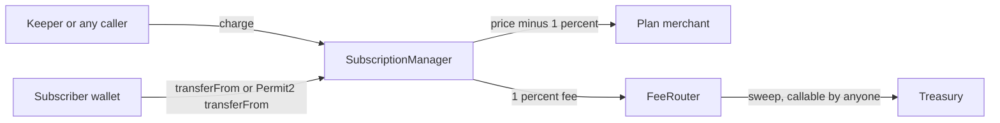

# Smart Contracts

Levy's on-chain layer is two contracts and one interface, written in Solidity (`^0.8.20`) on OpenZeppelin 5.7.0 and built with Foundry. `SubscriptionManager` holds plans and subscriptions and moves the money. `FeeRouter` receives the 1% protocol fee. `IPermit2` is the three-function slice of Uniswap's Permit2 that Levy calls. The contracts run on Arc testnet only. Nothing is on mainnet and nothing has been audited.

Amounts are USDC integers with 6 decimals (1 USDC = 1,000,000 units), moved through USDC's ERC-20 interface. Native 18-decimal values never enter the payment math, and all division rounds down.

## Deployment

| Contract | Arc testnet address (chain 5042002) |
|---|---|
| SubscriptionManager | `0xea24ac9c1217a671139d93225fdcf19ea3c4df4e` |
| FeeRouter | `0x9e62309243da8be600a718a323fbbdfce00f3ce8` |

Deployed 2026-10-24 in blocks 68869601 and 68869602 from `54724d0`, built with solc 0.8.33. The constants below were read back from the deployed manager. See [Deployment](Deployment.md) for the process.

## How the pieces fit

The manager never holds funds at rest: every pull is split in the same transaction. Fee details are in [Charging and Fees](Charging-and-Fees.md).

## Constants and immutables

| Name | Value | Meaning |
|---|---|---|
| `FEE_BPS` | 100 | A divisor, despite the name: `fee = amount / 100`, which is 1% |
| `MIN_CYCLE` | 1 day | Shortest billing cycle |
| `MAX_CYCLE` | 10 years (315,360,000 s) | Longest billing cycle |
| `RETRY_GAP_FIRST` | 1 day | Minimum gap before the 2nd recorded failure |
| `RETRY_GAP_SECOND` | 3 days | Minimum gap before the 3rd |
| `RETRY_GAP_LATER` | 7 days | Minimum gap before the 4th and every later one |
| `PERMIT2_ARC` | `0x000000000022D473030F116dDEE9F6B43aC78BA3` | Canonical Permit2 address, for reference |
| `usdc`, `feeRouter`, `permit2` | set in the constructor | Immutable. A zero address reverts `ZeroAddress` |

`retryGap(failures)` returns 0 for no failures, then 1, 3 and 7 days. See [Dunning and Failures](Dunning-and-Failures.md).

## Data model

**Plan** (immutable once created): `merchant`, `price`, `cycleSeconds`, `trialSeconds`, `graceSeconds` (stored, never read), `maxFailed` (uint8), `exists`.

**Subscription**: `subscriber`, `planId`, `start`, `nextChargeAt` (when the next pull is due, which is the end of the trial before the first pull), `failedAttempts`, `credit` (proration credit, in USDC units), `chargeCount`, `status`.

**Status**: `TRIAL`, `ACTIVE`, `PAST_DUE`, `PAUSED`, `CANCELLED` (values 0 to 4).

Public state: `plans`, `subscriptions`, `subscriptionRef` (the merchant's reference), `lastFailedAt` (time of the last recorded failure, zero if none), `pausedByMerchant` (true while the subscription is paused by its merchant, cleared on resume), `planCount`, `subCount`. Plan and subscription ids start at 1.

## Functions

| Function | Who may call | Effect |
|---|---|---|
| `createPlan(price, cycleSeconds, trialSeconds, graceSeconds, maxFailed)` | Anyone, who becomes the plan's merchant | Stores a plan, emits `PlanCreated` |
| `subscribe(planId, ref)` | Anyone, as themselves | Opens a subscription. Without a trial it pulls the first cycle |
| `subscribeWithPermit2(planId, ref, permitSingle, signature)` | The permit signer only | Applies a Permit2 permit, then subscribes in one transaction. If the permit fails but the signer's Permit2 allowance already covers one cycle and has not expired, it subscribes anyway |
| `charge(subId)` | Anyone | Pulls one cycle once `nextChargeAt` has passed, or records a failure |
| `pauseSubscription(subId)` | Subscriber or plan merchant | Sets `PAUSED` |
| `resumeSubscription(subId)` | Subscriber, or the plan merchant for a pause it made itself | `PAUSED` to `ACTIVE`, as a fresh start |
| `cancelSubscription(subId)` | Subscriber or plan merchant | Sets `CANCELLED`, which is final |
| `changePlan(subId, newPlanId)` | Subscriber only | Moves to another plan of the same merchant, prorated |
| `isChargeable(subId)` | Anyone (view) | True if the status is `TRIAL`, `ACTIVE` or `PAST_DUE` and `nextChargeAt` has passed |

Behavior of each is covered in [Plans and Subscriptions](Plans-and-Subscriptions.md), [Charging and Fees](Charging-and-Fees.md) and [Plan Changes and Proration](Plan-Changes-and-Proration.md).

## Access model

- There is no owner, admin role, proxy or pause switch. Nothing can change a plan, the fee or the wired addresses after deployment.
- `charge` is permissionless on purpose. It can only move the subscriber's pre-approved funds to the plan's merchant and the router, so a caller gains nothing. What a caller does control is when a failing pull gets recorded, and the contract spaces those by `retryGap`.
- A merchant can pause and cancel subscriptions on its own plans, and resume only a pause it made itself (not the subscriber's pause or a dunning auto-pause). It cannot change a subscriber's plan or charge more than the plan price.
- `subscribe`, `subscribeWithPermit2`, `charge` and `changePlan` are `nonReentrant`. Pause, resume and cancel only write storage and are unguarded. Outgoing transfers use `SafeERC20`.
- Storage updates in the money-moving functions happen after the transfers. That is safe with USDC and is flagged for the auditor in [Security](Security.md).

## Events

| Event | Fields (indexed first) |
|---|---|
| `PlanCreated` | `planId`, `merchant`, `price`, `cycleSeconds` |
| `Subscribed` | `subId`, `subscriber`, `planId`, `nextChargeAt`, `ref` |
| `Charged` | `subId`, `invoiceRef`, `amount`, `fee`, `chargeCount` |
| `ChargeFailed` | `subId`, `failedAttempts` |
| `AutoPaused` | `subId` |
| `Paused`, `Resumed`, `Cancelled` | `subId` |
| `PlanChanged` | `subId`, `oldPlanId`, `newPlanId`, `credit` |

`Charged.amount` is what was pulled, so it is 0 when proration credit covered the cycle. `invoiceRef` is `keccak256(abi.encode(subId, chargeCount))`. `AutoPaused` follows `ChargeFailed` in the same transaction. The keeper turns these into webhooks: see [Webhooks](Webhooks.md).

## Custom errors

| Error | Thrown when |
|---|---|
| `BadPlanParams` | `createPlan` limits are broken |
| `UnknownPlan`, `UnknownSubscription` | The id does not exist |
| `NotChargeable` | `charge` on a status other than `TRIAL`, `ACTIVE`, `PAST_DUE`, or before `nextChargeAt`. Also pause on a `PAUSED` or `CANCELLED` subscription, resume on anything but `PAUSED`, cancel on a `CANCELLED` one, and `changePlan` on a status that cannot be charged |
| `NotSubscriberOrMerchant` | Pause, resume or cancel from anyone else |
| `NotSubscriber` | `changePlan` from anyone but the subscriber, or the merchant resuming a pause it did not make |
| `SamePlan`, `DifferentMerchant` | `changePlan` to the current plan, or to another merchant's plan |
| `BadPermitSpender`, `BadPermitToken` | The permit's spender is not the manager, or its token is not USDC |
| `PaymentFailed` | The pull at subscribe (no trial) or at `changePlan` failed. The whole call reverts |
| `RetryTooSoon` | A failing `charge` came before `lastFailedAt + retryGap(failedAttempts)`. Nothing changes |
| `ZeroAddress` | A zero constructor argument |

A failed pull inside `charge` does not revert. It is recorded as `ChargeFailed`, unless `RetryTooSoon` applies.

## FeeRouter

`FeeRouter(usdc, treasury)` receives the 1% fee and holds it until `sweep()`, which anyone can call and which sends the whole USDC balance to `treasury` (emitting `Swept`, even for a zero balance). Moving the treasury takes two steps. `proposeTreasury(address)` works only from the current treasury and rejects the zero address (`OnlyTreasury`, `ZeroAddress`; event `TreasuryProposed`); it stores the public `pendingTreasury`, and proposing again replaces it. `acceptTreasury()` works only from that pending address (`OnlyPendingTreasury`; event `TreasuryUpdated`) and clears it, so a mistyped address never takes over the fees. It has no pause or kill switch. The deploy script lets a plain key be the treasury on testnet but refuses a non-contract treasury on Arc mainnet. The Phase 2 fee split (buyback and staking) is not built.

## IPermit2

The interface declares `permit(owner, permitSingle, signature)`, `transferFrom(from, to, amount, token)` and the view `allowance(owner, token, spender)`. The manager calls `permit` with `msg.sender` as owner when subscribing. If that call fails, it reads `allowance` and goes ahead only when the amount covers one cycle and has not expired, else it re-throws Permit2's error. It falls back to `transferFrom` when a direct ERC-20 pull fails. Permit2's amounts are `uint160`, so larger pulls are refused on that path. See [Permit2](Permit2.md).

## Invariants checked by the tests

The suite has 77 tests: 68 unit tests (52 in `Levy.t.sol`, 9 in `FailureCooldown.t.sol`, 7 for the deploy script) and 9 fuzzed invariants. A handler throws random plans, approvals, subscriptions, charges, plan changes, pauses, resumes, cancels and sweeps at the system. Defaults are 256 runs at depth 15, and the `ci` profile runs 1,000 at depth 40.

| Invariant | Meaning |
|---|---|
| `conservation` | Manager, router, treasury and the fuzz actors together hold exactly the minted supply |
| `failedAttemptsBounded` | `failedAttempts` never exceeds `2 * maxFailed` |
| `cancelIsTerminal` | A cancelled subscription stays cancelled and its `chargeCount` never moves |
| `nextChargeMonotonic` | `nextChargeAt` never falls below `start`. Despite the name it can move earlier on a switch to a shorter-cycle plan |
| `creditBounded` | Credit never exceeds the largest plan price |
| `creditBacked` | Credit never exceeds the USDC the subscription has actually paid |
| `failuresSpaced` | Recorded failures are never closer than `retryGap` allows, however often `charge` is called |
| `managerHoldsNothing` | The manager's USDC balance is always 0 |
| `noBackToBackCharges` | A successful `charge` never leaves its subscription chargeable, so missed cycles are never pulled back to back |

See [Testing](Testing.md) for how to run them.

## Source files

- [src/SubscriptionManager.sol](https://github.com/RunTimeAdmin/levy/blob/main/src/SubscriptionManager.sol)
- [src/FeeRouter.sol](https://github.com/RunTimeAdmin/levy/blob/main/src/FeeRouter.sol)
- [src/IPermit2.sol](https://github.com/RunTimeAdmin/levy/blob/main/src/IPermit2.sol)
- [script/Deploy.s.sol](https://github.com/RunTimeAdmin/levy/blob/main/script/Deploy.s.sol)
- [test/Levy.t.sol](https://github.com/RunTimeAdmin/levy/blob/main/test/Levy.t.sol)
- [test/FailureCooldown.t.sol](https://github.com/RunTimeAdmin/levy/blob/main/test/FailureCooldown.t.sol)
- [test/LevyInvariant.t.sol](https://github.com/RunTimeAdmin/levy/blob/main/test/LevyInvariant.t.sol)
- [foundry.toml](https://github.com/RunTimeAdmin/levy/blob/main/foundry.toml)
