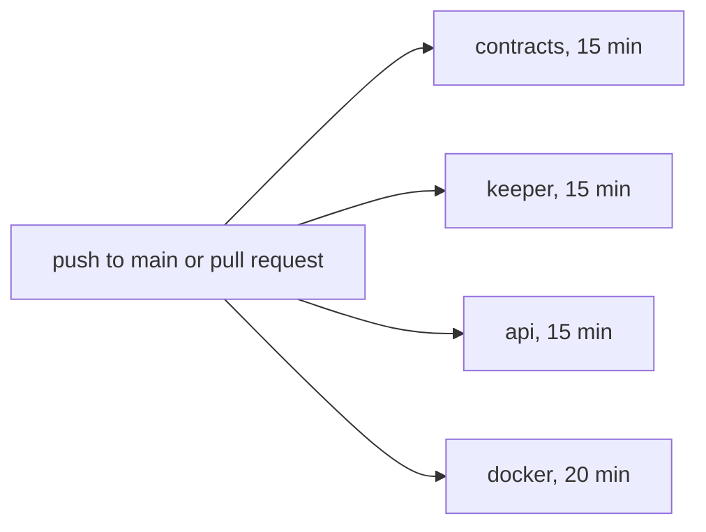

# Testing

Levy has three automated suites and one live test. Foundry tests cover the contracts, including nine fuzzed invariants. Node's built-in test runner covers the keeper (with an integration test against a local anvil chain) and the API. GitHub Actions runs all of them on every pull request and every push to `main`. The live test is the testnet soak: real billing against the deployed contracts. None of this replaces an audit; the contracts are unaudited and run on Arc testnet only.

## Totals

The counts come from the test sources and match the README.

| Suite | Tests | Made up of |
|---|---|---|
| Contracts | 77 | 68 unit tests (52 + 9 + 7) and 9 invariants |
| Keeper | 56 | 45 unit tests and 11 anvil integration tests |
| API | 55 | 32 endpoint tests and 23 wallet-encoding tests |

## Contract tests

| File | Tests | Covers |
|---|---|---|
| `test/Levy.t.sol` | 52 | Core behaviour, below |
| `test/FailureCooldown.t.sol` | 9 | The on-chain dunning schedule against a griefer |
| `test/Deploy.t.sol` | 7 | The deploy script's checks |
| `test/LevyInvariant.t.sol` | 9 invariants | Properties that must hold after any action sequence |
| `test/mocks/` | none | `MockUSDC` (6 decimals, public `mint`) and `MockPermit2` |

`MockPermit2` implements the real Permit2 EIP-712 scheme and, like the real one, pulls through the owner's ERC-20 approval and refuses a pull once the allowance's expiration has passed, so tests sign genuine permits with `vm.sign`. Amounts are 6-decimal USDC units: `PRICE = 10_000_000` is 10 USDC, and 1 USDC = 1,000,000 units. Tests jump to billing dates with `vm.warp`.

**`Levy.t.sol`** by group: plan creation (4: the stored plan, zero price, the 1-day minimum cycle, a trial longer than the cycle); subscribe (6: trial or not, the merchant reference, no allowance, unknown plan); charge (10: the 99/1 split, charging early, a failure recorded without reverting, PAST_DUE then auto-pause, resume, a `maxFailed` of 200 that once overflowed `uint8`, resume never billing paused cycles, credit surviving a failed pull); back-billing after failures, from the 2026-10-24 review (4: a PAST_DUE recovery pulls one cycle, a recovery starts a fresh cycle, a charge after an outage skips the ended cycles, a late charge keeps the billing date); proration (6: upgrade and downgrade credit, no credit from a trial, no change without a payment, same plan, another merchant's plan); regressions for unbacked credit found in the 2026-09-25 self-review (2); pause, cancel and access (3); merchant resume, from the 2026-10-24 review (4: the merchant cannot resume the subscriber's pause or an auto-pause, can resume its own, and the subscriber can resume the merchant's); fee rounding (1); FeeRouter sweep and the two-step treasury move (2); Permit2 (10: the full flow, a front-run permit with enough allowance, with less than one cycle and with an expired allowance, only the signer can submit, wrong spender, token or signature, a direct allowance taking priority).

**`FailureCooldown.t.sol`** turns the external reviews' proofs of concept into regression tests. A second failing `charge()` in the same block or in a looped transaction reverts `RetryTooSoon`. `retryGap` reads 1, 3 and 7 days. Failures land only on days 0, 1, 4 and 11, so a griefer calling daily records four failures and cannot pause before day 11. A top-up inside a gap is collected at once, a success is never held back, resume clears the timer, and a funded subscriber is unaffected. See [Dunning and Failures](Dunning-and-Failures.md).

**`Deploy.t.sol`** places the mocks at the real Arc USDC and Permit2 addresses so the defaults are exercised, and uses `vm.chainId` to switch chain rules. It checks that `run()` wires everything, that USDC or Permit2 without code and a non-6-decimal token revert, that chain 5042 demands a contract treasury and the canonical USDC and Permit2, and that testnet accepts a plain-key treasury. See [Deployment](Deployment.md).

## Invariants and the handler

`LevyInvariantTest` points Foundry at `LevyHandler`, which makes random calls through four actors (the first is the merchant), each minted 1,000,000 USDC. Its nine actions are `createPlan` (cycle length 1 to 365 days, `maxFailed` over the full 1 to 255 range, optional trial), `subscribe`, `approve`, `warpAndCharge` (up to 60 days), `griefCharge` (2 to 4 back-to-back `charge()` calls), `changePlan`, `cancelSub`, `pauseResume` and `sweepFees`. Every call is wrapped in `try/catch`, so one bad call never ends a run. The handler also reads the event logs to total each subscription's `Charged` amounts and to compare every `ChargeFailed` with the previous one, and after each successful `charge()` it checks that the subscription is no longer chargeable.

| Invariant | Asserts |
|---|---|
| `conservation` | USDC in the manager, router, treasury and the four actors equals total supply |
| `failedAttemptsBounded` | `failedAttempts` is at most 2 x `maxFailed` for every subscription |
| `cancelIsTerminal` | A cancelled subscription stays cancelled and its `chargeCount` never moves |
| `nextChargeMonotonic` | `nextChargeAt` never falls below the subscription's start (it can move earlier on a switch to a shorter-cycle plan) |
| `creditBounded` | Credit never exceeds the largest plan price created |
| `creditBacked` | Credit never exceeds what the subscription has actually paid |
| `failuresSpaced` | No two recorded failures are closer than `retryGap` allows |
| `managerHoldsNothing` | The manager's USDC balance is always 0 |
| `noBackToBackCharges` | A successful `charge()` never leaves its subscription chargeable, so missed cycles are never pulled back to back |

`foundry.toml` sets 256 runs at depth 15 by default and 1000 runs at depth 40 under the `ci` profile; the resume bug only showed up past depth 15. There are no stateless fuzz tests, so the invariant suite is the fuzzing. See also [Smart Contracts](Smart-Contracts.md).

## Keeper tests

| File | Tests | Covers |
|---|---|---|
| `webhooks.test.ts` | 30 | Canonical JSON; Ed25519 signing; key loading from file, base64 seed and PEM; the 1m, 5m, 15m, 1h, then 6h backoff and the 24 h dead letter; event mapping; fan-out and fairness; live HTTP delivery (signature headers, redirects and private addresses refused, an endless body, parallel endpoints, one request at a time per endpoint, coarse errors); webhook URL policy |
| `dunning.test.ts` | 6 | Retry times of 1, 3 and 7 days, clamping, persistence |
| `dedup.test.ts` | 4 | Collapsing duplicate USDC transfer logs (EIP-7708) |
| `funds.test.ts` | 3 | The allowance runway rule: low under two rounds |
| `log-ranges.test.ts` | 2 | Block-range chunking, including a day of Arc blocks in 500-block requests |
| `integration.test.ts` | 11 | The keeper against a real chain |

The live HTTP tests start local servers, so they build the dispatcher with `allowPrivate: true` (the code behind `LEVY_WEBHOOK_ALLOW_PRIVATE`); the private-address test uses the strict setting.

The integration test spawns `anvil --port 8546` (chain 31337), reads its printed dev keys, deploys `MockUSDC`, `FeeRouter`, `MockPermit2` and `SubscriptionManager` from `keeper/abi/*.json` and `.bin`, and builds a `Keeper` over an in-memory database. It sets the log chunk to 7 blocks so every sync crosses chunk boundaries, and moves time with `evm_increaseTime` because the keeper works on chain time. Its eleven scenarios: a due charge splits 99/1; failures schedule dunning retries; a retry after the backoff clears dunning on success; resume clears dunning and charges from now; the database records who paused, since the merchant may resume only its own pause; `Subscribed` and `Charged` enqueue webhooks; charging never waits on webhook delivery; plans nobody subscribed to are indexed and plan changes reported; a charge that reverts backs off; the merchant is warned once when an allowance runs low; only USDC logs involving Levy are indexed. See [Keeper Service](Keeper-Service.md).

## API tests

`api.test.ts` (32) starts the real Fastify server on an ephemeral port over a seeded temporary SQLite database, with three real keys (a merchant, a subscriber and a second merchant) that sign in with genuine EIP-4361 signatures. Groups: `formatUsdc` (1); sign-in (6: message bound to origin and chain, the sign-in and logout round trip, reused nonce, wrong wallet, malformed input, every private endpoint demanding a session); cookie sessions (5: `__Host-` cookie attributes, origin check on writes, logout, the local http variant); public endpoints (5); data scoped to the signed-in address (6); webhook management (5: scoping, unsafe URLs, the 5-per-merchant cap); the production origin requirement (1); static pages and their Content-Security-Policy (3). See [Authentication](Authentication.md) and [API Reference](API-Reference.md).

`wallet.test.ts` (23) guards the hand-written browser code in `api/public/wallet.js` against the contract ABIs in `keeper/abi/`: 10 function selectors, the event topics, the getter field order and the `createPlan` argument order. It also covers the plan-change quote, plain-language wallet errors, exact USDC amounts, the check that the wallet is really on Arc, a missing receipt reported as unknown, reverted transactions, and the faucet and explorer links. See [Dashboard, Portal and Checkout](Dashboard-Portal-and-Checkout.md).

## Continuous integration

`.github/workflows/ci.yml` runs on pushes to `main` and on pull requests. The four jobs are independent. A newer push to the same pull request cancels the run in progress; runs on `main` always finish.



| Job | Timeout | What it does |
|---|---|---|
| `contracts` | 15 min | Checks out submodules, installs Foundry, `forge build --sizes`, then `forge test -vvv` with `FOUNDRY_PROFILE=ci`, then the ABI drift check |
| `keeper` | 15 min | Installs Foundry (for anvil) and Node 24, then `npm ci`, `npx tsc --noEmit`, `npm test` |
| `api` | 15 min | Node 24, then `npm ci`, `npx tsc --noEmit`, `npm test` |
| `docker` | 20 min | Builds both images and starts the API container. Checks `/api/health`, `/`, `/public/auth.js`, `/checkout.html` and `/api/config`, that `/api/metrics` answers 401, that the API refuses to start without `LEVY_PUBLIC_ORIGIN`, and that the keeper image stops with `missing env var LEVY_MANAGER_ADDRESS`. Always prints the API logs. |

The ABI drift check runs `forge inspect <Contract> abi --json` for `FeeRouter`, `MockPermit2`, `MockUSDC` and `SubscriptionManager` and fails if the result differs from `keeper/abi/<Contract>.json`. Those files are regenerated by hand (`forge inspect <Contract> abi --json > keeper/abi/<Contract>.json`, and the bytecode into the matching `.bin`). The check covers the `.json` files only, not the `.bin` files that the integration test deploys. The Docker job exists because the Docker files once broke silently. CI has no coverage report or static-analysis step and never deploys.

## Running the suites locally

```bash
forge build
forge test                            # all contract tests, invariants at 256 x 15
FOUNDRY_PROFILE=ci forge test         # as CI runs it, invariants at 1000 x 40
forge test --match-path test/FailureCooldown.t.sol

cd keeper && npm ci
npx tsc --noEmit                      # typecheck
npm test                              # 56 tests; the integration test needs anvil on PATH
npm run test:integration              # the anvil test alone
node --import tsx --test test/dunning.test.ts   # one file

cd api && npm ci && npx tsc --noEmit && npm test    # 55 tests
```

Node 24 is expected (22.13 or later also works, since `node:sqlite` is built in). Foundry provides `forge` and `anvil`. See [Getting Started](Getting-Started.md) for the full setup.

## Live test: the testnet soak

The soak (`ops/testnet-soak.md`) is the end-to-end test: a week of real billing on Arc testnet against the current deployment, the keeper and the API, started on 2026-10-07. Five subscriber wallets cover the paths: a control left alone, a trial with pause, resume and cancel, a failing allowance that goes through dunning to auto-pause and recovery, an upgrade then a downgrade with proration credit, and a Permit2 subscribe. A separate receiver checks every webhook signature, and `ops/soak-status.sh` produces the daily report ([Monitoring and Maintenance](Monitoring-and-Maintenance.md)). Pass criteria include every due charge collected once within 5 minutes, all ten event types received with valid signatures, on-chain totals matching the database to the unit, and the sweep moving exactly the fees collected. It stops if a subscription is charged twice for one date, USDC goes anywhere but the merchant and the fee router, or a signature fails. Results are in the log at the bottom of that file.

## Source files

- [test/Levy.t.sol](https://github.com/RunTimeAdmin/levy/blob/main/test/Levy.t.sol)
- [test/FailureCooldown.t.sol](https://github.com/RunTimeAdmin/levy/blob/main/test/FailureCooldown.t.sol)
- [test/Deploy.t.sol](https://github.com/RunTimeAdmin/levy/blob/main/test/Deploy.t.sol)
- [test/LevyInvariant.t.sol](https://github.com/RunTimeAdmin/levy/blob/main/test/LevyInvariant.t.sol)
- [test/mocks/MockUSDC.sol](https://github.com/RunTimeAdmin/levy/blob/main/test/mocks/MockUSDC.sol)
- [test/mocks/MockPermit2.sol](https://github.com/RunTimeAdmin/levy/blob/main/test/mocks/MockPermit2.sol)
- [keeper/test/integration.test.ts](https://github.com/RunTimeAdmin/levy/blob/main/keeper/test/integration.test.ts)
- [keeper/test/webhooks.test.ts](https://github.com/RunTimeAdmin/levy/blob/main/keeper/test/webhooks.test.ts)
- [api/test/api.test.ts](https://github.com/RunTimeAdmin/levy/blob/main/api/test/api.test.ts)
- [api/test/wallet.test.ts](https://github.com/RunTimeAdmin/levy/blob/main/api/test/wallet.test.ts)
- [.github/workflows/ci.yml](https://github.com/RunTimeAdmin/levy/blob/main/.github/workflows/ci.yml)
- [foundry.toml](https://github.com/RunTimeAdmin/levy/blob/main/foundry.toml)
- [ops/testnet-soak.md](https://github.com/RunTimeAdmin/levy/blob/main/ops/testnet-soak.md)
