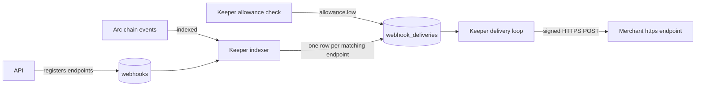

# Webhooks

Levy tells merchants about billing events by POSTing signed JSON to endpoints they register. The keeper delivers the webhooks, not the API: the API only stores endpoint registrations and shows the delivery log. Each delivery is signed with Ed25519, retried on a fixed schedule for about 19 hours, and then dead-lettered. Charging never waits on a webhook.

Amounts in payloads are strings in 6-decimal USDC units (1 USDC = 1,000,000).



An event is queued only for endpoints that exist, are active and subscribe to that event type when the keeper indexes it. Nothing is replayed to a new endpoint. An endpoint's event list is fixed at registration, so the three types added with manager v2 reach only endpoints that list them.

## Event types

Every payload except `merchant.updated` carries `subId` (string), `merchant` (the plan's merchant account) and `ref` (the merchant's reference as `0x` plus 64 lowercase hex digits, or `null`). The table lists the rest.

| Event | Sent when | Extra fields |
|---|---|---|
| `subscription.created` | `Subscribed` | `subscriber`, `planId`, `nextChargeAt` |
| `subscription.updated` | `PlanChanged` (upgrade or downgrade) | `oldPlanId`, `newPlanId`, `credit`, `txHash`, `blockNumber` |
| `charge.succeeded` | `Charged` | `amount`, `fee`, `invoiceRef`, `chargeCount`, `txHash`, `blockNumber` |
| `invoice.ready` | `Charged`, alongside `charge.succeeded` | Same body as `charge.succeeded` |
| `charge.failed` | Every `ChargeFailed` | `failedAttempts`, `txHash`, `blockNumber` |
| `dunning.started` | First failure only (`failedAttempts` is 1) | `nextRetryAt` (unix seconds) |
| `subscription.paused` | `Paused` or `AutoPaused` | `auto`: true when the contract paused it after repeated failures |
| `subscription.resumed` | `Resumed` | none |
| `subscription.cancelled` | `Cancelled` | none |
| `subscription.completed` | `Completed`: a limited plan's last cycle was billed | `txHash`, `blockNumber` |
| `subscription.transferred` | `SubscriptionTransferred`: the subscription moved to another wallet | `from`, `to`, `txHash`, `blockNumber` |
| `allowance.low` | Keeper allowance check, not a contract event | `subscriber`, `allowance`, `balance`, `cyclesCovered`, `nextChargeAt` |
| `merchant.updated` | `PayoutChanged`, `OwnershipTransferStarted` or `OwnershipTransferred` | No `subId` or `ref`. `merchant` (the account), `owner`, `payout` (`null` while the share follows the owner), `pendingOwner` (`null` when none), `txHash`, `blockNumber` |

`amount` is 0 on `charge.succeeded` when proration credit covered the cycle. `fee` is the 1% protocol fee, rounded down. `subscription.resumed` and `subscription.cancelled` have identical bodies, so route on the `X-Levy-Event` header. Allowance rules for `allowance.low` are in [Keeper Service](Keeper-Service.md).

`subscription.completed` comes from the same transaction as the `charge.succeeded` and `invoice.ready` that carry the last payment. A one-time payment therefore produces `subscription.created`, `charge.succeeded`, `invoice.ready` and `subscription.completed` from one subscribe. After `subscription.transferred`, later events for the subscription carry the same `subId` and `ref`, and the payer is `to`. `merchant.updated` carries the account's state as the keeper read it from the chain while indexing the event. `PlanRetired` and `TransferProposed` send no webhook.

## What a delivery looks like

```http
POST /hooks/levy HTTP/1.1
Content-Type: application/json
X-Levy-Event: charge.succeeded
X-Levy-Delivery: 9f3c1a2b4d5e6f70-42
X-Levy-Webhook: 3
X-Levy-Timestamp: 1790990000
X-Levy-Key-Id: 0123456789abcdef
X-Levy-Signature: <base64 Ed25519 signature>

{"amount":"10000000","blockNumber":65210000,"chargeCount":1,"fee":"100000","invoiceRef":"0xabababababababababababababababababababababababababababababababab","merchant":"0x1111111111111111111111111111111111111111","ref":null,"subId":"7","txHash":"0xcdcdcdcdcdcdcdcdcdcdcdcdcdcdcdcdcdcdcdcdcdcdcdcdcdcdcdcdcdcdcdcd"}
```

The body is canonical JSON: keys sorted recursively, no whitespace. The values above are placeholders.

| Header | Meaning |
|---|---|
| `X-Levy-Event` | The event type. Signed. |
| `X-Levy-Delivery` | Delivery id: 16 hex digits fixed for the database, a dash and the row number. Unique per event per endpoint, unchanged across retries, and never reused, even after the database is recreated. Signed. |
| `X-Levy-Webhook` | The id of the endpoint the delivery was made for. Signed; check it against your own (step 4). |
| `X-Levy-Timestamp` | Unix seconds when this attempt was signed. Retries get a fresh one. Signed. |
| `X-Levy-Key-Id` | First 16 hex characters of the SHA-256 of the public key (SPKI DER). |
| `X-Levy-Signature` | Base64 Ed25519 signature. |

## Verifying a signature

The signature covers this UTF-8 string, built from the headers and the raw body:

```text
{X-Levy-Timestamp}.{X-Levy-Delivery}.{your webhook id}.{X-Levy-Event}.{raw body}
```

One key signs for every merchant. The webhook id is what ties a delivery to one endpoint: without it, a delivery made for one merchant would verify at another merchant's endpoint too (finding H-1 of the 2026-10-24 infrastructure review). Until that review the string was `{timestamp}.{deliveryId}.{event}.{body}` and delivery ids were plain row numbers.

Fetch the public key from `GET /api/webhooks/public-key`. It needs no sign-in and returns `algorithm` (`ed25519`), `keyId`, `publicKey` (SPKI PEM) and the event list. Levy signs with one key per deployment; see [Keeper Configuration](Keeper-Configuration.md) for how the key is created and shared with the API.

Steps for every request:

1. Read the raw body before any JSON parsing. Re-serialized JSON will not match.
2. Reject a timestamp more than 5 minutes from your clock.
3. Reject an event type that is not one of the thirteen above, and a delivery id that is not 16 hex digits, a dash and a number. Event names contain dots, so without these checks the same signed text could be split differently.
4. Rebuild the signed string with your own webhook id (from registration or the dashboard, not the `X-Levy-Webhook` header) and verify the signature.
5. Drop delivery ids you have already processed. The id is signed, so this is safe.
6. After parsing, reject an event whose `merchant` is not your merchant account, and act only on subscriptions to your own plans.

```js
import { createPublicKey, verify } from "node:crypto";

const API = "https://your-levy-host"; // your Levy API base URL
const WEBHOOK_ID = "3"; // this endpoint's id, from registration or the dashboard
const { publicKey } = await fetch(`${API}/api/webhooks/public-key`).then((r) => r.json());
const key = createPublicKey(publicKey);

const EVENTS = new Set([
  "subscription.created", "subscription.updated", "charge.succeeded", "charge.failed",
  "dunning.started", "subscription.paused", "subscription.resumed",
  "subscription.cancelled", "invoice.ready", "allowance.low",
  "subscription.completed", "subscription.transferred", "merchant.updated",
]);

// rawBody: the request body as a string; headers: Node's lowercased header map
export function isAuthentic(rawBody, headers) {
  const ts = headers["x-levy-timestamp"];
  const event = headers["x-levy-event"];
  const delivery = headers["x-levy-delivery"];
  if (Math.abs(Date.now() / 1000 - Number(ts)) > 300) return false;
  if (!EVENTS.has(event) || !/^[0-9a-f]{16}-[0-9]+$/.test(delivery)) return false;
  const signed = Buffer.from(`${ts}.${delivery}.${WEBHOOK_ID}.${event}.${rawBody}`, "utf-8");
  return verify(null, signed, key, Buffer.from(headers["x-levy-signature"], "base64"));
}
```

After `isAuthentic` passes, look up `X-Levy-Delivery` in your own store (step 5), check `merchant` and the plan (step 6), then process and answer 2xx. `verifyDelivery` in `keeper/src/webhooks.ts` performs steps 2 to 4 (pass it your webhook id); it does not remember ids or know your address.

## Endpoint rules

Merchants register endpoints with `POST /api/webhooks` ([API Reference](API-Reference.md), [Authentication](Authentication.md)) or from the dashboard.

| Rule | Detail |
|---|---|
| Scheme and port | `https` on port 443 only |
| Credentials | None in the URL |
| Address | Must be public. Loopback, private, link-local (including the cloud metadata address), carrier-grade NAT, multicast, documentation and reserved ranges are refused. IPv6 must be global unicast |
| At registration | The hostname is resolved and every address must be public. One error covers both "does not resolve" and "resolves privately" |
| At delivery | Scheme, port and credentials are checked again, and the connection's DNS lookup refuses any non-public answer, which stops DNS rebinding after registration |
| Redirects | Never followed. A 3xx counts as a failure, so register the final URL |
| Limit | 5 endpoints per merchant account, active or not |
| Events | A non-empty list of the thirteen known types |
| Account | The endpoint belongs to a merchant account, which the registering address must own. Once the account changes hands and the keeper has indexed it, only the new owner can list, change or delete it, and it keeps receiving the account's events |

`LEVY_WEBHOOK_ALLOW_PRIVATE=1` lifts the scheme, port and address rules. It is for local development only.

## The delivery loop

Every `LEVY_WEBHOOK_POLL_MS` (default 5 seconds) after the previous pass ends, the keeper sends the deliveries that are `pending` or `failed` and due.

- **Fair and bounded.** Each endpoint's oldest due delivery goes before any endpoint's second, an endpoint gets at most 5 per pass, and a pass holds at most 200. One backlogged endpoint cannot starve the others.
- **Parallel.** Up to 8 requests run at once, with at most one in flight per endpoint. A hanging endpoint holds one slot.
- **Timeout.** 5 seconds to get a response status. The response body is discarded.
- **Success.** Any 2xx. Everything else is a failure. The keeper stores only a coarse reason in `last_error`: `HTTP 500`, `timeout after 5s`, `connection failed`, `refused: ...` or `invalid url`. Raw network errors are never stored, so they cannot reveal which hosts and ports answer.
- **Fresh signature.** Each attempt is signed at send time.
- **No ordering guarantee.** A failed delivery waits for its backoff while later events can arrive first. Order events by payload fields such as `chargeCount`.

## Retries and states

| Attempt | 1 | 2 | 3 | 4 | 5 | 6 | 7 | 8 |
|---|---|---|---|---|---|---|---|---|
| Wait after the previous failure | none | 1 min | 5 min | 15 min | 1 h | 6 h | 6 h | 6 h |
| Time since the event | 0 | 1 min | 6 min | 21 min | 1 h 21 min | 7 h 21 min | 13 h 21 min | 19 h 21 min |

If attempt 8 fails, the next retry would fall at 25 h 21 min, past 24 hours of age, so the delivery is marked dead instead. The last attempt is therefore at about 19 hours 21 minutes, give or take a few seconds of pass timing.

| Status | Meaning |
|---|---|
| `pending` | Queued, not yet attempted |
| `sent` | The endpoint answered 2xx |
| `failed` | An attempt failed and `next_retry_at` is set |
| `dead` | Given up: the next retry would pass 24 hours of age, or the endpoint was deleted or deactivated (`last_error` says which) |

`attempts` counts failed attempts, so a delivery that succeeds the first time shows 0. Setting an endpoint to `active: false` is not a pause: its queued deliveries are dead-lettered on the next pass, events during the inactive period are not queued, and nothing is replayed on reactivation. Deliveries of a deleted endpoint no longer appear in `GET /api/deliveries`.

## What a merchant should do

- Verify every request on the raw body before trusting it.
- Answer 2xx within 5 seconds, then do slow work.
- Deduplicate on `X-Levy-Delivery`. For charges, also key on `invoiceRef`, which is unique per charge. The keeper queues each chain event once per endpoint, even when it reads the same logs again after a crash; before 2026-10-28 a crash could queue an event twice under a new delivery id.
- Do not rely on arrival order.
- Track a subscription by `subId`. The `ref` is chosen by whoever subscribes, so link it to your customer once and then use `subId` (see the [merchant guide](https://github.com/RunTimeAdmin/levy/blob/main/docs/merchant-guide.md)). The subscriber can change with `subscription.transferred`; the `subId` never does.
- Check every `merchant.updated` you did not expect. A stolen owner key that redirects the payout or hands the account on shows up there.
- Reconcile after any outage longer than about 19 hours. Dead deliveries are not replayed. Check `GET /api/deliveries?status=dead`, then re-read state from `GET /api/invoices` and `GET /api/subscriptions`.

## Source files

- [keeper/src/webhooks.ts](https://github.com/RunTimeAdmin/levy/blob/main/keeper/src/webhooks.ts)
- [keeper/src/webhook-url.ts](https://github.com/RunTimeAdmin/levy/blob/main/keeper/src/webhook-url.ts)
- [keeper/src/db.ts](https://github.com/RunTimeAdmin/levy/blob/main/keeper/src/db.ts)
- [keeper/src/indexer.ts](https://github.com/RunTimeAdmin/levy/blob/main/keeper/src/indexer.ts)
- [keeper/src/keeper.ts](https://github.com/RunTimeAdmin/levy/blob/main/keeper/src/keeper.ts)
- [api/src/server.ts](https://github.com/RunTimeAdmin/levy/blob/main/api/src/server.ts)
- [docs/merchant-guide.md](https://github.com/RunTimeAdmin/levy/blob/main/docs/merchant-guide.md)
